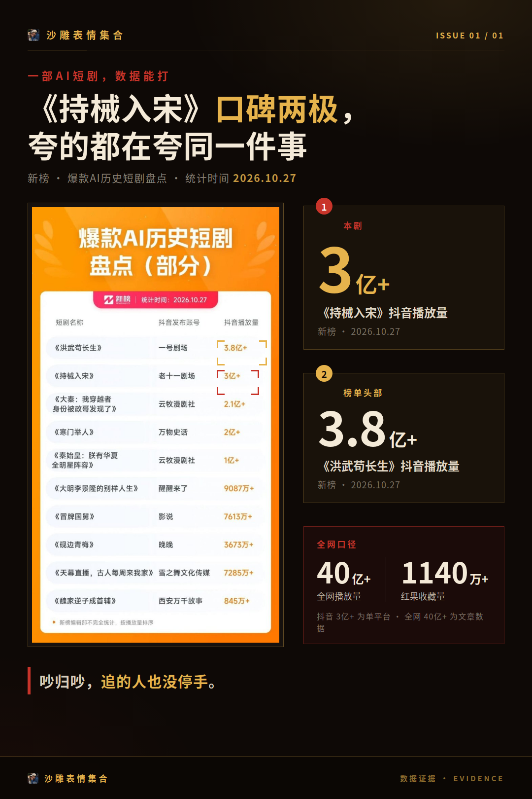
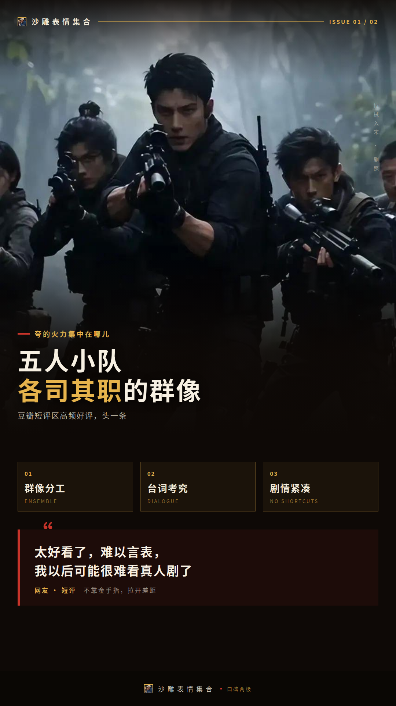
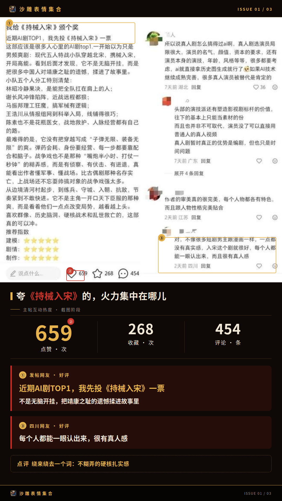
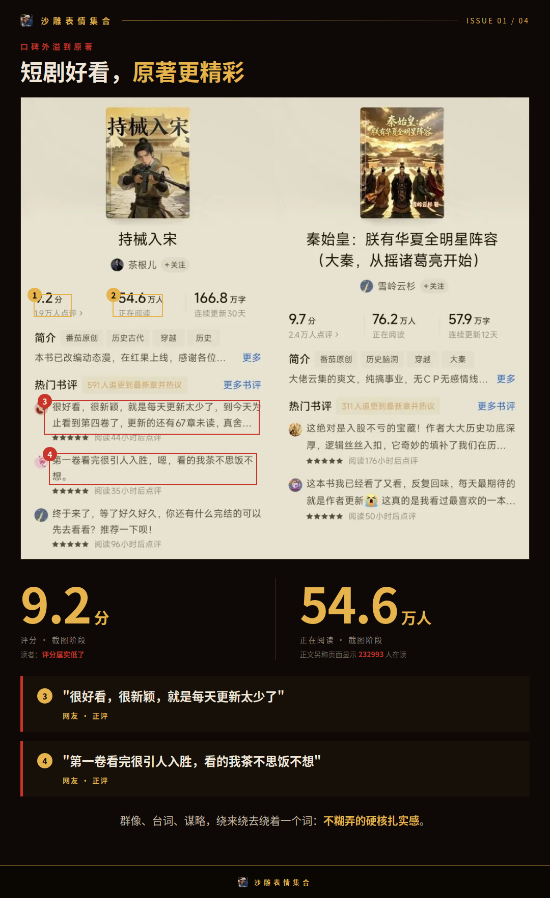
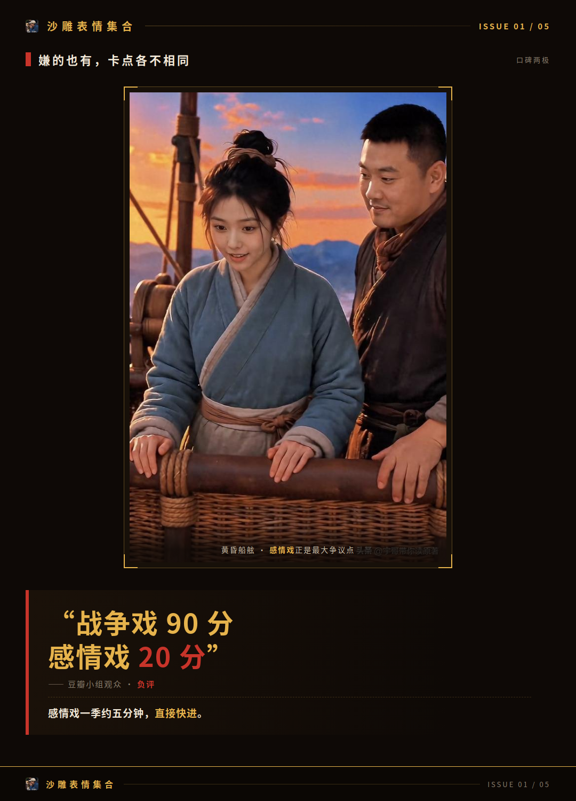
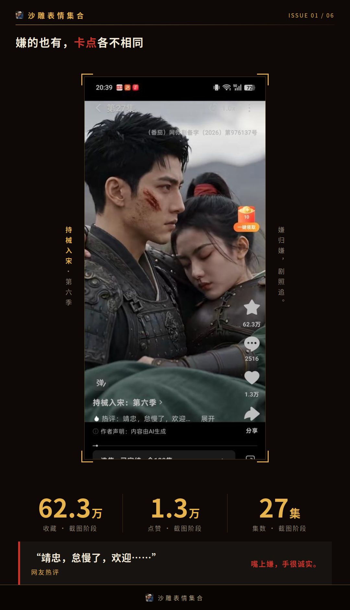
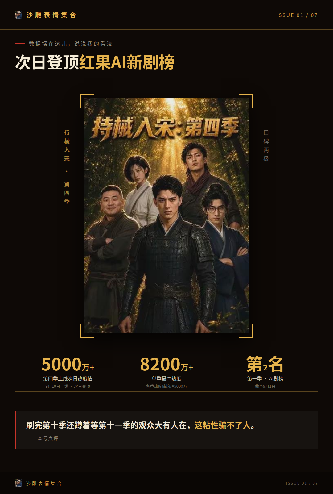

# 《持械入宋》口碑两极，夸的都在夸同一件事

一部AI短剧，全网播放量超过40亿次，红果收藏量超过1140万，这数据搁真人剧身上都算能打了吧？可《持械入宋》的评论区偏偏还在吵：一边夸到“以后可能很难看真人剧”，一边嫌感情戏和配音有AI感。

吵归吵，这剧的讨论度是实打实的。40亿播放摆在这儿，吵的人再多，追的人也没停手。那都在吵什么？我把两边的说法翻了翻，发现一个挺有意思的规律：夸的人，夸的居然是同一件事。

## 夸《持械入宋》的，火力集中在哪儿

先说夸的这边。豆瓣短评区的高频好评，头一条就是五人小队的群像——人物各有特点、各司其职，观众觉得这种分工在短剧里挺少见。第二条是台词，考究、直逼一流被反复点名，还有人觉得台词的抑扬顿挫接近完美。

第三条更有意思：不靠系统金手指、剧情紧凑逻辑在线，被观众当成它和同类AI短剧拉开差距的地方。有人直接放话：

**太好看了，难以言表，我以后可能很难看真人剧了**

还有观众评价，就AI短剧加穿越加历史这个赛道来说，这是思想性很强的一部作品。

硬核感也是自来水主力。有剧评观众说，排兵布阵讲解详细到让人怀疑作者干过这行。口碑还外溢到了原著那边，番茄读者觉得短剧好看、原著更精彩，甚至认为评分属实低了，页面显示232993人在读。

你品品，群像、台词、谋略，绕来绕去就绕着一个词：不糊弄的硬核扎实感。声量这么集中，也就不奇怪了。

## 嫌的也有，卡点各不相同

再看嫌的这边。最大的争议点是感情线，有豆瓣小组观众给出“战争戏90分感情戏20分”式的落差评价——感情戏一季约五分钟，直接快进。还有声音觉得男作者不该写爱情，这部分占比不大，但吐槽得挺用力。

第二类卡在制作细节：台词念白AI感重、配音口型对不齐。第三类是原著党落差，微博上有用户直言“看不下去，真不如小说好看”。还有批评认为前期空降式抖威风、军械制作一带而过不够硬核。

弃剧的也有。虎扑有回帖说“不怎么样，看了九季我就不看了”。不过连弃剧的都是看了九季才走的，这个弃法本身也挺说明问题。

嫌的人卡点各不相同，但有一条我翻了半天没找到：没人否认主线剧情的完成度，负面基本集中在感情线和细节这类小切口上。有观众吐槽得很典型：

**除了太吵，剧情高速推进**

嫌归嫌，剧照追。

## 数据摆在这儿，说说我的看法

把口碑落到数据上看更清楚。第四季9月10日上线，次日就登顶红果AI新剧榜，热度值超5000万。截至9月1日，第一季冲进AI剧榜第二名，各季红果热度值均超5000万，单季最高热度8200多万。

圈外背书也来了。六神磊磊、馒头说这些大V相继发文推荐，把它当成AI短剧精品化的例证来看。

所以我的看法是：口碑分歧是真的，但刷完第十季还蹲着等第十一季的观众大有人在，这粘性骗不了人。这部AI短剧的市场表现，配得上它的讨论度。

后续口碑还会怎么走，评论区下一轮吵什么，我蹲到了再来汇报。
