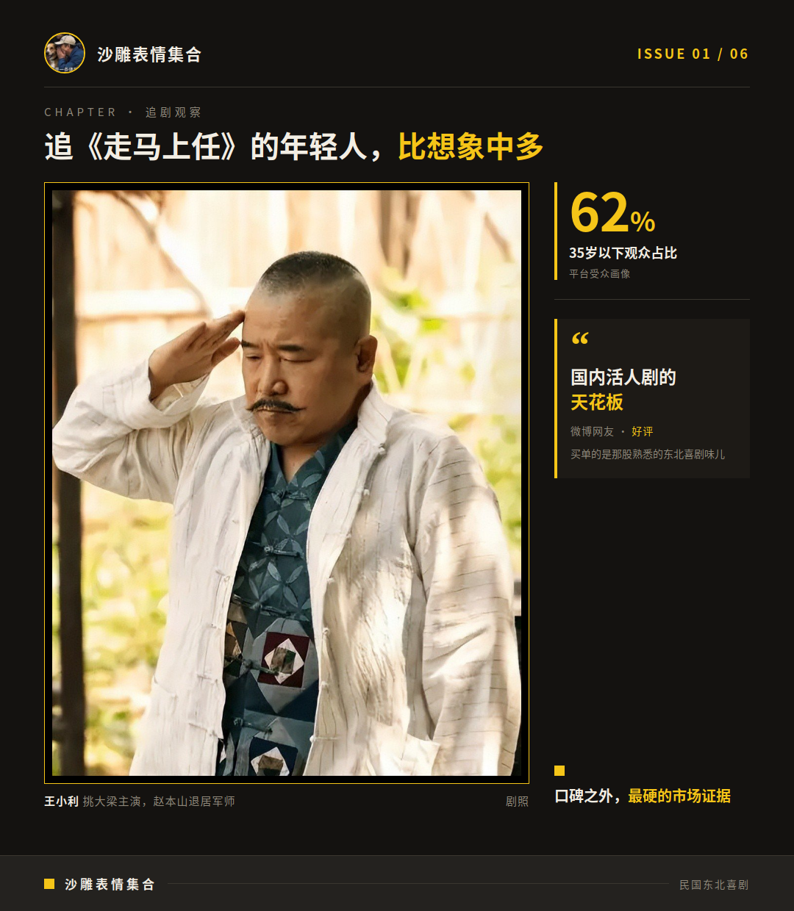

# 《走马上任》口碑吵翻了，热度却先爆了

才播几集，《走马上任》的评论区就吵翻了。吵归吵，腾讯视频站内9.5分摆在那儿，热度也从开播当天的18000一路涨破23000。架吵得热闹，数据涨得更热闹，这瓜我先搬好小板凳。

## 夸的和骂的，盯的是同一股小品味儿

最有意思的是这句评语——“加长版春晚小品”。夸的人拿它当奖章，骂的人拿它当判决书。同一句话，两边意思完全相反，评论区肉眼可见地分成两派。

夸的那拨多是老粉，说找回了早年看本山喜剧和春晚小品的快乐，东北味儿接地气、适合下饭，赵本山的演技被叫作“定海神针”。

骂的那拨也有话说：小品感太强，故事全靠误会推着走，套路旧；还有人觉得配角戏份拖了节奏。对导演赵大牛的处理方式，一部分观众也保留了意见——这属于创作选择层面的讨论，咱们只看戏不评人。

评论区翻多了，我咂摸出点味儿来：

**两拨人看的根本不是同一部剧。**

一拨要的是能笑出来，一拨要的是故事精巧，各要各的，可不就吵起来了。

## 吵归吵，《走马上任》热度榜可没客气

数据这边一点没受影响。站内9.5分/10，热度开播当天18000起步，次日涨到最高23000，另有报道口径是22000——反正都破了，还顺手登顶平台喜剧榜和飙升榜。

空降上线之后，接连拿下三个第一：平台喜剧榜第一、站内热度榜第一、短视频剧集种草榜第一。

站外榜单也不差。骨朵日榜上《走马上任》排全平台第四，同期热播榜热度72.53，跟第二名《小城良方》的73.98差距很小，咬得挺紧。

当然，也有另一路信号。云合口径显示次日热度没翻到2倍，有微博网友觉得“差些意思”，热度能不能持续还得再看几天。

**吵得凶不影响数据涨得猛，说明吵架的人自己也都在追。**

## 追《走马上任》的年轻人，比想象中多

这瓜还有个更值得嚼的细节：平台受众里35岁以下观众占比约62%。一部民国东北喜剧，从东北基本盘破圈破到了年轻人那儿。

微博上有网友给它封了个“国内活人剧的天花板”，意思是观众买单的是那股熟悉的东北喜剧味儿，不是剧情多精妙——这是网友观点，我先记瓜不动筷。还有观众追完六集后说这不是炒冷饭：赵本山把主角位子让给徒弟王小利，自己退居军师。

能让年轻人也点开一部民国东北喜剧，这本身可能就是《走马上任》口碑之外最硬的一条市场证据。

## 《走马上任》这瓜，我追着吃

口碑两极是事实，站内高分、热度登顶、年轻观众上桌也是事实，大众端这一仗，眼下是《走马上任》赢面。豆瓣分和后续热度走势我接着盯，有新动静再来报。
