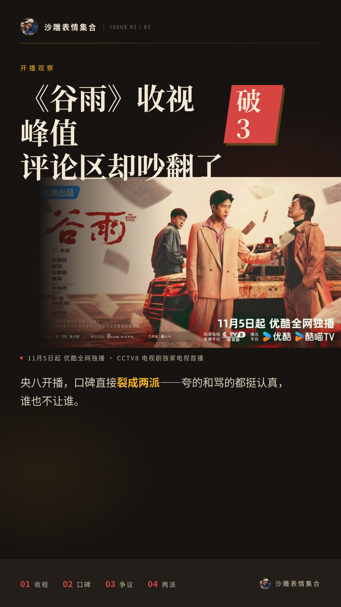
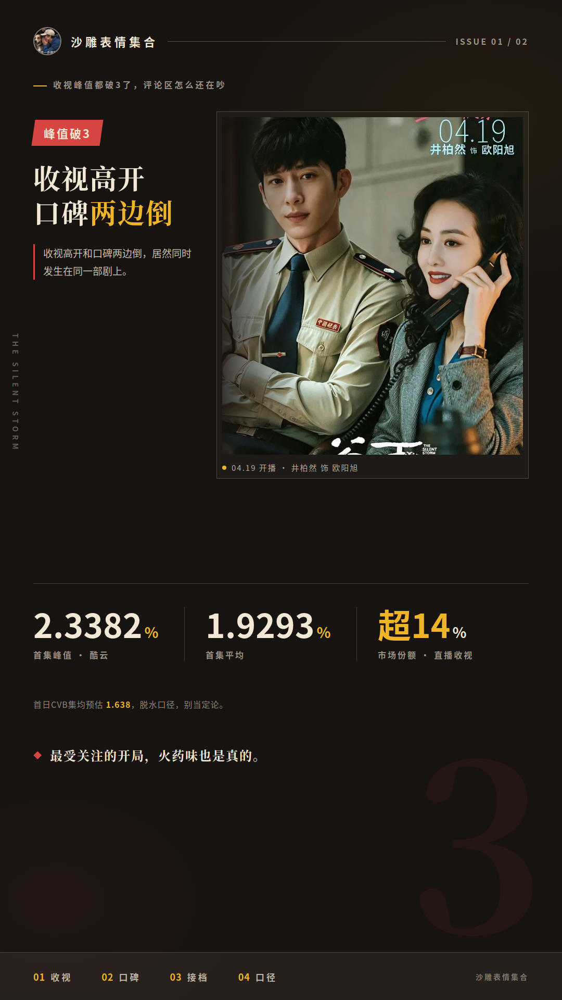
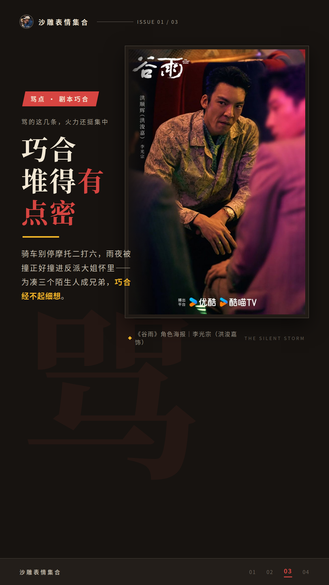
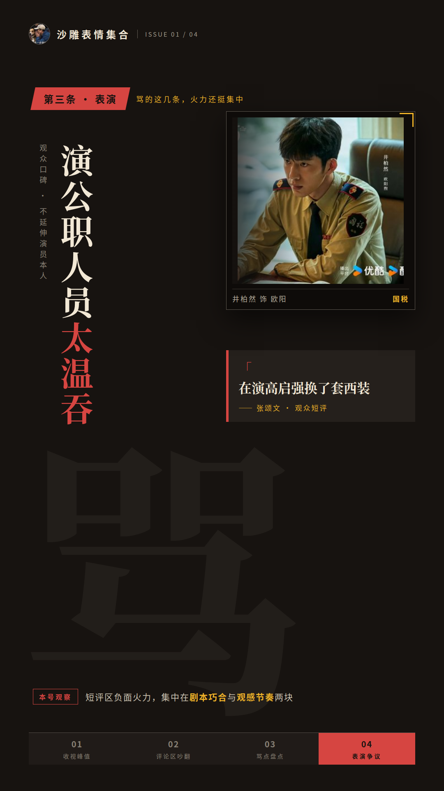
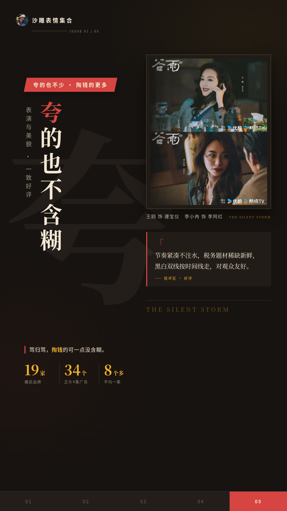
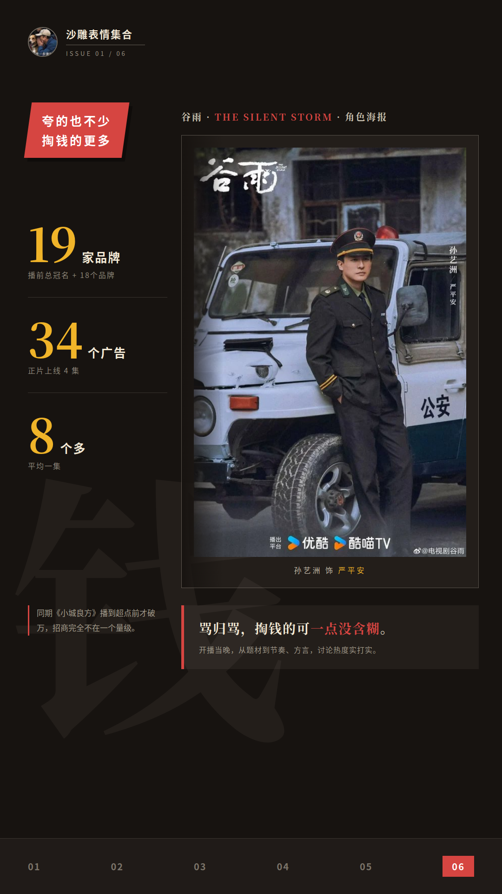
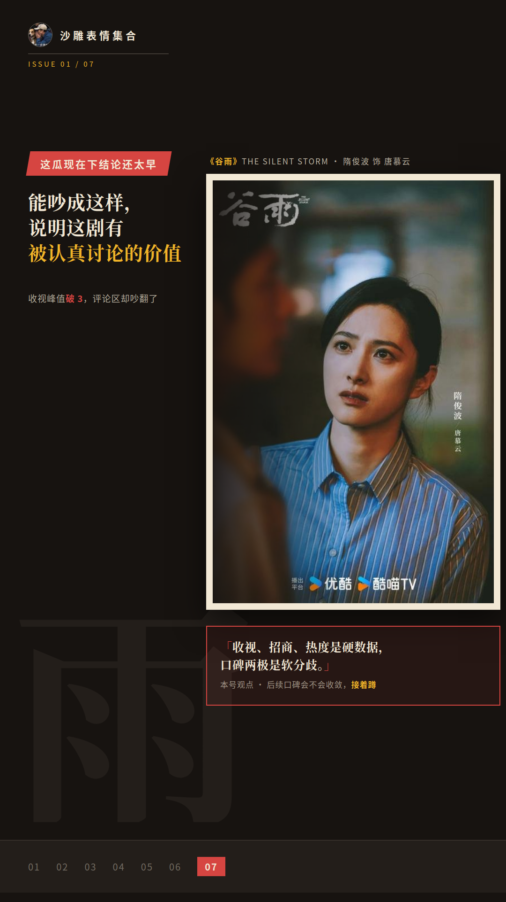

# 《谷雨》收视峰值破3，评论区却吵翻了

一部剧收视爆了、广告主排着队掏钱，评论区却吵翻了天——这瓜怎么吃？《谷雨》在央八开播，口碑直接裂成两派，夸的和骂的都挺认真，谁也不让谁。

## 收视峰值都破3了，评论区怎么还在吵

先把硬数据摆出来。酷云口径下，《谷雨》首集峰值2.3382%，首集平均1.9293%，开播后直播收视率破3、市场份额超14%。业内还预估首日CVB集均约1.638——这是脱水收视率口径，属于预估，先记着，别当定论。

接档对比更直观：这个开局直接超过了央八上一部剧《小城良方》的全剧最高峰值，接档后稳住了同时段第二。有观众的说法是，前一部收视一路下坠，这回大家总算愿意打开央八了。

**收视高开和口碑两边倒，居然同时发生在同一部剧上。** 就目前数据看，这算央八近期最受关注的开局之一，但短评区的火药味也是真的。

## 骂的这几条，火力还挺集中

骂的人不是乱开火，火力挺集中的。头一条对准剧本巧合：骑车别停摩托二打六、雨夜被撞正好撞进反派大姐怀里——为了凑三个陌生人成兄弟，巧合堆得有点密，经不起细想。

第二条是节奏。有观众吐槽警匪双方“一边0.5倍速一边2倍速”，看得昏昏欲睡。豆瓣还有条高赞短评直接开问：“怎么现在的电视剧只要是找来几个有人气脸熟的演员就可以万事大吉了”。

第三条落在表演上。先说清楚，这只是观众口碑，不延伸到演员本人：井柏然被批演公职人员太温吞、不够有震慑力，张颂文则被说“在演高启强换了套西装”。就目前短评区的声音看，负面火力集中在剧本巧合和观感节奏这两块。

## 夸的也不少，掏钱的更多

翻到另一边，夸的也不含糊。李小冉的表演和美貌几乎是一致好评，节奏紧凑不注水、税务题材稀缺新鲜、黑白双线按时间线走对观众友好，这些都是短评区真实存在的正面声音。

有意思的是，骂的这边也绕不开李小冉。豆瓣有条短评写的是“除了李小冉的美貌，毫无看点”——夸和骂吵了半天，在“李小冉好看”这事上倒是达成了共识。

<!-- SOURCE_REF: S2 -->

**骂归骂，掏钱的可一点没含糊。** 播前总冠名加18个品牌共19家，正片上线4集塞进34个广告，平均一集8个多。对比一下，同期《小城良方》播到超点前才破万，招商完全不在一个量级。开播当晚，从题材到节奏、方言都有人热议，讨论热度是实打实的。

## 这瓜现在下结论还太早

我的看法是：收视、招商、讨论热度是硬数据，口碑两极是软分歧，两边都有真实依据，谁也说服不了谁。骂逻辑的和夸题材的，看的其实是同一部剧的不同面，能吵成这样，说明这剧有被认真讨论的价值。

后续口碑会不会随着剧情推进收敛，本号接着蹲，有新进展再来汇报。
