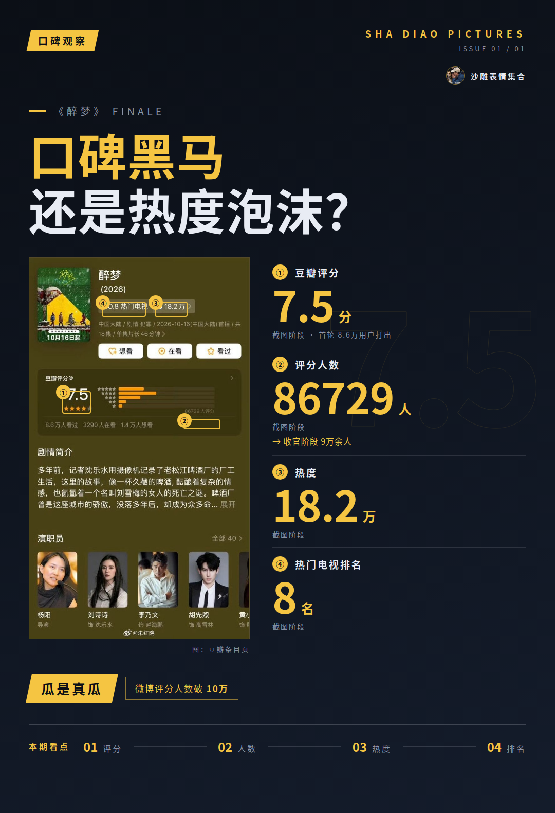
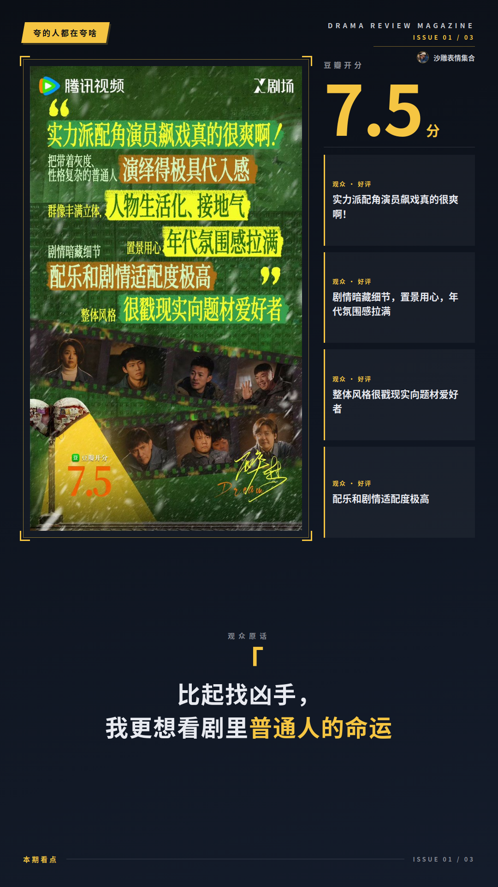
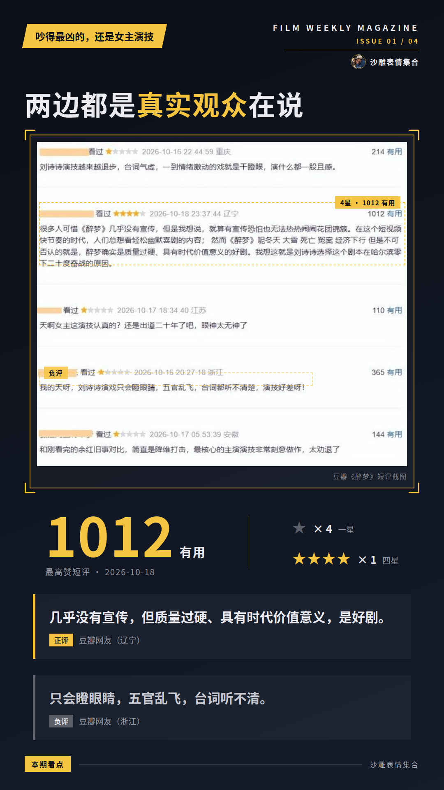
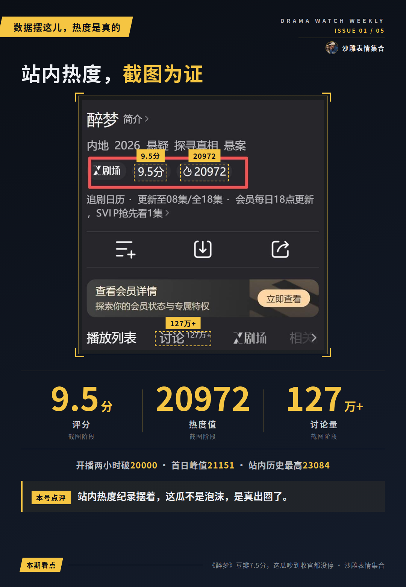
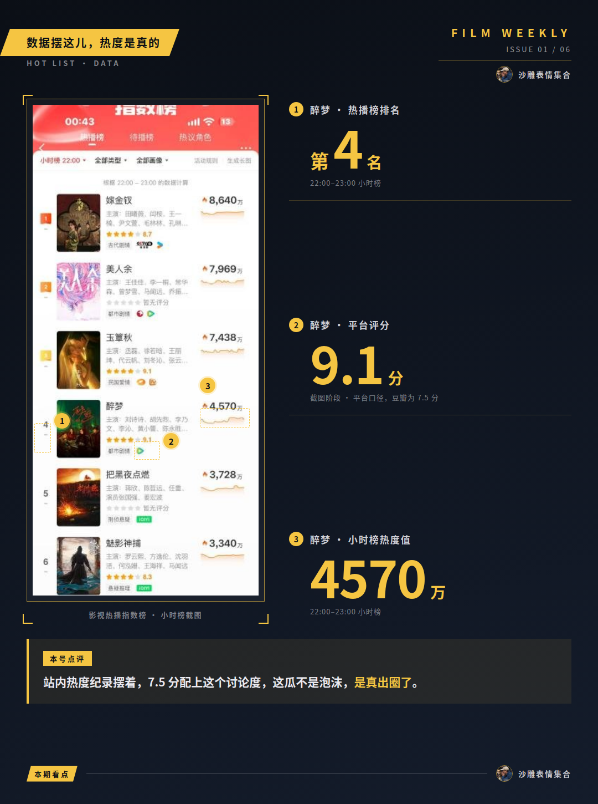

# 《醉梦》豆瓣7.5分，这瓜吵到收官都没停

家人们，《醉梦》都收官了，评论区还有人在线上头。这剧到底是口碑黑马还是热度泡沫？这争论是真实存在的，我先把数据摆这儿：豆瓣首轮8.6万用户打出7.5分，收官阶段评分人数涨到9万余人，微博那边口径显示评分人数已经破10万。评分人数一路往上涨，**这波讨论度确实出圈了，瓜是真瓜**。

## 《醉梦》这瓜，两边吵的点完全不一样

夸的人基本集中在几样：质感高级、年代氛围感、东北幽默不压抑、伏笔铺垫扎实。骂的点也绕不开几样：前两集信息量大、双时空叙事要适应、宣发推流偏弱。一拨人嫌入坑成本高，一拨人夸得停不下来，谁也说服不了谁。

## 夸的人都在夸啥

正面口碑不是空夸，落点都在具体细节上。年代氛围和东北幽默是被反复提的，有观众原话是“东北银真的是自带喜感”，还有人直接表态“比起找凶手，我更想看剧里普通人的命运”——夸的都不是场面话，是冲着具体的东西去的。

演员这边也有正向信号，胡先煦收到的基本是好评，“哭戏封神”“情绪爆发力强”是观众反复提到的关键词。豆瓣小组里还有人替剧抱不平，说“醉梦这么好看，我以为得8分以上”，跟评觉得这质量绝对够得上8分。7.5分这瓜，两边都觉得委屈，能吵到收官一点都不奇怪。

## 吵得最凶的，还是女主演技

主战场在刘诗诗身上，澎湃剧评口径的判断也是两极——一端说她像在等口令，另一端说她脱胎换骨、几场对峙戏顶得住李乃文。

观众原话两边都有。批评侧有人说“演技是通过眼睛的情绪表达外放的，但是我只看到了空洞”；认可侧也有人一句“刘诗诗的演技真的很稳定”。同一个人，两拨观众给出完全相反的观感，我只能搬好小板凳：**两边都是真实观众在说，我不下结论，只报这瓜确实吵到收官都没停**。

## 数据摆这儿，热度是真的

再看硬数据。开播两小时腾讯视频站内热度破20000，首日峰值21151，创X剧场2026年首日最高纪录；10月20日前后站内热度冲到历史最高的23084。猫眼专业版口径，开分时全网有效播放量已超1.09亿。沈乐水这个角色开播当天热度破亿，是X剧场首个达成此成绩的角色，微博口径还显示付费榜第一。

另一面也得报：首播正片有效播放市占率仅2.5%，没进主榜热搜。这么看，这剧属于圈层内被狠狠看到、圈层外存在感偏弱。但站内热度纪录摆着，7.5分配上这个讨论度，我认为这瓜不是泡沫，是真出圈了。

后续《醉梦》口碑要是反转了，或者市场表现有新动静，我第一时间来报。小板凳我先不撤。
