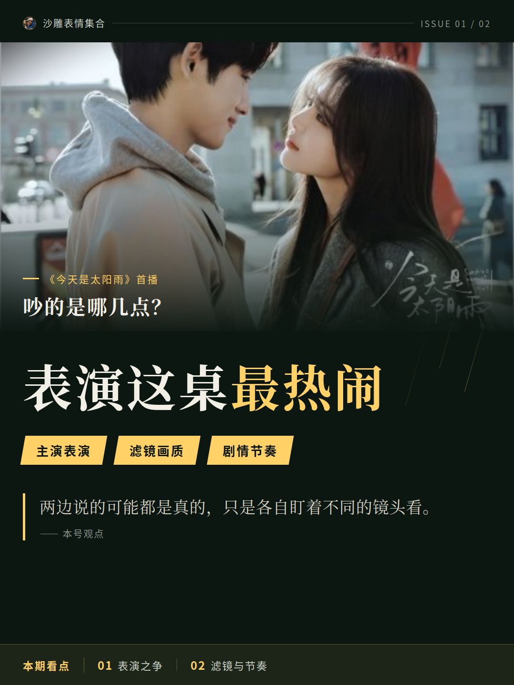
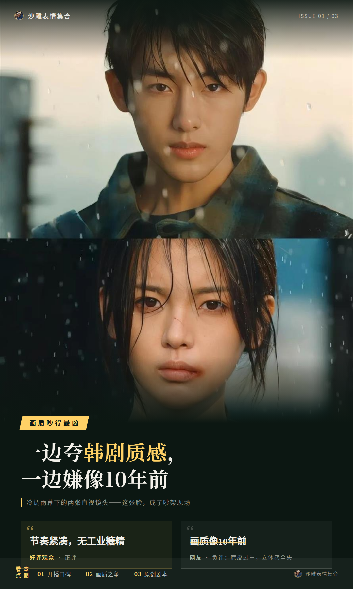
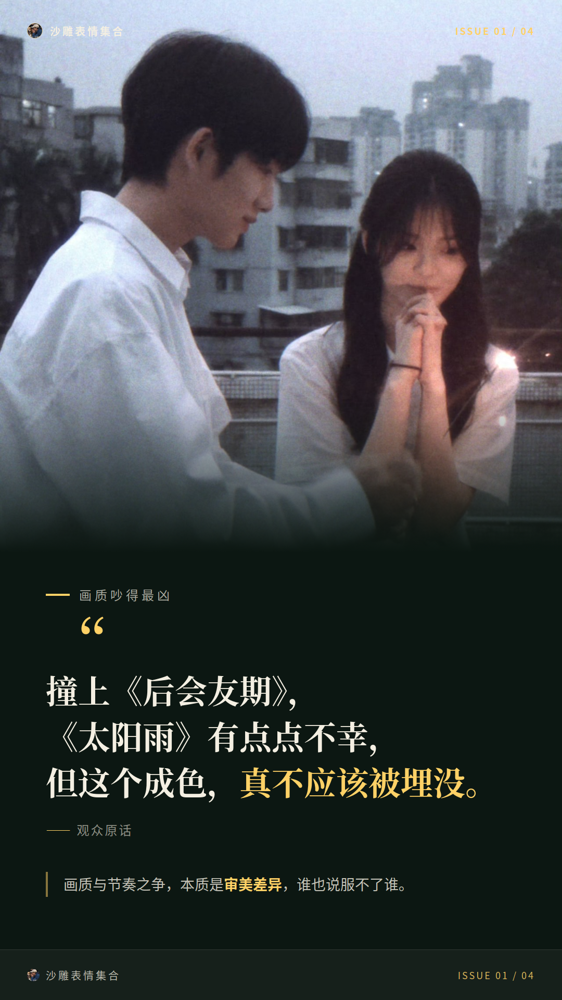
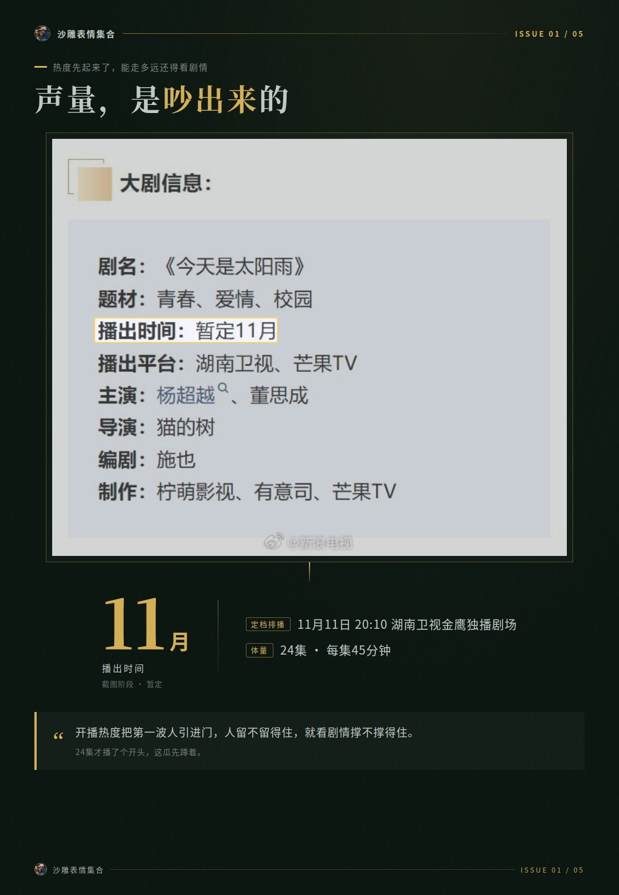
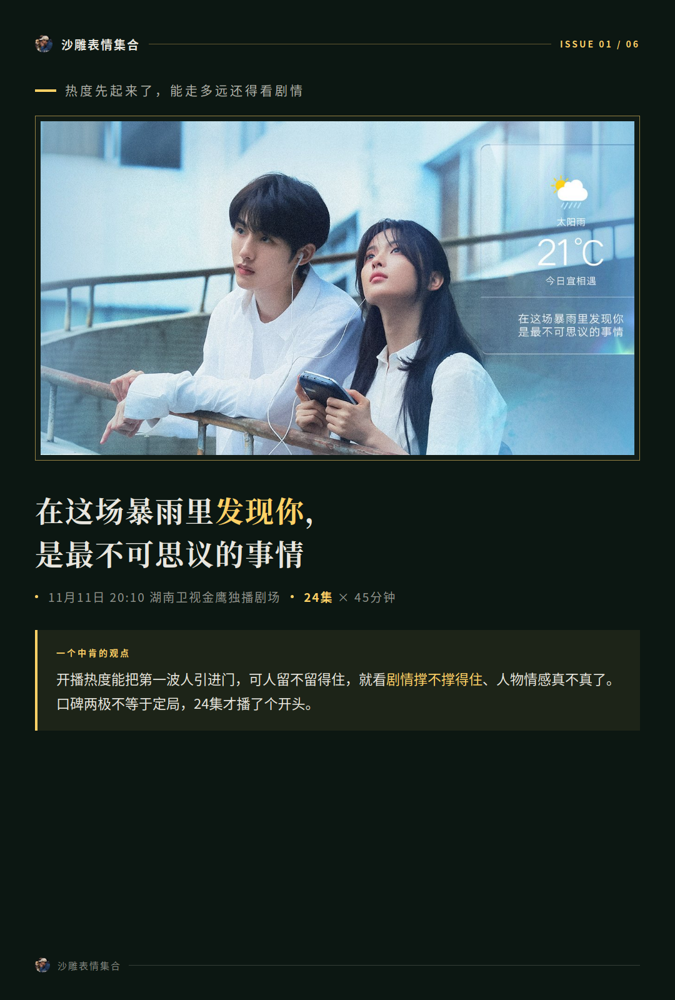

# 《今天是太阳雨》开播，夸的和骂的在吵什么

一部剧开播第一天，评论区能吵成几桌？《今天是太阳雨》11月6日中午在芒果TV上线，Netflix全球同步，当天全网有效播放量就破了1000万。热度是真起来了，可点开评论区一看，夸的和骂的基本不在一个频道。

## 《今天是太阳雨》首播，吵的是哪几点？

把吵的点聚一聚，主要就三堆：主演表演、滤镜画质、剧情节奏。

表演这桌最热闹。夸的人觉得杨超越演出了那种疲惫里带倔强的劲儿，董思成自带清冷疏离感，俩人CP感还挺强。嫌的人口径也统一：两位主演表演木讷、张不开嘴。

我认为两边说的可能都是真的，只是各自盯着不同的镜头看。

## 画质吵得最凶：一边夸韩剧质感，一边嫌像10年前

视觉这桌音量最大。低饱和色调、去磨皮，一部分观众直接夸出了韩剧质感，画面清新、镜头语言细腻，双向救赎的设定也有人认。

另一部分人就不干了：滤镜磨皮糊成一团，有网友直言“画质像10年前”，磨皮过重导致脸部立体感全失。

豆瓣有用户看完两集，觉得男女主人设立住了，大学生活呈现也写实，对比之后还认为《太阳雨》比《折月亮》略胜一筹。剧迷里也有不同声音，觉得女主角人设太硬。节奏上，好评说紧凑、无工业糖精，另一边嫌偏平缓。

还有个背景值得提一嘴：这剧是原创剧本，无原著可对照，没有魔改风险和原著粉先入为主的审判，吵起来全靠观众自己看出来的感受。

有条观众原话我挺想放这：

**“撞上《后会友期》，《太阳雨》有点点不幸，但这部剧这个成色，真不应该被埋没。”**

画质和节奏这种吵法，我觉得属于审美差异，谁也说服不了谁。

## 热度先起来了，能走多远还得看剧情

数据摆一摆。开播前一天双平台预约量突破300万，开播当日全网有效播放量破1000万，芒果TV站内更新到3集时播放量3809.7万。

不过起点真不算顶配。百度指数搜索热度上，《折月亮》是6479，《太阳雨》是1093，前者差不多是后者的近6倍。也就是说，这剧是开播之后靠口碑吵出来的声量，不是靠先天热度撑的。

排播再补一笔：11月11日20:10上湖南卫视金鹰独播剧场，一共24集，每集45分钟。

有个观点我觉得挺中肯：开播热度能把第一波人引进门，可人留不留得住，就看剧情撑不撑得住、人物情感真不真了。

口碑两极不等于定局，24集才播了个开头。这瓜我先蹲着，后续口碑怎么走，追着看咱们接着唠。
