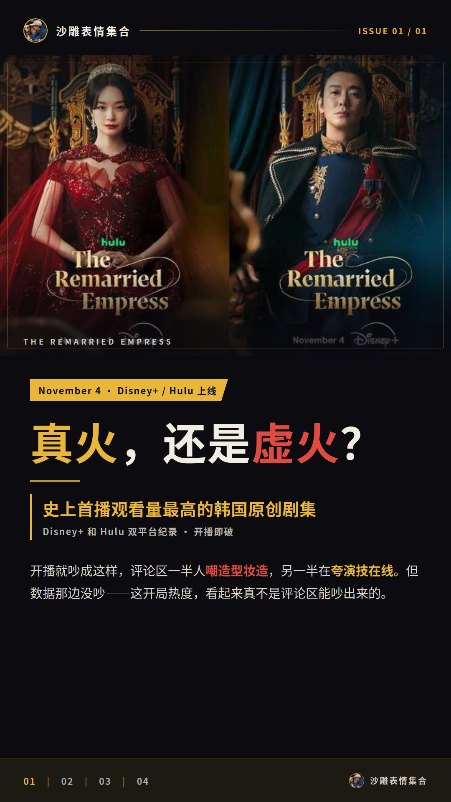
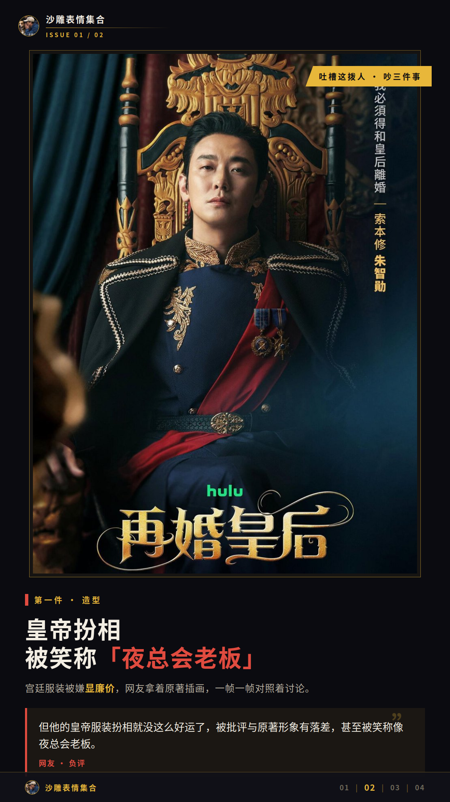
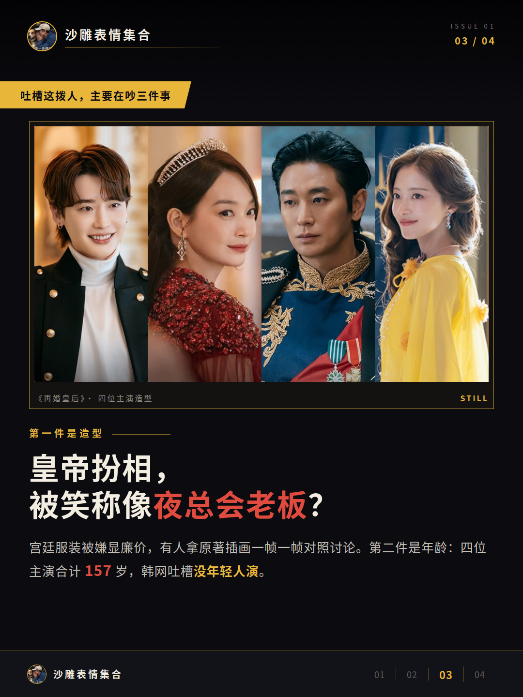
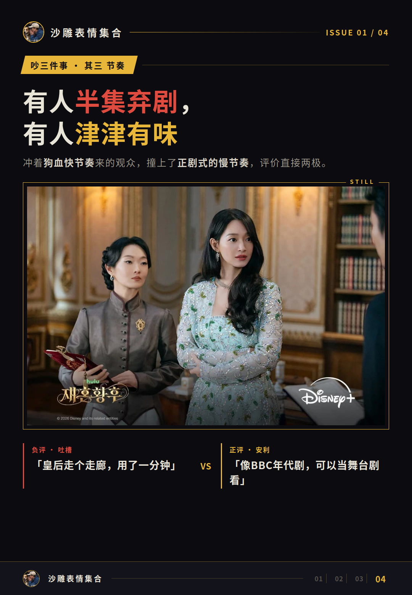
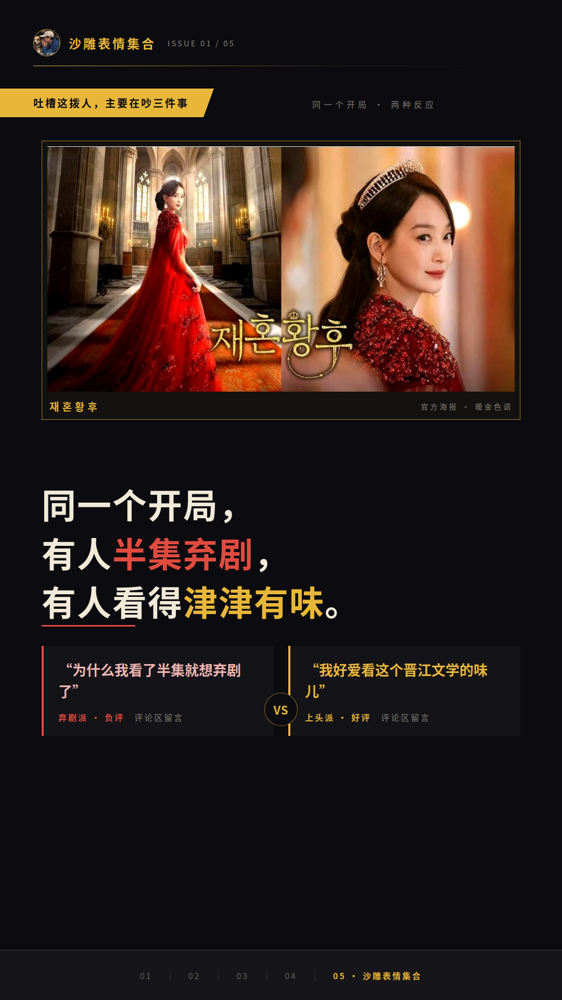
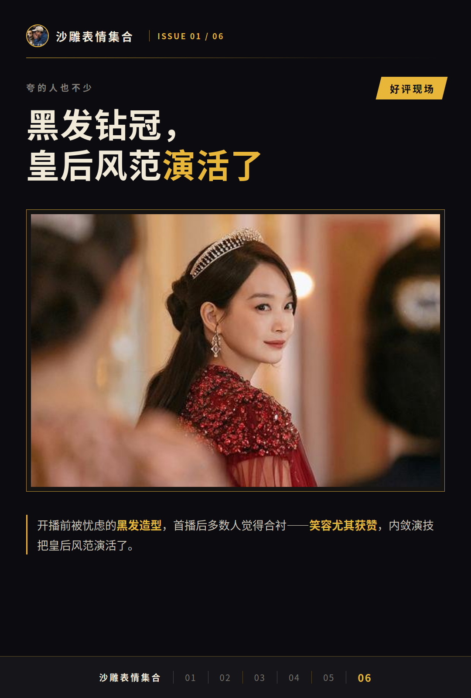
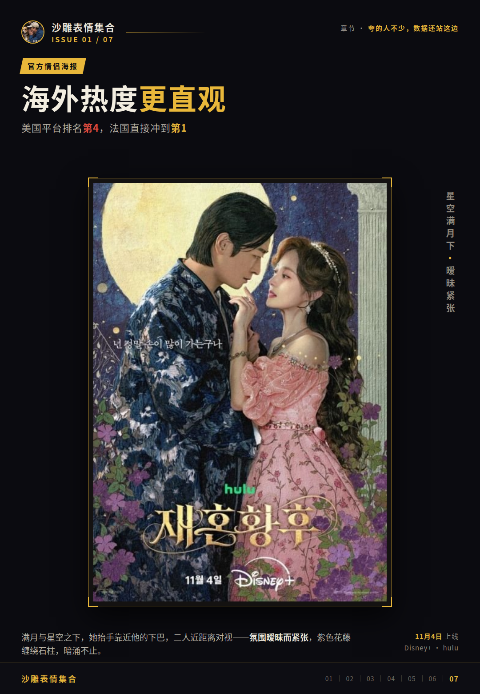
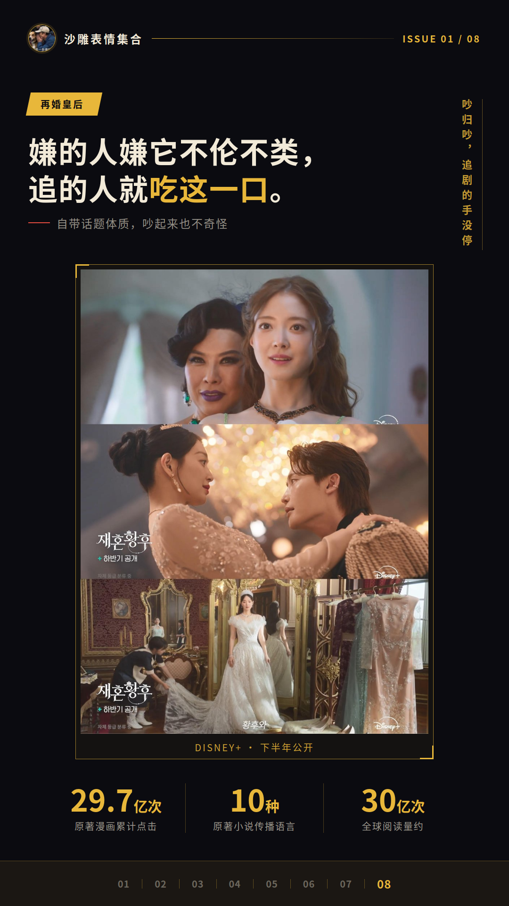

# 《再婚皇后》吵翻天，热度却破纪录了

开播就吵成这样，《再婚皇后》这火是真火还是虚火？评论区一半人在嘲造型妆造，另一半在夸演技在线，吵得不可开交。但数据那边没吵：这剧成了Disney+和Hulu史上首播观看量最高的韩国原创剧集。我认为这开局热度，看起来真不是评论区能吵出来的。

## 吐槽这拨人，主要在吵三件事

第一件是造型。朱智勋的皇帝扮相被观众调侃像夜总会老板，宫廷服装也被嫌显廉价，还有人拿着原著插画和网漫一帧一帧对照着讨论。有位网友说得直接：“但他的皇帝服装扮相就没这么好运了，被批评与原著形象有落差，甚至被笑称像夜总会老板。”

第二件是年龄。四位主演合计157岁，韩网有人吐槽没年轻人演。国内短评区也有同款声音，那句“受不了一堆中年发面（我喜欢二硕，但他也发面了”，点赞的人不少。

第三件是节奏，这个吵得最有意思。冲着狗血快节奏来的观众，撞上的是正剧式的慢节奏，评价直接两极。有人吐槽皇后走个走廊用了一分钟，配乐宏大得莫名其妙；也有人觉得像BBC年代剧，可以当舞台剧看，还有人说“不带脑子看还挺好笑”。

**同一个开局，有人半集弃剧，有人看得津津有味，这分歧是真的深。**

那句“为什么我看了半集就想弃剧了”和“不好意思，我好爱看这个晋江文学的味儿”，居然出现在同一部剧的评论区。

## 夸《再婚皇后》的人也不少，数据还站这边

好评这边也不是空喊。申敏儿的黑发造型开播前被忧虑，首播后多数人觉得合衬，笑容尤其获赞，内敛演技把皇后风范演活了。李钟硕的军服造型身形出众，风流一面也演得讨好。

豆瓣好评的方向也挺具体：交响乐式配乐、童话式开篇有新意、皇后骑马戏好帅。你看，夸的人夸的和骂的人骂的，基本不在一个频道上。

海外热度更直观：美国平台排名第4，法国直接冲到第1。微博还流传着收视率13.8%、Disney+首月播放量4300万小时的说法，这数据目前没见到官方确认，大家先看着参考。

## 吵归吵，追剧的手没停

我认为这两极口碑有个挺合理的解释：资深明星加高规格制作，碰上的是漫画式人物和短剧式情节，靠接连不断的冲突把人留住了。

**嫌的人嫌它不伦不类，追的人就吃这一口。**

别忘了这剧的底子：原著网络漫画累计点击29.7亿次，原著小说用10种语言传播，全球阅读量约30亿次。自带话题体质，吵起来也不奇怪。

吐槽与追看并存，热度数据摆在那，这争议本身就是热度的一部分。后续口碑有新动静，我再跟大家汇报。
