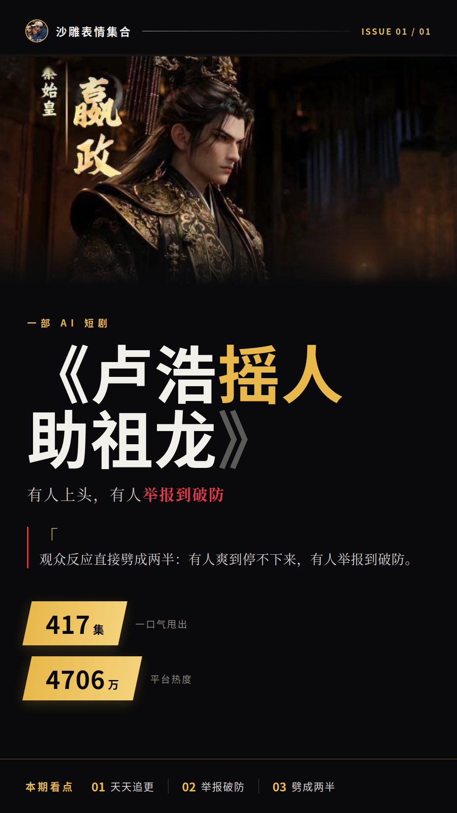
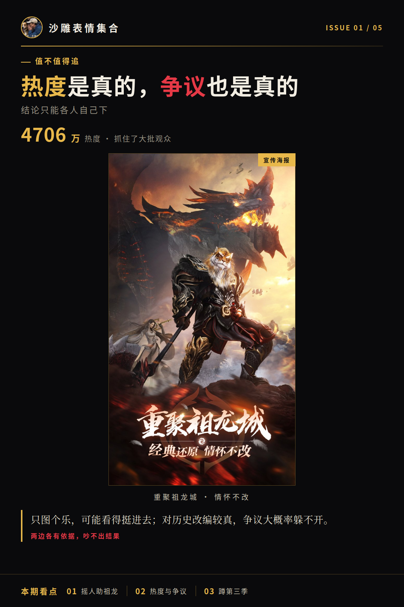

# 《卢浩摇人助祖龙》有人上头，有人举报到破防

一部AI短剧，怎么就能吵到有人天天追更、有人直接举报的地步？《卢浩摇人助祖龙》2026年9月9日上线，一口气甩出417集，观众反应直接劈成两半：有人爽到停不下来，有人举报到破防。平台热度已经冲到4706万，看的人是真不少。

## 上头的和举报的，看的是同一部《卢浩摇人助祖龙》

先把基本盘摆出来。这剧417集体量，2026年9月9日上线，走的是AI短剧赛道。追更的和举报的，点开的是同一部剧，较真的点却完全不在一个地方。

追的人图的是热闹和爽感，评论区原话就摆在那儿：「更新100季都看不腻，一部比一部上瘾」。举报的人盯的是历史改编这根弦，话也简单：「越了线，直接走流程」。两边看的明明是同一部剧，聊起来却像在聊两部作品。

**一边上头一边举报，这画面本身就够好笑的。**

我认为，这剧的口碑分歧就卡在历史改编这个点上，你能不能接受，直接决定你站哪边。能接受的看得津津有味，不能接受的连多看一眼都不愿意，直接举报。两边吵的其实不在一个频道上，谁也听不见谁。

## 热度冲到4706万，举报的也没停手

再看数据面。平台页面显示，热度4706万，收藏318.2万。另有报道提到热度峰值冲到5700万+，这个口径目前尚未得到官方确认，先按下不表。

进展这边更热闹。第三季涉及满清相关剧情后，举报就来了，审核随之陷入停滞。也就是说，数据在涨，架也在吵，审核那边还卡着。一边是收藏往上涨，一边是举报往里递，这局面看着就挺拧巴。

我的看法是：热度数据能证明看的人确实多，但证明不了口碑好坏。收藏318.2万这个数挺说明问题——追的人是真心在追，不是点开划走那种。追更的和举报的两拨观众同时存在，谁也说服不了谁，这瓜一时半会儿完不了。

## 《卢浩摇人助祖龙》到底值不值得追

目前没有权威评分，也没有大面积差评的硬性口碑证据。热度是真的，争议也是真的，结论只能各人自己下。

说句公道话，热度4706万说明它确实抓住了大批观众，这是实打实的本事；举报争议也说明历史改编的边界问题真实存在，不是谁没事找事。你要是只图个乐，可能看得挺进去；你要是对历史改编较真，那这争议大概率躲不开。两边各有各的依据，这瓜暂时吵不出结果。

我继续蹲第三季的审核进展，有信儿第一时间来报。
