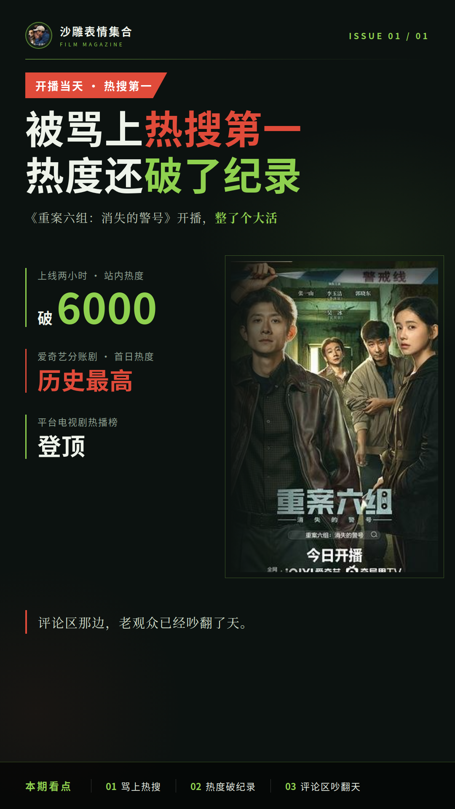
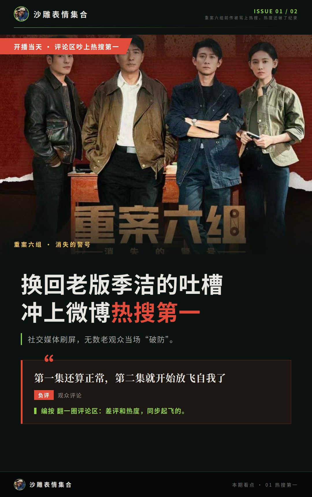
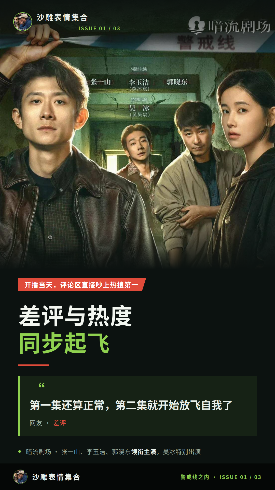
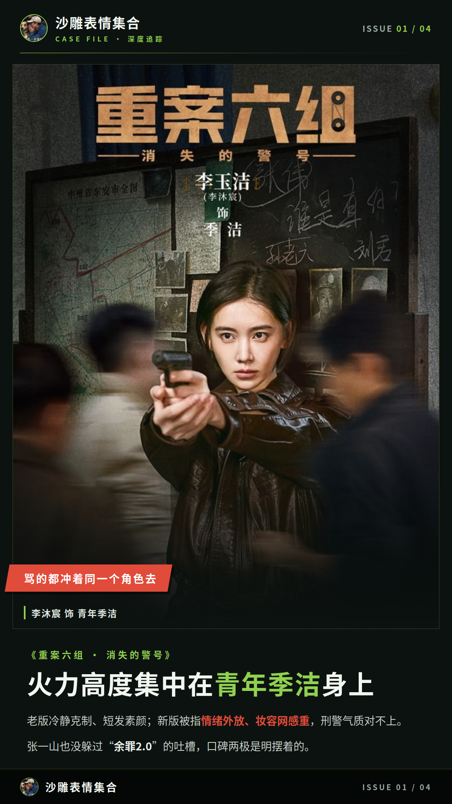
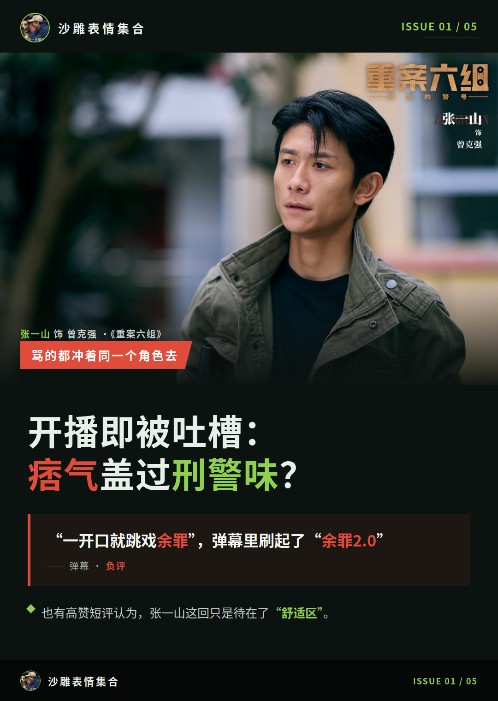
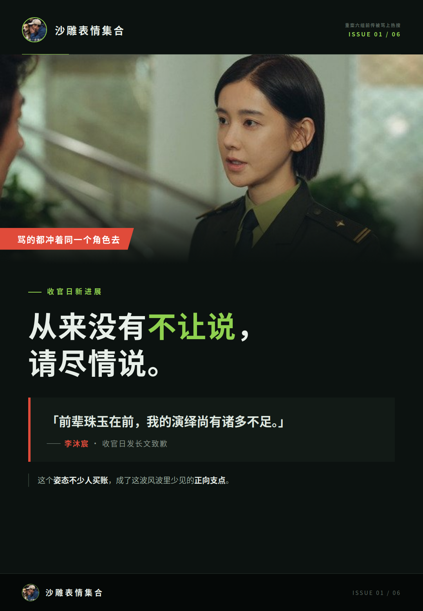
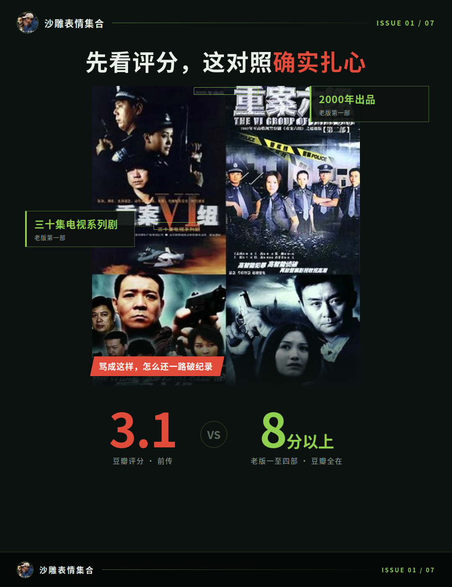
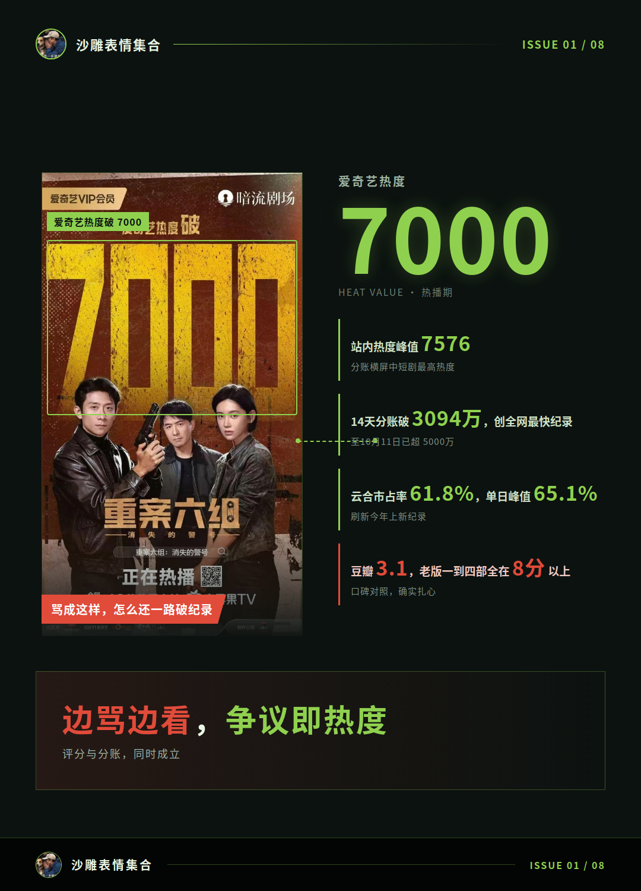

# 重案六组前传被骂上热搜，热度还破了纪录

一部剧开播当天被骂上热搜第一，热度还顺手破了纪录，这瓜你见过吗？《重案六组：消失的警号》就给家人们整了个大活：上线才两小时，站内热度破6000，创下爱奇艺分账剧首日热度历史最高，转头还登顶了平台电视剧热播榜。评论区那边，老观众已经吵翻了天。

## 开播当天，评论区直接吵上热搜第一

吵的由头特别集中：一条要求换回老版季洁的吐槽，开播当天直接冲上微博热搜第一，社交媒体刷屏，无数老观众当场“破防”。

我翻了一圈评论区，差评和热度基本是同步起飞的。有人第一集还看得下去，后面就绷不住了。

**“第一集还算正常，第二集就开始放飞自我了”**

我认为这不是简单的好坏之争。老IP的情怀撞上新版的观感，吵的是“这还算不算那个味儿”，两边各有各的理。

## 骂的都冲着同一个角色去

点开差评区你会发现，火力高度集中在一个角色身上：青年季洁。老版王茜演的季洁冷静克制、短发素颜，新版被指情绪外放、妆容网感重，跟老版刑警气质对不上。豆瓣高赞短评里，有人觉得女主表演生硬、“人造感”太强，和其他演员格格不入，倒是认为张一山在“舒适区”。

张一山开播那几天也没躲过吐槽，“痞气盖过刑警味”“一开口就跳戏余罪”，弹幕里还有“余罪2.0”的说法。

好评这边也不是没有。正面评价集中在案件写实风格和硬核刑侦内核，配角也被夸出彩，口碑两极是明摆着的。

收官日还有个新进展：李沐宸发长文致歉，承认“前辈珠玉在前，我的演绎尚有诸多不足”，还回应“从来没有不让说，请尽情说”。这个姿态不少人买账，算这波风波里少见的正向支点。

## 骂成这样，怎么还一路破纪录

先看评分：豆瓣3.1，而老版《重案六组》一到四部豆瓣全在8分以上，这对照确实扎心。

再看数据，一路都在创纪录：上线6小时登顶爱奇艺飙升榜，站内热度峰值7576，是2024年以来平台分账横屏中短剧的最高热度。分账更猛，14天破3094万，创全网横屏中短剧最快破3000万纪录，到10月11日已经超5000万。9月2日云合中剧热播榜市占率61.8%，单日峰值65.1%，刷新今年上新纪录。

**“后面我一直看着呢，反正没啥可看的，放着下饭”**

这条短评我愿称之为现象级答案。评分和分账同时成立，说明大量观众就是边骂边看，争议本身就是这部剧热度的一部分。口碑分歧是事实，商业成绩也是事实，两者不矛盾。

这瓜还没完，分账和评分一个天一个地，后面口碑会不会继续变，本号蹲着追，家人们下回接着唠。
