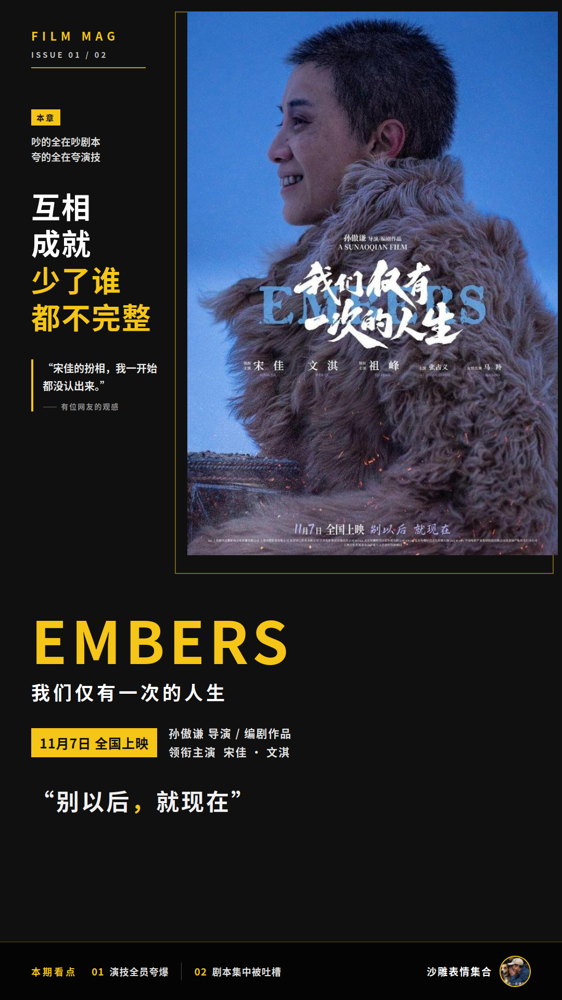
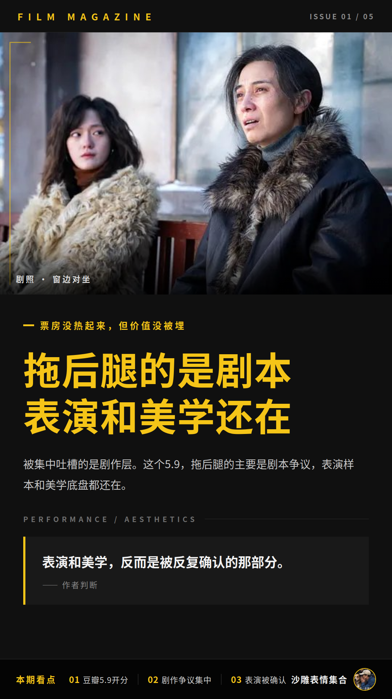

# 宋佳文淇被夸爆，这部电影豆瓣才5.9分

一部宋佳文淇双女主、还没上映就被夸表演的电影，豆瓣开分怎么只有5.9？《我们仅有一次的人生》上映没几天，评论区已经吵成一锅粥了：一边夸表演互相成就，一边嫌剧本割裂松散，两边谁也不服谁。

市场数据先摆这儿：北京日报口径，上映4天票房约1633万元；灯塔专业版显示，11月7日晚上8点多，票房才刚过1000万。这个节奏，说不上热。

豆瓣短评区有位网友说得挺直接：“**《我们仅有一次的人生》豆瓣开分5.9分，高了**”。也有人本想去看，一看5.9的开分直接被劝退。但分数低不等于没人聊，这片子的争议热度反而挺高。

## 吵的全在吵剧本，夸的全在夸演技

评论区吵归吵，吵的点位其实挺整齐，基本分成两大阵营。

夸的一派，火力全在表演上。宋佳的光头造型突破、文淇的灵气和对戏爆发力被反复提及。“互相成就、少了谁都不完整”是高频夸法。还有人连东北雪景配双女性角色的美学一起夸，说美学与演技双在线。

有位网友的观感挺有代表性："**宋佳的扮相我一开始都没认出来，也可能是我眼力不太好**"。

嫌的一派，火力全在剧本上。最重的一条吐槽是骨灰置换：这个设定没挖透，对两个逝者家庭的探讨浮于表面，镜头浪漫但被指空洞。另外，双女主的情感羁绊铺垫薄弱，从陌生隔阂到双向救赎的转变嫌仓促，互动戏份也生硬刻意。

有豆瓣短评把两边态度捏在了一句话里：故事可以更好，宋佳文淇无可挑剔，希望好本子越来越多递到她们面前。我认为这句算是把分歧说透了：演员把角色立住了，剧本没把关系写透。两边观众看的是同一批演员，失望的点位不一样。

## 连片名都被观众嫌了

剧本之外，评论区还有几条支线在吵。

一条是片名。多条评论认为这个片名与内容不符，原名《余烬》更贴切，还有人吐槽“电影完全对不住这个名字”。连片名都要下场争一轮，这瓜的含瓜量确实可以。

另一条争议要保留口径：有评论认为影片对女性形象的塑造让人不舒服，黄燕抽烟喝酒纹身爆粗口，姚雪金发粉发纹身未婚先孕。这是部分观众的观点，不是定论，大家自行判断。

## 票房没热起来，但价值没被埋

票房遇冷的信号和5.9开分是并存的。但把口碑结构摊开看，被集中吐槽的是剧作层，表演和美学反而是被反复确认的那部分。所以我的判断是：这个5.9，拖后腿的主要是剧本争议，表演样本和美学底盘都还在。

本号继续蹲这部片的评分和票房走势，有新瓜第一时间端上来。
