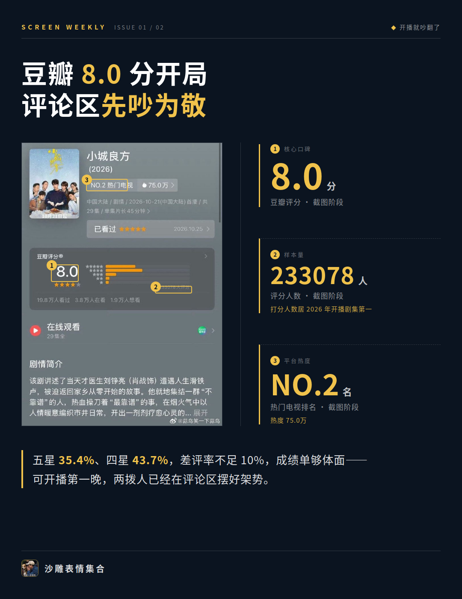
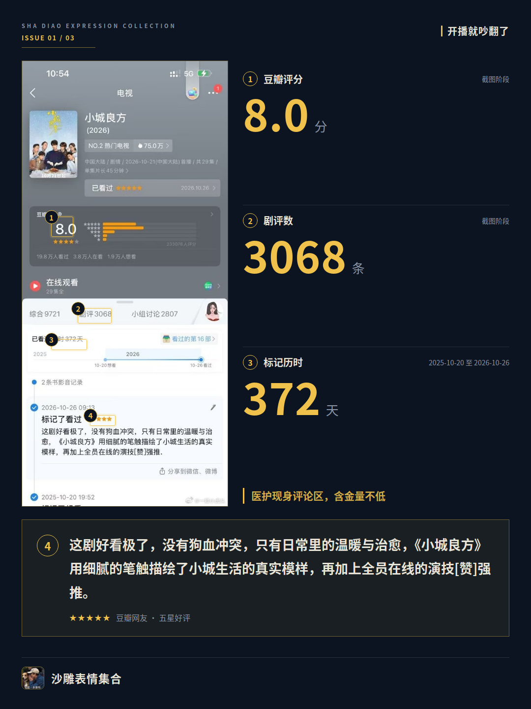
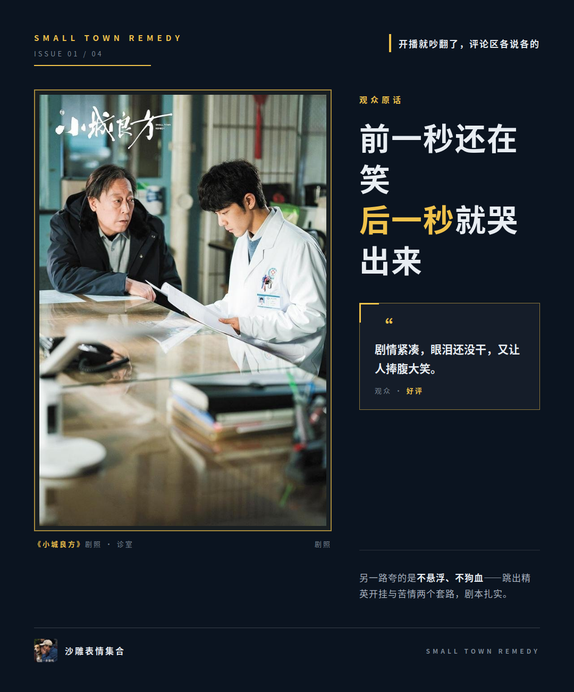
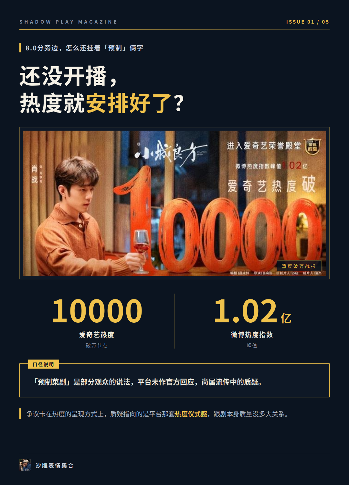
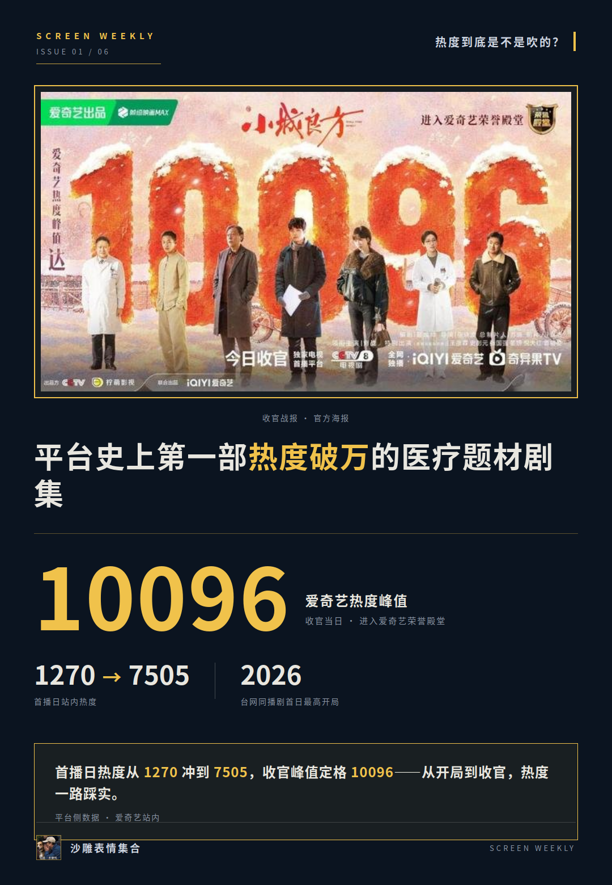
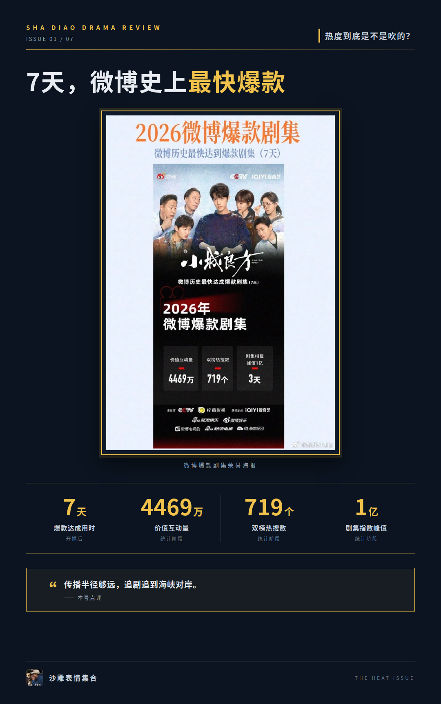

# 《小城良方》热度破万，观众到底在争什么

《小城良方》这剧现在是真热闹：豆瓣开分8.0，超23万人打分，好评率79.1%，结果弹幕里还飘着“太悬浮”“爽文男主”的质疑。一部剧能一边被夸、一边被挑刺挑得这么起劲，这瓜值得摆开吃吃。

## 开播就吵翻了，评论区各说各的

先看硬数据：豆瓣8.0分，五星占35.4%、四星占43.7%，差评率不足10%，打分人数是2026年截至目前开播剧集里的第一。这成绩单放在哪部剧身上都算体面，可开播第一晚，两拨人就已经在评论区摆好架势了。

夸的人夸得很具体。出现频率最高的说法是节奏：笑中带泪，前一秒还在笑后一秒就哭出来。有观众原话是“剧情紧凑，前一秒还在笑后一秒马上就要哭了，眼泪还没干，又让人捧腹大笑”。

另一路夸的是“不悬浮、不狗血”，说它跳出了精英开挂和苦情两个套路，剧本扎实。更有意思的是评论区里真有医护现身：有基层医生留言“我们不是不努力，是没人给我们写剧本”，还有重症工作十年的观众说看得很舒适。行业观众都点头，这含金量不算低。

挑刺的也挑得很具体：太悬浮、爽文男主、现实里谁敢这么操作。但同一批评论里，也有人对照自己当年在厂矿医院见过的真实经历。

**我认为这场架不是粉丝互怼，是两种看剧标准在碰。**

## 8.0分旁边，怎么还挂着“预制”俩字

争议的爆点挺有意思。开播才几分钟，平台就弹出金色“热度破万”横幅，弹幕里“恭喜破万”的话术也提前出现。于是“还没开播热度就安排好了”的质疑跟着起来了，“预制菜剧”这个标签迅速传播。

这里得把口径说清楚：“预制菜剧”是部分观众的说法，平台没对此做过官方回应，目前就是流传中的质疑，尚未得到官方确认。

还有评论指出，围绕这剧的讨论已经超出好看与否，变成了关于国产剧评价体系的大撕裂。我认为这波争议主要卡在热度呈现方式上，质疑指向的是平台那套热度仪式感，跟剧本身的质量没多大关系。

**横幅弹早了，锅却让剧背，多少有点冤。**

## 热度到底是不是吹的？

平台侧：爱奇艺热度峰值10096，进了荣誉殿堂，是平台史上第一部热度破万的医疗题材剧集。首播日站内热度从1270冲到7505，2026年台网同播剧里首日最高开局。

收视侧更夸张：CSM全国网首集收视率1.9389%，创2026年CCTV-8黄金档开播首集最高纪录。71城口径首播日收视率4.261%、市场份额18.38%，同时段全频道第一。云合市占率20.9%，全网有效播放量超6.43亿。29集塞进207个广告位，44个品牌排队合作，年度招商冠军。

传播半径也够远：国台办都谈到了《小城良方》等大陆影视剧在中国台湾掀起追剧热。另有观众个人转述金橙开分8.3、抖音9.3、IMDB9.2，个人口径，仅供参考。

把天平两边都看完：打分人数今年开播剧第一，差评率不足10%，热度破万，追剧追到海峡对岸。口碑和市场的天平，整体明确偏向好评那一侧。争议留下的更多是“热度该怎么呈现”的讨论，剧本身的好评一分没丢。

这热度到底是预制还是真火，评论区那23万个打分的人，可能比那条横幅更有说服力。后面口碑还会不会翻出新花样，我蹲到了再来报。
