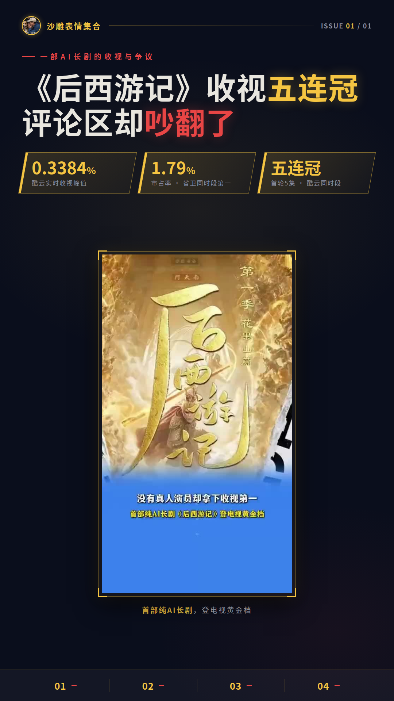
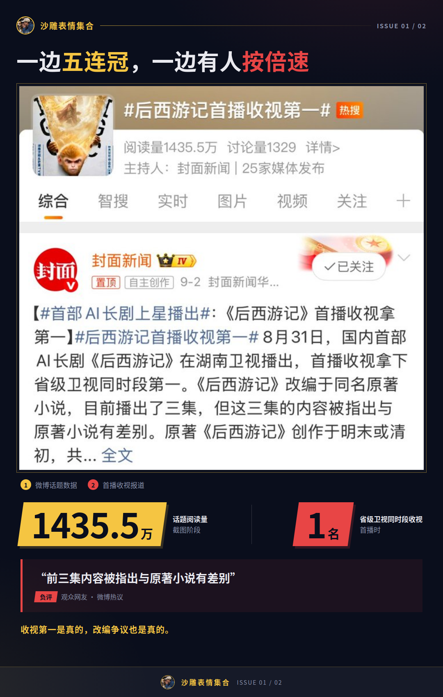
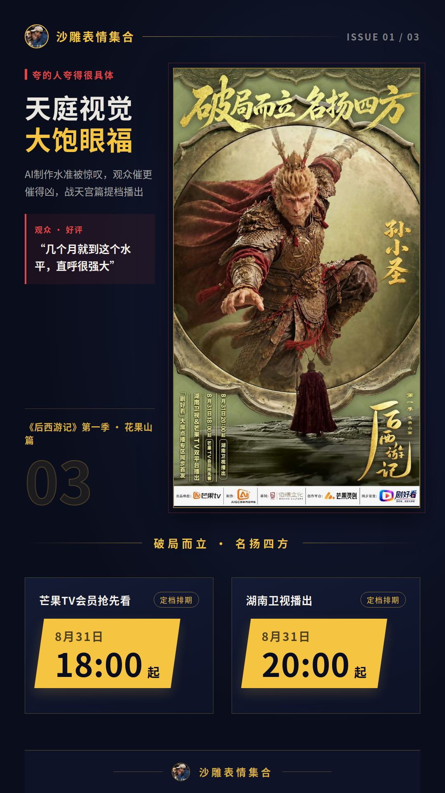
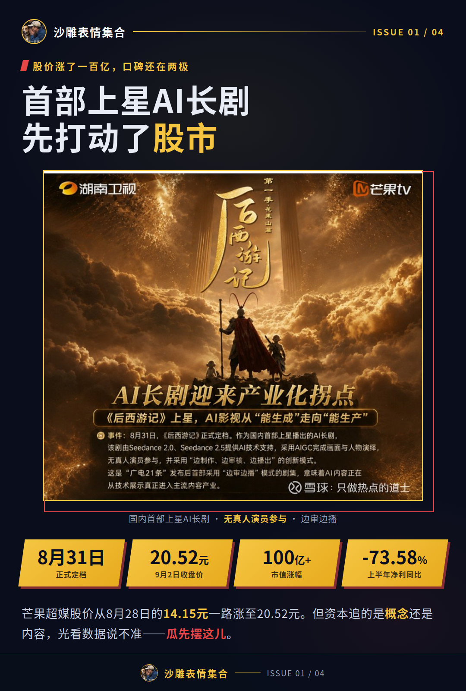
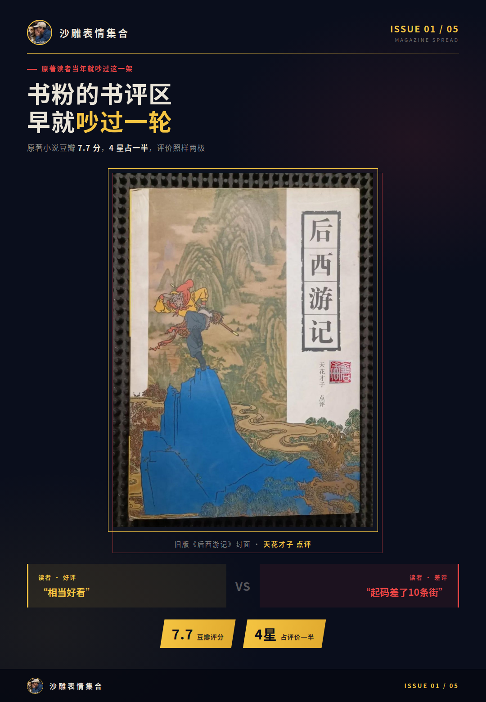
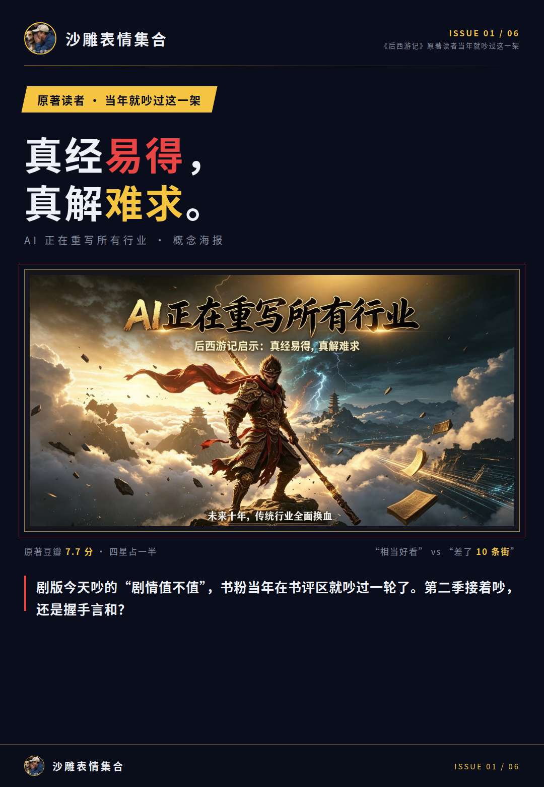

# 《后西游记》收视五连冠，评论区吵翻了

## 《后西游记》一边五连冠，一边有人按倍速

一部AI长剧，收视拿了省级卫视同时段第一，评论区却还在吵“到底行不行”——这架到底在吵什么？《后西游记》开播当晚，酷云实时收视峰值0.3384%，市占率1.79%，省级卫视同时段第一；首轮5集，直接拿下酷云同时段省卫收视五连冠。

数据摆在这儿，架也摆在这儿。豆瓣短评区，一部分观众把AI技术本身当看点，看得津津有味；另一部分甩下一句“ai不ai的不是重点，从剧情到动作设计，起码都是合格的”。热度是真的，分歧也是真的，两边都没说谎。

## 夸的人夸得很具体，弃的人弃得很干脆

先看夸的。天庭视觉被赞“大饱眼福”，有观众惊叹AI制作水准，几个月就到这个水平，直呼很强大。打戏也是口碑重头，名场面被反复夸，观众催更催得凶，官方干脆把战天宫篇提档播了。

再看弃的，一个比一个干脆。豆瓣短评里有人嫌节奏拖——

**“三集能说完的事，做了十集，弃剧！”**

还有人嫌剧情是“小圣再走一遍大圣的老路”，全程2倍速拉完。流传的批评口径里，也有“ai味道太重”“炫技太多、叙事弱”这类声音。

掰开看，两边吵的看着是AI，其实全是节奏和剧情。夸的和弃的，看的同样是那几集。

## 股价涨了一百亿，口碑还在两极

播放侧的数字更吓人。芒果TV正片播放量，花果山篇收官超2.1亿次，战天宫篇收官超4.7亿；“剧好看”大屏点播专区观看用户超70万家庭户。首播当天全网传播量19.6亿，拿下66个全网热搜；收官时传播量近43亿次，多平台热搜上榜312次，累计在榜1719.78小时，猫眼双榜TOP2。

资本市场的反应更夸张。“首部上星AI长剧”这个概念先打动了股市，芒果超媒股价从8月28日的14.15元涨到9月2日收盘的20.52元，市值涨超100亿元。

**这瓜吃着吃着，怎么吃成财经瓜了。**

对照着看更有意思：这家公司上半年归母净利润同比下滑73.58%。播放和热搜都有口径可查，是真的；但资本追的是概念还是内容，光看数据说不准，我不下这个结论，瓜先摆这儿。

## 《后西游记》原著读者当年就吵过这一架

这场架还真不是AI带来的新瓜。原著小说在豆瓣7.7分，4星占一半，读者评价照样两极：有人称这本续书“相当好看”，也有人觉得“和《西游记》的水平起码差了10条街”。

剧版今天吵的“剧情到底值不值”，书粉当年在书评区就吵过一轮了。视觉和制作水准这次确实被大量观众认可，收视热度也有完整数据撑着，这场AI长剧试验的成绩摆在明面上，争议也有它的来历。

战天宫篇高燃收官，官方口径是寒假再见。第二季口碑是接着吵还是握手言和，我蹲住评论区等结果。
