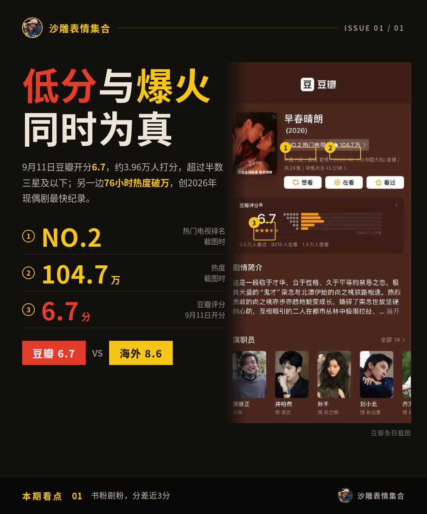
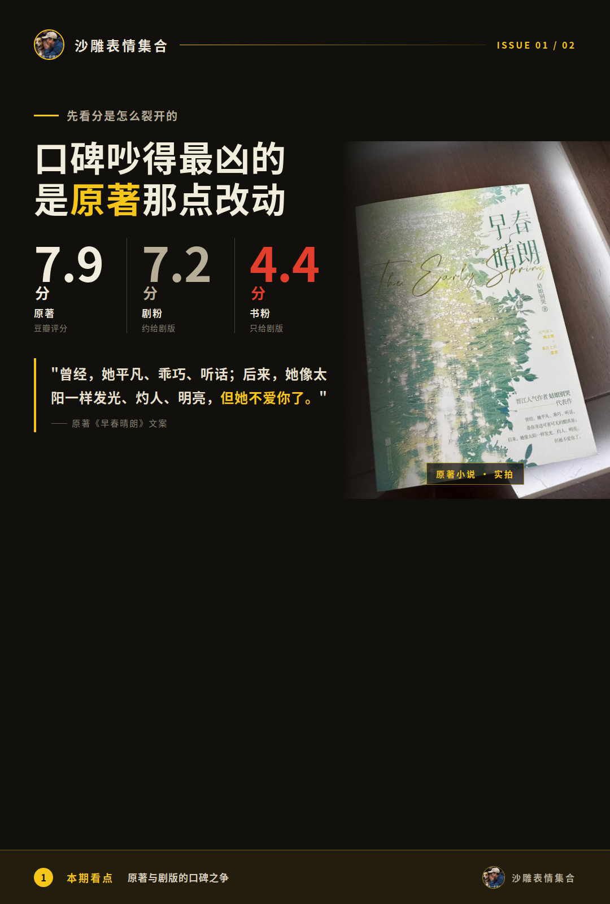
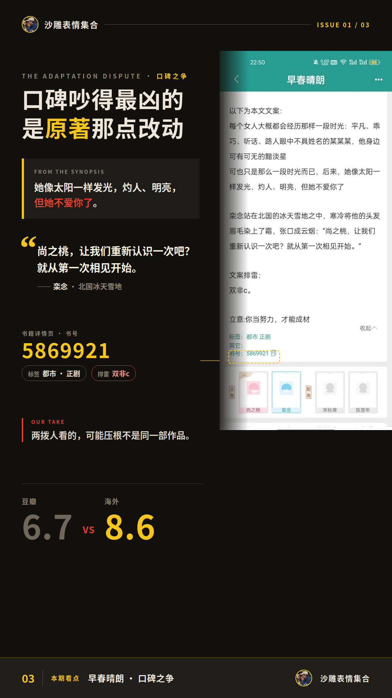
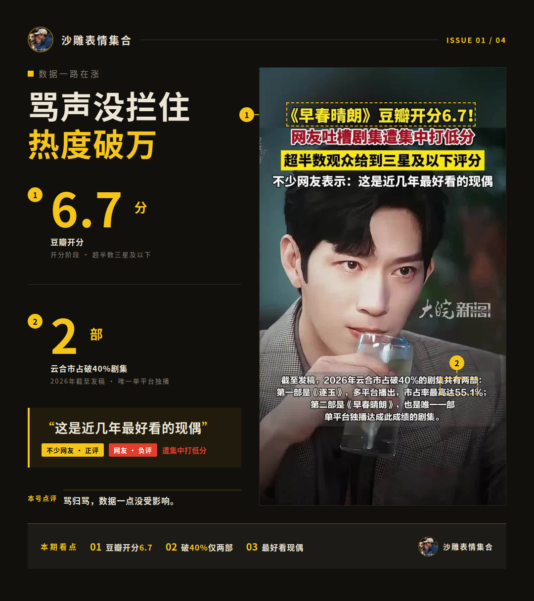
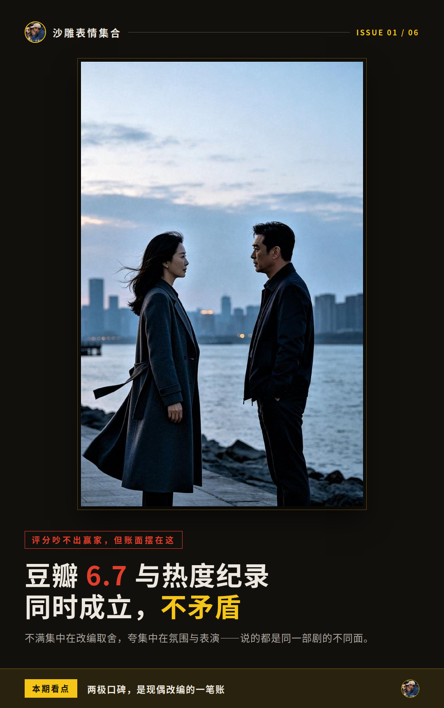

# 《早春晴朗》豆瓣6.7，海外却打出8.6

书粉和剧粉打分能差出近3分，这瓜你们见过吗？《早春晴朗》9月11日豆瓣开分6.7，约3.96万人打分，超过半数三星及以下。可另一边，它76小时热度破万，创了2026年现偶剧最快纪录。低分和爆火同时为真，两边谁也说服不了谁。

## 口碑吵得最凶的，是原著那点改动

先看分是怎么裂开的。原著小说在豆瓣7.9分，剧粉群体给剧版打约7.2分，原著书粉只给4.4分。差评主力就卡在改编上：原著男女主始于不对等的关系，剧里改成了隐秘地下恋；栾念的底色也从精致利己改成了嘴硬心软。书粉觉得这一改，故事原本那股酸涩压抑感没了。剧粉正相反，认为剔掉不健康设定后，情感线更顺畅，嗑糖更顺。

另一路差评不谈原著，直冲职场戏。职场PUA被浪漫化、上下级权力不对等，女主自尊卑微，连职场细节都被批悬浮失真。有豆瓣长评直接批评前五集拍出“职场糟粕大全”，三千多人标记有用。

好评那边也有自己的清单。氛围感出圈，说的是成年人克制又热烈的爱情；井柏然孙千这对也被点名，表演细腻不油腻；造型赏心悦目同样有人夸。

两边的原话放一起看更有意思。书粉侧有人说“我是很讨厌人不会好好讲话的，栾念简直太下头”，剧粉侧则是“话说这个剧豆瓣评分也太偏低了吧”。

**两边都觉得对面不可理喻，这架根本吵不到一个点上。**

我认为这波争议主要卡在“改没改编味”上——两拨人看的可能压根不是同一部作品。

## 骂声没拦住热度破万

吵归吵，数据一路在涨。开播76小时热度破万，之后连续13天维持热度破万，豆瓣差评一集没落下，两边就这么一路吵到收官。云合数据更夸张：9月9日正片有效播放市占率40.3%，是2026年第二部市占破40%的剧集；播出期间持续登顶云合日榜，市占率最高27.7%。灯塔专业版那边，全网正片播放量也破了18亿。

**好家伙，骂归骂，数据是一点没受影响。**

海外又是另一番景象。Netflix非英语剧集榜上，它先以240万次观看排第2，第二周观看次数升到320万，两周蝉联，创国产剧在该榜历史最高位次。海外观众的评价是“感觉像真实的人”，谷歌趋势英文名检索覆盖68个地区，是中文名的2.5倍。

评分也错位得明明白白：MyDramaList给到8.6，豆瓣6.7。同一部剧，两套评分体系里是两种命运。国内批职场悬浮，海外夸真实感——看起来不是剧变了，可能是各自对照的职场经验不一样。

## 评分吵不出赢家，但账面摆在这

把两边的账摆一起，其实都成立。不满集中在改编取舍和职场刻画，夸集中在氛围、表演和造型，说的都是同一部剧的不同面。所以豆瓣6.7和热度纪录能同时存在，不矛盾。

我认为这波两极口碑对后续现偶改编算个有价值的样本：改得狠能换来更大众的嗑糖体验，代价是丢掉一部分原著受众的分。这笔账怎么算，得片方自己掂量。

这剧的评分后续会不会随着讨论沉淀再挪一挪，咱接着看。
