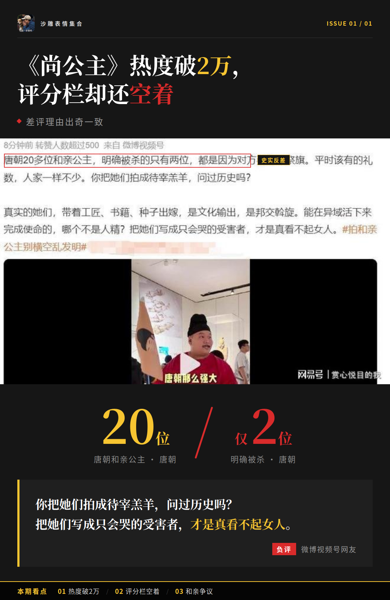
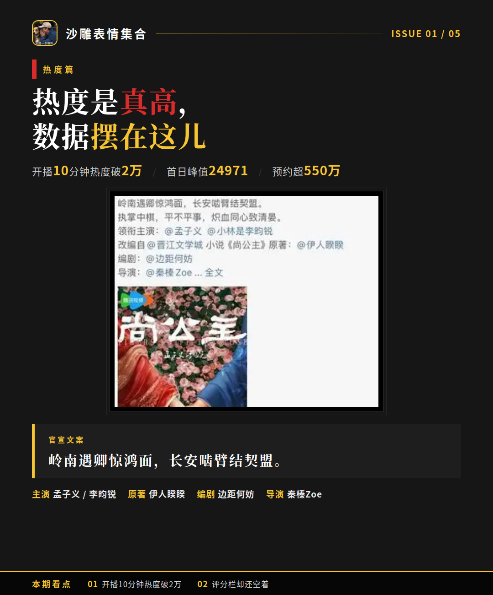

# 《尚公主》热度破2万，评分栏却还空着

《尚公主》开播就吵翻了。可点开猫眼一看，13次日冠、播放破4亿，热度实打实能打。一边骂声集中，一边数据狂飙——这瓜到底该怎么吃？

差评这边，理由出奇一致：剧情空洞、人设割裂、节奏太慢。书粉的不满更具体——剧版把和亲改成了祈福，“拔去了刺”，言尚还被加了一条罪臣之子复仇线，双强硬生生变成了不对等的从属关系。

女主的行为也是吵架焦点。“拖行言父”“摔桌椅”“我就是王法”这些桥段，有人批观感不适，也有人觉得“疯批公主”带感，符合她九死一生归来的性格底色。

## 《尚公主》夸的人也不少，夸的点还挺一致

好评派的说法是慢热：第四集回都城后权谋线铺开，节奏明显提速。有观众直接点名余皑磊演的权臣鱼成安，一出场就给太子下马威，几场戏把朝堂压迫感立住了。

画面、配乐、群像也被反复称赞，晚唐氛围和岭南实景都有人夸，“鲈鱼副线”甚至被封神。孟子义李昀锐三搭的默契度，认可的人也不少，说CP拉扯自然、避开工业糖精。

有句短评把这种错位说得很直白：“招商排面拉到顶，弹幕里刷的却是‘女主太作了’。”

**排面和观感，完全是两个世界。**

我认为两边都不是凑热闹：差评理由集中，好评也言之有物。分歧点其实卡在“前四集的劝退成本”上——有人前三集就弃了，有人熬到第四集开始真香。

## 热度是真高，数据摆在这儿

开播10分钟站内热度破2万，2小时首日峰值24971；另一微博口径是24110，两个数字都列在这，口径有差异。开播前预约超550万，进了同平台2026年首日热度榜前五。

猫眼专业版：累计有效播放超4.74亿，13次热度日榜冠军、16次有效播放日榜冠军，还登顶了第44周双榜。

艺恩娱数上线22天的数据更有意思：播放市占率7.6%、观看度91.2，好评度只有54。

**热度高、好评中游，数据本身就写着“两极”两个字。**

还有个广告传闻：有快讯称该剧开局有总冠名，后来广告商撤资落到裸播。这属于媒体口径，目前尚未得到官方确认，照实说，不断言。

## 评分栏空着，这事本身就挺说明问题

最魔幻的来了：播出第十天，豆瓣条目攒了10497条短评，评分栏还是空的。对比同档期《小城良方》，开播12天已有24万余人打出8.0分。

有观众对评分空缺本身都有情绪：“用豆瓣这么多年，第1次出现这种情况。”评分缺席，口碑就只能靠吵，谁也压不倒谁。

我的判断是：播放和热度是可核验的强项，差评集中和评分缺席是可核验的争议，两边都是真的，不矛盾。这更像一部“数据先行、口碑慢热”的剧，播放破4亿、群像和美学被夸，受众基本盘实打实存在，最终评价可能得等全集播完才落得下来。

后续评分栏开不开、开了是多少分，本号接着蹲。
