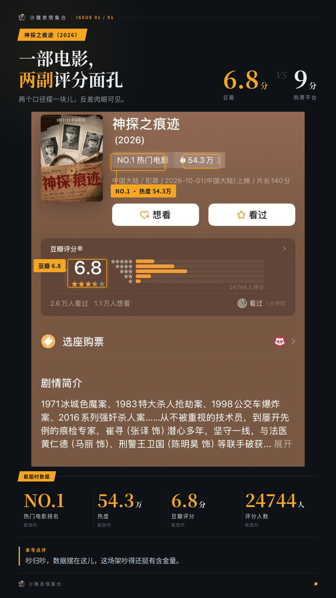
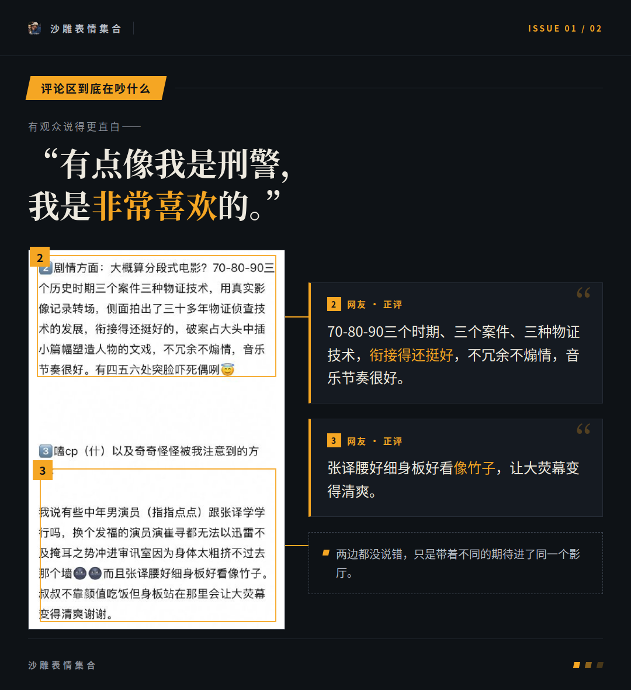
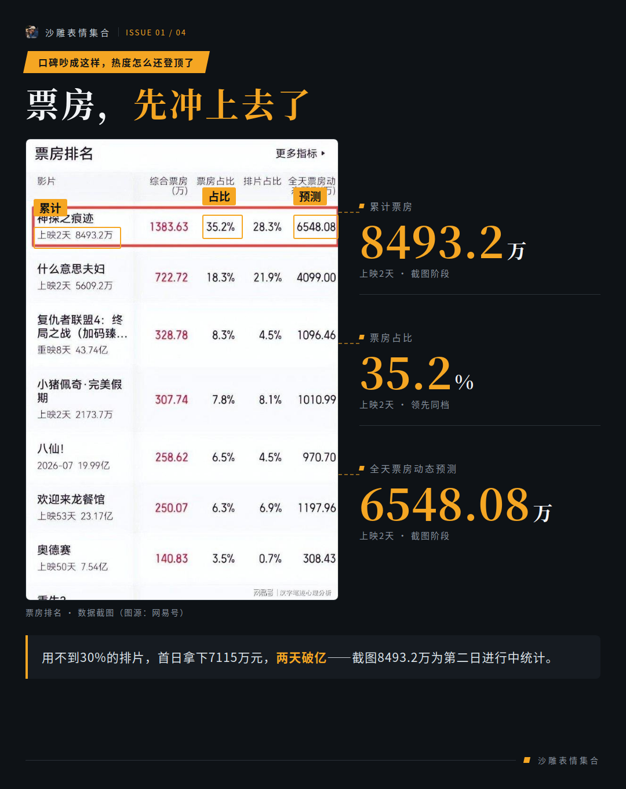
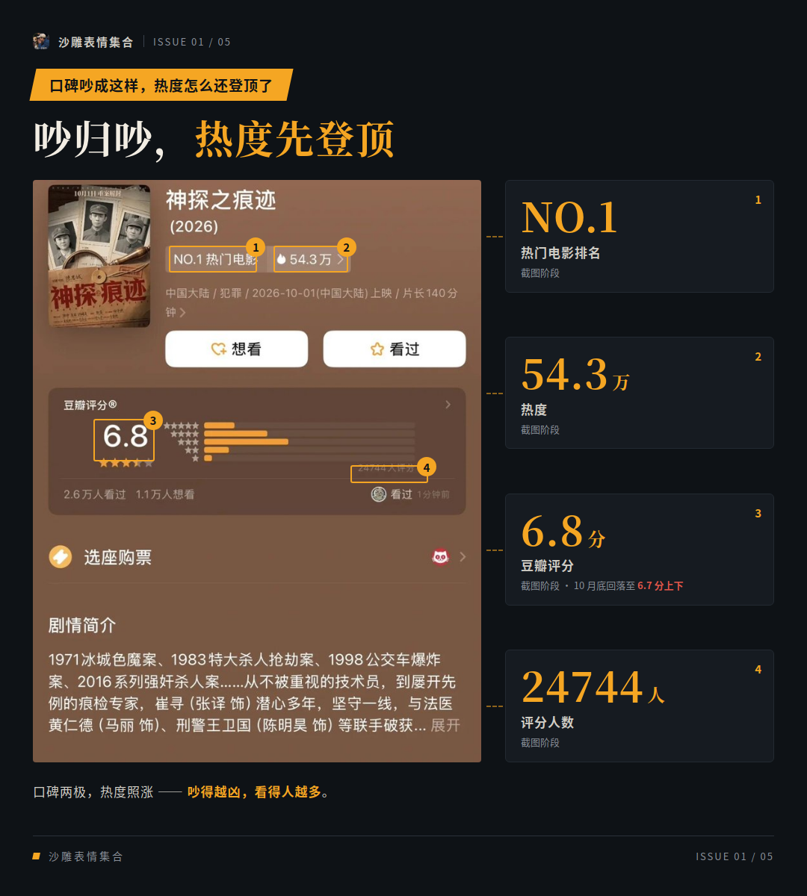
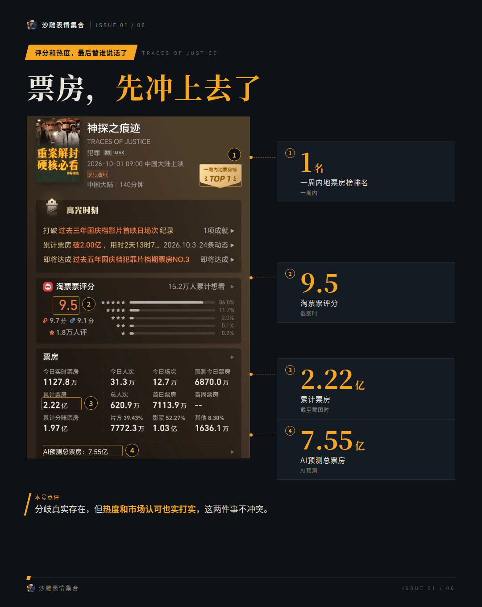

# 《神探之痕迹》口碑吵翻了，票房却先冲上去了

一部电影，怎么会在豆瓣和购票平台拿到完全不同的两副评分面孔？《神探之痕迹》就摊上了这事儿：豆瓣6.8分，购票平台高达9分，两个口径摆一块儿，反差肉眼可见。

吵的点也清楚。一边嫌它叙事拼盘、节奏慢，一边夸它真实、过瘾、越想越震撼，两边谁也不服谁。

我认为吵归吵，数据摆在这儿，这场架吵得还挺有含金量。

**毕竟没人看的片子，连吵架的人都凑不齐。**

## 评论区到底在吵什么

先看叫好那拨。被夸得最多的是真实感，写实刑侦叙事不靠反转和开挂这点也有人专门提。老戏骨演技在线，警员也没被神化。还有人看完直接改了观感：“看之前顾虑蛮多但看完觉得真挺好的。”

有观众说得更直白——

**“有点像我是刑警，我是非常喜欢的。”**

那不买账的人呢？叙事拼盘、悬疑感薄弱、节奏慢，这几条被反复提，转场抒情和怼脸特写挨点最多。有观众给出理由：“一部电影里三四个案子，每个都有点浅尝辄止。”也有人觉得“不值得，相当于看了几集电视”。

从两边的话来看，这架吵的其实不是同一件事。冲着强反转进场的观众落了空，接受物证推演慢叙事的观众反而看得进去。两边都没说错，只是带着不同的期待进了同一个影厅。

## 口碑吵成这样，热度怎么还登顶了

票房这边一路没含糊。首日用不到30%的排片拿下7115万元，上映两天破亿，之后排片占比稳定在25%左右。

档期成绩更扎眼：国庆档总票房11.65亿元，《神探之痕迹》以4.23亿元登顶，占比超36%，档期观影人次突破1138万。上映12天，总票房破5亿，观影人次超1399万。

满意度这栏也拿了第一。中国电影观众满意度调查里，它拿了85.1分，位居国庆档首位，比第二名高出1.4分。

到10月底，票房落定在六亿多量级，豆瓣评分停在6.7分上下。

## 评分和热度，最后替谁说话了

把几个口径放一起看：购票平台9分、满意度第一、票房占比超36%，普通观众这边明显更热情；豆瓣6.7分上下，打分严格的那拨人确实没全买账。

我的判断是，它对上了目标观众的胃口。分歧真实存在，但热度和市场认可也实打实，这两件事不冲突。

这波口碑和票房的后续走向，本号继续蹲着，有新动静第一时间端上来。
