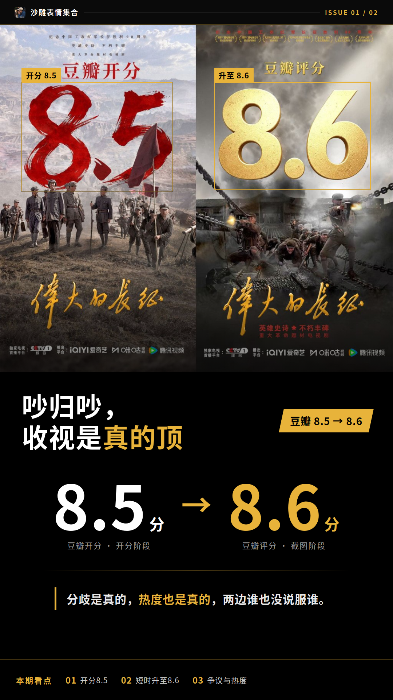
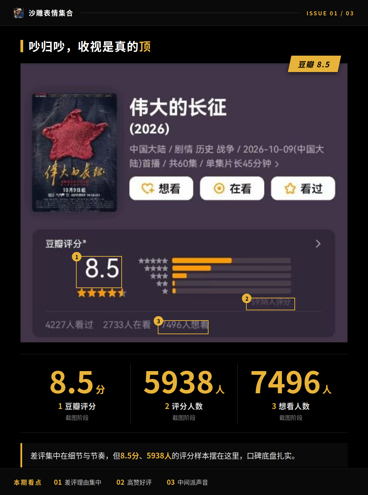
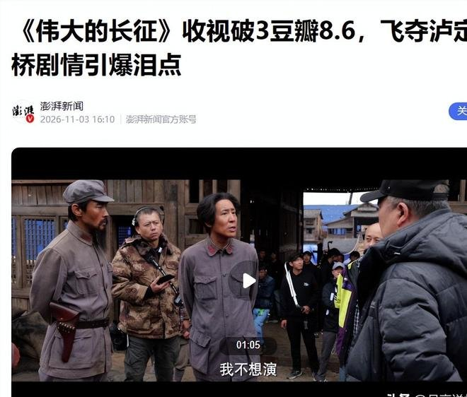
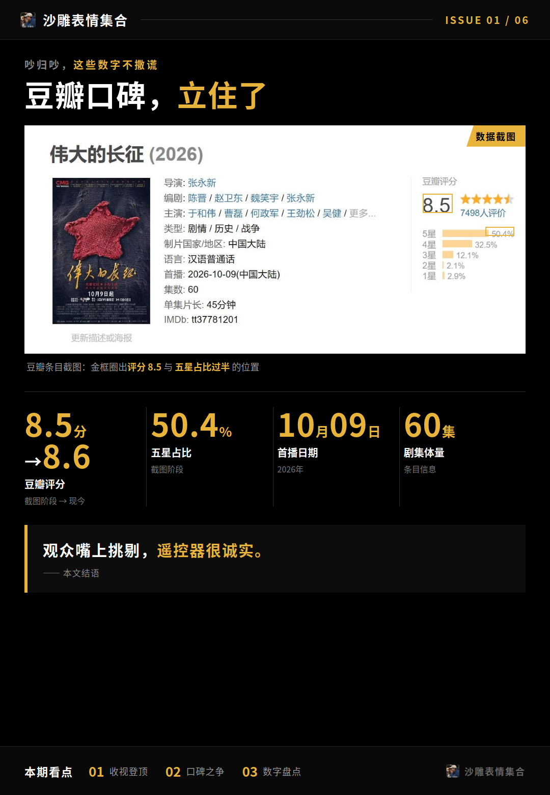

# 《伟大的长征》吵归吵，收视是真的顶

一部革命历史剧收官，观众到底在争什么？《伟大的长征》收官那晚，视频平台的弹幕齐刷刷飘着同一句话——“打草鞋的本事不能丢”。“遵义会议弹幕打卡”“年轻人观剧做笔记”这些话题轮番上热搜，年轻人边看边记笔记，把追剧追出了上课的架势。

可同一时间，另一路声音也没停。有微博网友把批评归纳得挺整齐：台词枪械服装这些细节真不真、慢镜头水不水、战争场面是不是老套路。

先摆一个数：豆瓣开分8.5，短时间内升到8.6。我的判断是，分歧是真的，热度也是真的，两边谁也没说服谁。

## 打低分的和打高分的，各说各的理

差评这边，理由相当集中。历史细节失真、重复慢镜头拖节奏、战争场面套路化、知识点讲得太刻意，这几条被翻来覆去地提。还有观众把个别演员表演用力过猛列为扣分点，点名黄晓明演的瞿先生。

好评那边，火力也猛。豆瓣有条七百多人点有用的高赞短评：“不用吝啬，光是17、18集遵义会议就可以满分。”播到第40集前后，评论区还掀起一波哭潮，大量观众留言说看哭了。

中间派也有话讲。有豆瓣用户表示，媒体说差评如潮，自己看完却觉得不错，并点出差评大多集中在演员像不像、剧情憋屈这两件事上。

**能看得出来，绝大多数看完的人，是真心认可这部剧**，这话跟“某些地方还有提升空间”并不打架。一部剧被挑剔和被认可，完全可以同时发生。

## 吵归吵，这些数字不撒谎

收视这边是真不含糊。集均收视率3.416%（CVB口径），是CVB上线7年来革命历史题材剧的第一名；单集最高冲到3.949%，累计收视12.7亿人次。截至11月5日，平均收视率3.384%、收视份额15.534%，稳居同时段第一。

传播面也不止电视一块。截至11月7日，剧集相关内容全媒体累计触达超75亿人次，年轻用户占比37%；大屏端直播收视率每天保持在3%以上，位列近两年革命题材电视剧收视率第一。截至10月20日，电视大屏、网络视听端的收视总时长已经有1.7亿小时（CVB统计），全网曝光量16.95亿。

平台热度同样能打。爱奇艺站内热度破7000，坐上电视剧飙升榜第一；腾讯视频热度突破22000，革命剧榜第一，观众评分9.6。

吵归吵，豆瓣8.6、收视第一、双平台热度全立住了，这份诚意，观众是看得出来的。

**观众嘴上挑剔，遥控器很诚实。**

这剧的口碑后续还有没有新动静，我蹲到第一时间来报。
