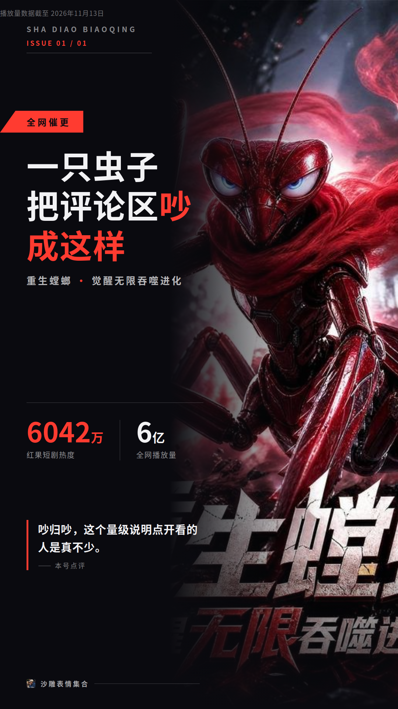
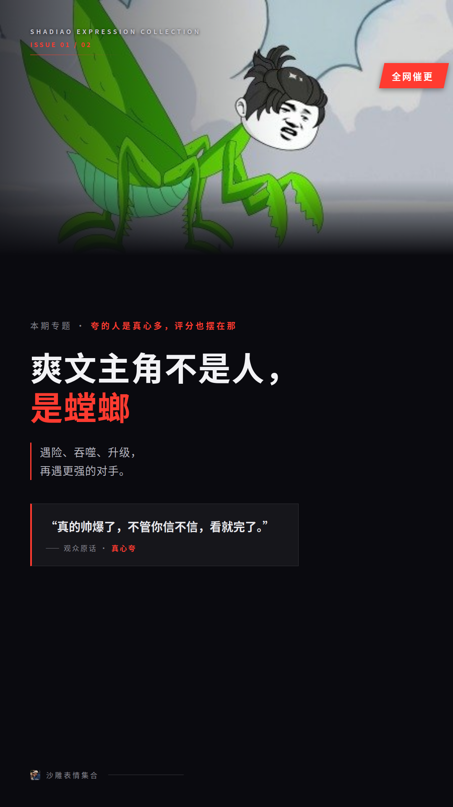
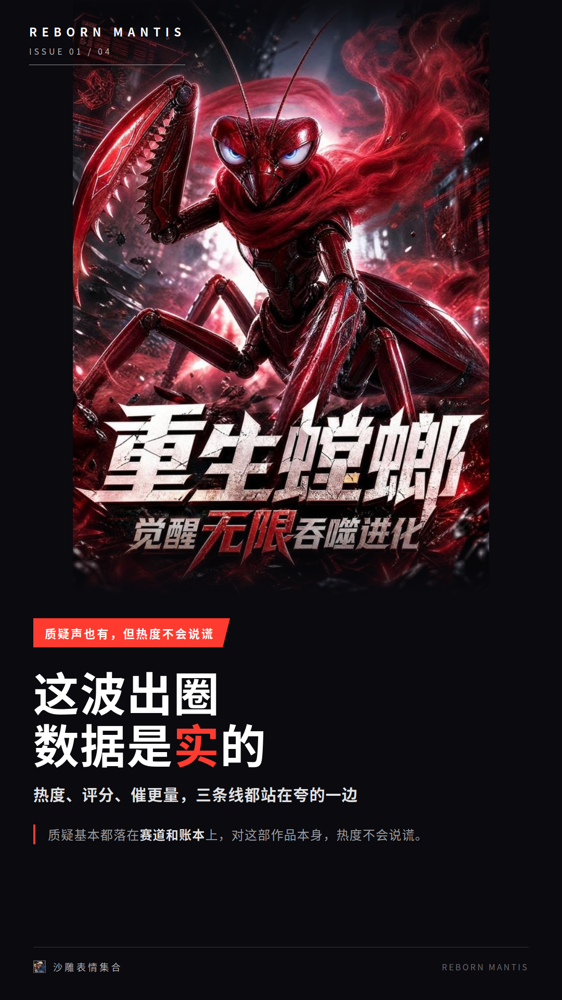

# 重生螳螂被全网催更，评论区吵翻了

一只螳螂当主角的AI短剧，凭什么把全网评论区点炸？说的就是《重生螳螂，觉醒无限吞噬进化》。

这剧的口碑是真能吵。一边催更催到创作者后台消息回不完，一边有人嫌它无脑，还有人直接翻起成本账，质疑4000多元做96集到底现不现实。

热度倒是一点不含糊：红果短剧热度6042万，截至2026年11月13日，全网播放量突破6亿。我认为，吵归吵，这个量级说明点开看的人是真不少。

**一只虫子把评论区吵成这样，我是头回见。**

## 夸的人是真心多，评分也摆在那

先看夸的这波在夸什么。聚类下来主要就一条：题材新奇。虫子当主角出人意料，进化流的爽点也直接，遇险、吞噬、升级、再遇更强的对手，观众点开就是想知道下一集解锁什么。还有人调侃，这回爽文主角不是人，是螳螂。

有观众原话相当直白：“我不是水军，真的不是……真的帅爆了，不管你信不信，看就完了。”也有人总结得更细：“进化流的爽点太直接了：遇险、吞噬、升级、再遇更大的对手。”

数据这边也能对上。红果评分8.9分，700多条剧评（截至11月12日）；榜单上稳坐抖音互动榜第一，红果短剧爆剧榜排第六，还给创作者增收了6万元。漫剧榜那边热度也到了6156万，进了异能重生题材的前列。我的看法是，这些夸不是空喊，评分和榜单摆在那，能互相印证。

## 质疑声也有，但热度不会说谎

再看吵的另一边，质疑分好几路。一路嫌剧情无脑、同质化严重、赛道拥挤，有观众说在抖音刷到过，直接没点；一路盯上成本账，指出4000多元做96集不现实，算力费和人工是两笔账；还有人提醒，6亿播放是流量不是收入，分成怎么算、到手多少，目前没有公开数字。

顺带一个细节：创作者第一部剧和第二部剧的播放数据相差600多倍。所以“别搞幸存者偏差，不是谁做短剧都能火”这个提醒，也不是没道理。不少人感慨普通人多了条新创作渠道，但出圈案例很难简单复制，这两件事不冲突。

有句评论我印象挺深：“但我得泼盆冷水：别急着把‘AI短剧’当成普通人的印钞机。”**这盆冷水泼得不冤。** AI把画面门槛压低了，可让人想点下一集的钩子不会自己长出来，脑洞、节奏和讲故事的能力还是硬门槛。

不过把话说回来，质疑基本都落在赛道和账本上，对这部作品本身，热度、评分、催更量三条线都站在夸的一边。这波出圈，数据上是实的。

后台催更的消息还在涨，这只螳螂接下来还能火成什么样，咱接着蹲。
