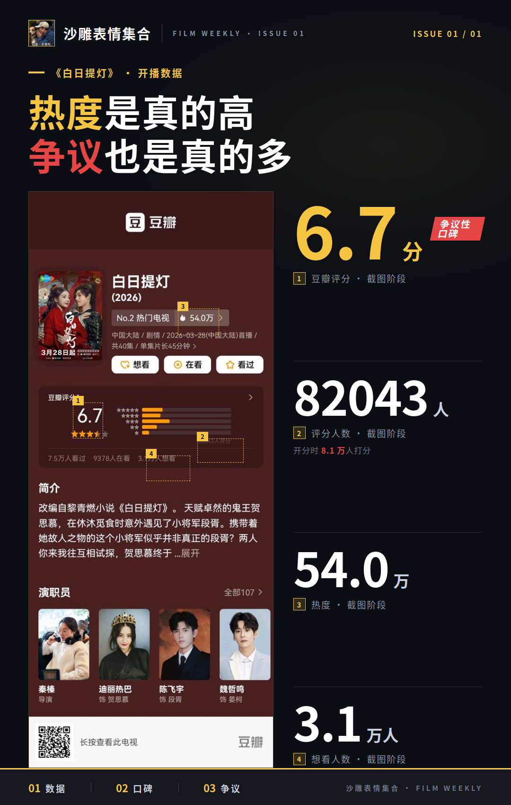
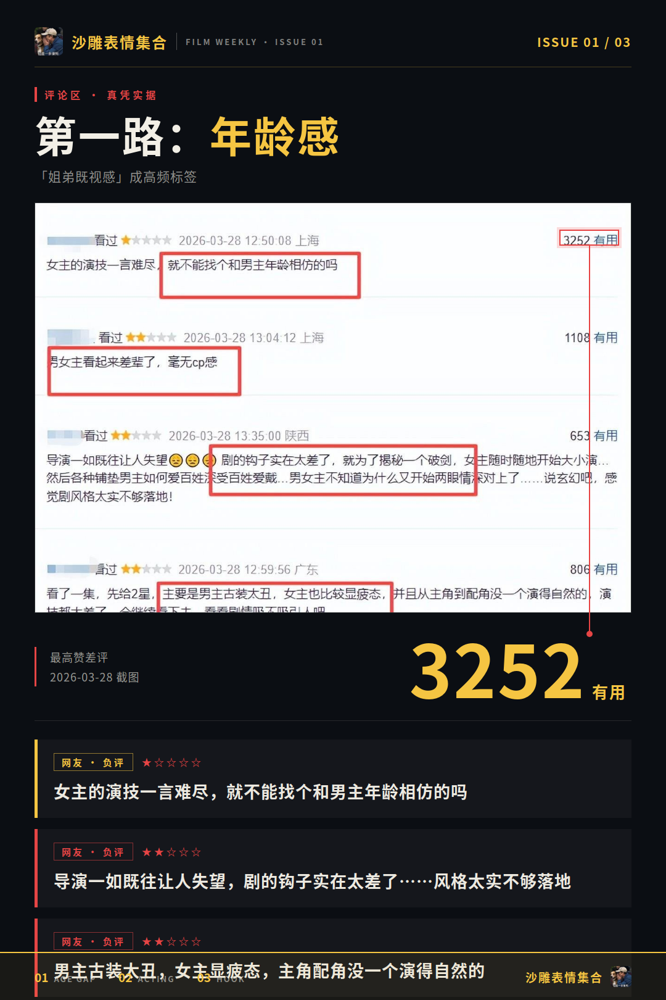
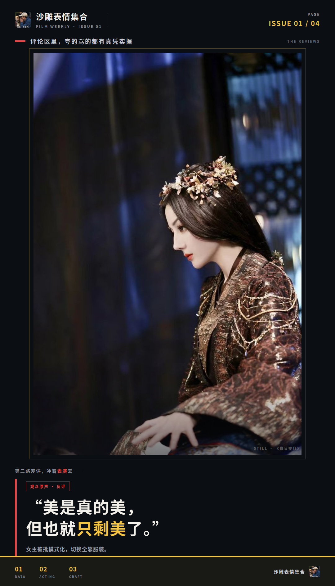
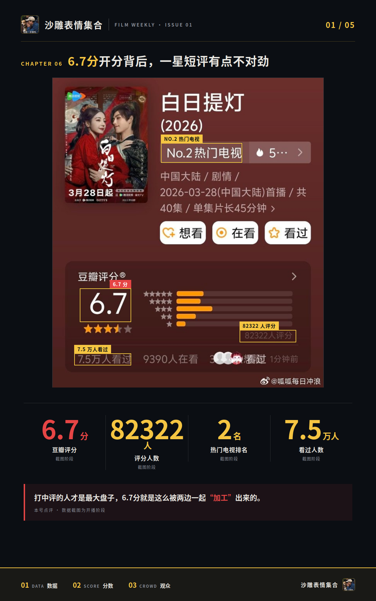
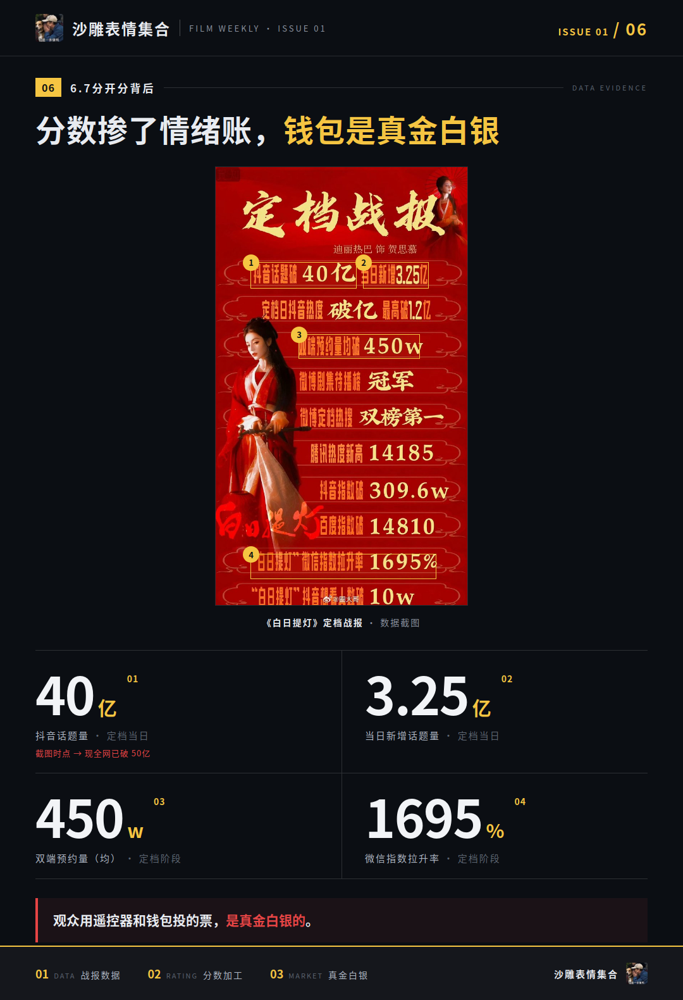
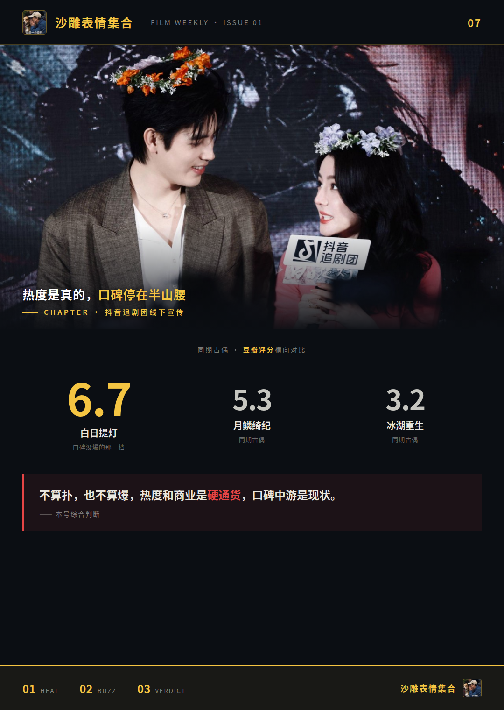

# 《白日提灯》一星差评，六成三像复制粘贴

一部剧开播，服化道特效被夸上天，CP感和演技却被骂上热搜，两边还都吵得特别起劲，这场面见过吗？《白日提灯》现在就是这个状态。

数据先摆出来：豆瓣开分6.7分，8.1万人打分；开播首日百度指数13万，腾讯站内热度峰值26481。热度是真的高，争议也是真的多。

我认为这不是一致差评，也不是一致好评，是标准的争议性口碑。夸和骂的同时这么起劲，评论区到底发生了什么，往下看。

## 评论区里，夸的骂的都有真凭实据

先说夸的那边。好评集中在制作上：S+级服化道、特效、打戏质感在线，“无五感灵主×少年将军”的人设被认为新颖，双结局的拍法也有人夸最后几集集集爆哭。

骂的那边分三路。第一路是年龄感：“姐弟既视感”成了高频标签，有短评直接开怼——

**“男女主毫无CP感，互动尴尬僵硬。”**

第二路冲着表演去：女主被批模式化、切换全靠服装。本号分到的原声里有一句挺扎心——

**“美是真的美，但也就只剩美了。”**

第三路对准制作和剧情：磨皮滤镜过重、剧情平淡注水，BE改HE被部分观众批“工业糖精”。

中间派也有声音，说叙事的老毛病还在，但底子是真的好，目前能看。我觉得这句挺代表一大波人的真实观感。

## 6.7分开分背后，一星短评有点不对劲

然后是这次最有意思的硬料。开播首日，1小时内涌进超300条一星短评，差评措辞的模板化重复率达到63%。看起来不太像自然发言，但实质性批评也真实存在。数据摆这儿，本号不下定论，各位自己品。

再看星级分布：五星23.2%，四星20.9%，三星31.1%占了大头，二星16.5%，一星8.3%。打中评的人才是最大盘子，6.7分就是这么被两边一起“加工”出来的。

商业这边更热闹：全网累计播放量超9亿次，抖音话题播放量突破50亿；40集全集有广告，14个品牌92条广告，周边销售额8天破千万。分数里可能掺了情绪账，但观众用遥控器和钱包投的票，是真金白银的。

## 热度是真的，口碑停在半山腰

横向一比更清楚：同期古偶里，《白日提灯》豆瓣6.7分，高于《月鳞绮纪》的5.3分和《冰湖重生》的3.2分。放在今年这批流量古偶里，它属于热度高、话题足，但口碑没爆的那一档。

夸它的人有真凭实据，骂它的人也有真凭实据，连模板化差评的成分都掺在里面。这锅口碑粥，熬得确实复杂。

我的综合判断：不算扑，也不算爆，热度和商业是硬通货，口碑中游是现状。后续评分要是涨了跌了，本号接着搬小板凳播报。
