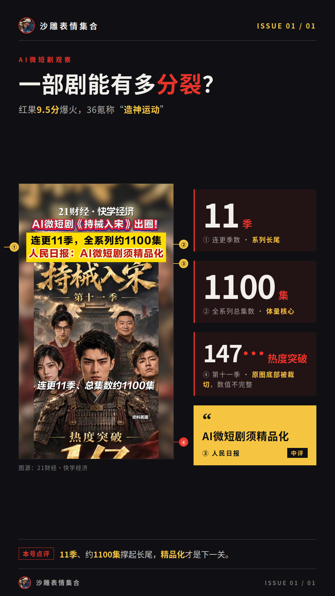
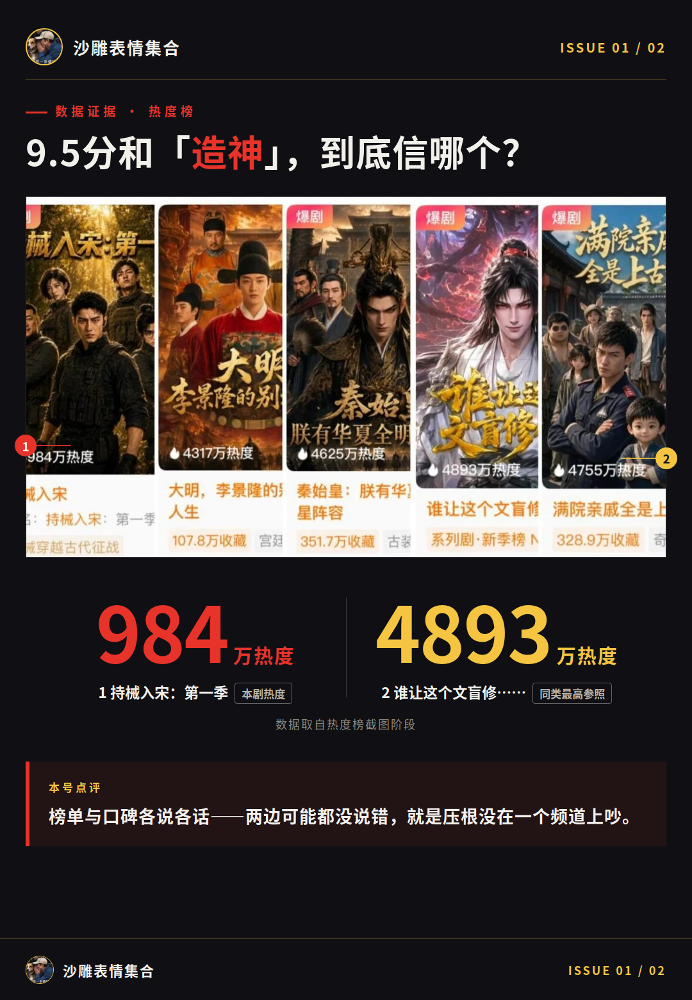
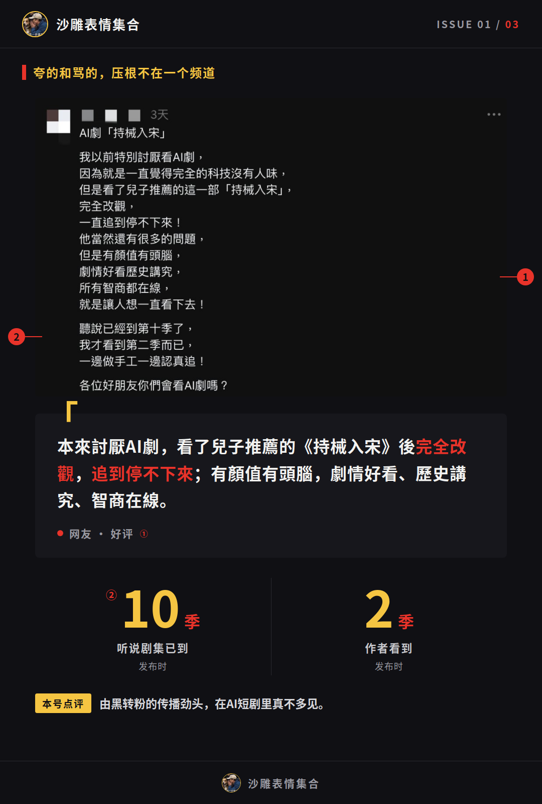
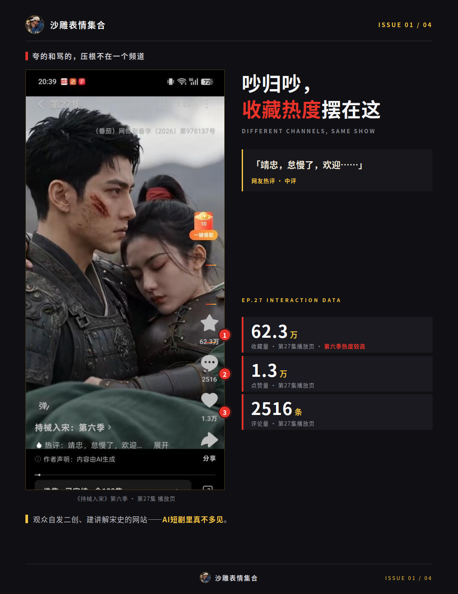
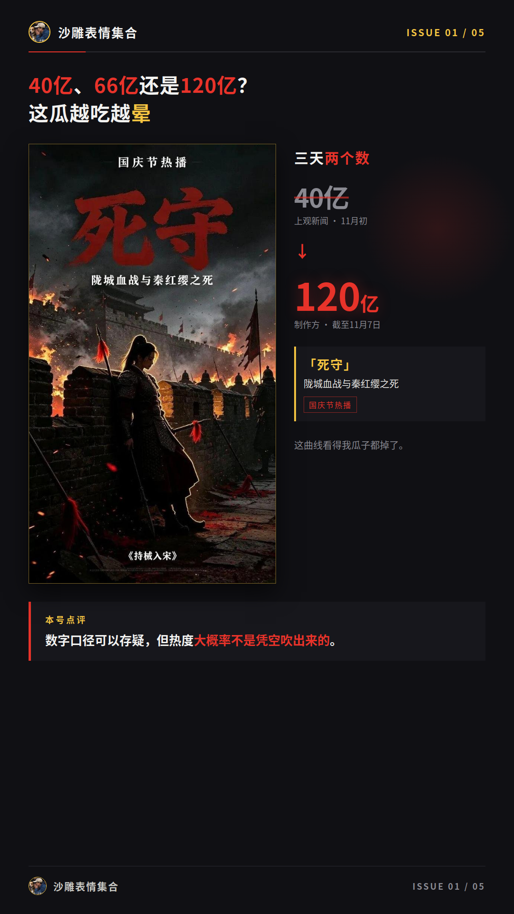
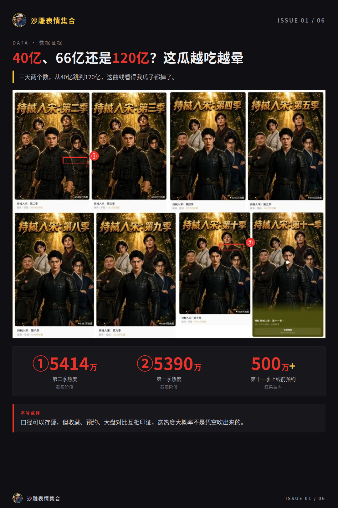
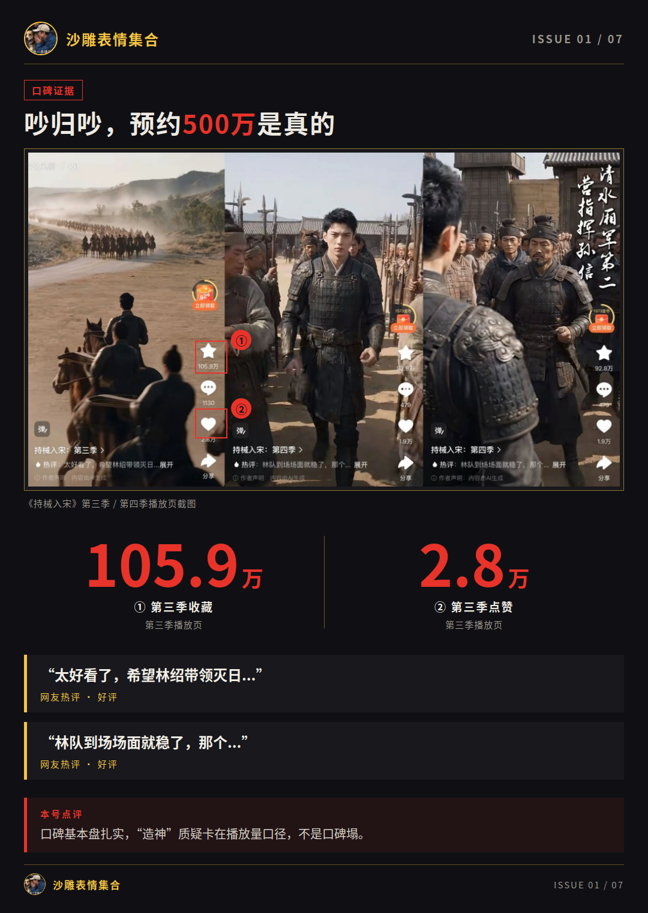

# 《持械入宋》9.5分爆火，36氪却说是场造神

一部剧能有多分裂？《持械入宋》在红果APP上挂着9.5分、1.9万人打分，转头就有媒体说它的爆火是一场“造神运动”。这瓜我端着看了半天，越看越觉得有意思。11月14日查红果，分数确实还挂在9.5；另一边36氪编辑部看完全剧，认为它的制作质量在AI短剧行业最多算中人之姿。而制作方对封面新闻给出的口径是，截至11月7日播放突破120亿。

## 9.5分和“造神”，到底信哪个？

家人们先别急着站队。我认为这个分歧压根不在“好不好看”，而在“火得是不是实至名归”，这是两个频道的问题。

一边是1.9万人真金白银打出来的9.5分，一边是媒体编辑部看完直摇头。你说观众瞎夸吧，人数摆在那；你说媒体乱质疑吧，人家是全剧看完才下的判断。

**两边可能都没说错，就是压根没在一个频道上吵。**

## 夸的和骂的，压根不在一个频道

我把评论区的动静捋了捋，正反两边的关注点几乎完全错开。

夸的人集中夸剧情落点。有人说整体不拖沓、构思好、人物刻画深入人心；反套路无金手指带来延迟满足的爽感；家国情怀和历史意难平是不少人追下去的动力。评论区还有人喊出“我的天啊第三季结尾攻城这里看得人热血沸腾”。更绝的是，有观众自发做二创，甚至给这部剧开发了配套讲解宋史的网站，这传播劲头在AI短剧里真不多见。

骂的人盯的是另一头。有批评观点认为该剧仍有爽剧执念，通过先知视角和先发技术简化了北宋的系统性困局；画面上也有人吐槽，“这一季的画面质量真是太差了 让人出戏”。

一边聊剧情落点，一边盯画面和套路，频道都不同，吵不出结果太正常了。

## 40亿、66亿还是120亿？这瓜越吃越晕

真正让“造神”说法有市场的，是播放量口径的时间线。

11月初上观新闻和半月谈称全网超40亿；界面新闻11月9日写66亿；制作方对封面新闻称截至11月7日突破120亿。

**三天两个数，从40亿跳到120亿，这曲线看得我瓜子都掉了。**

但硬数据这边，热度是真的能互相咬合。红果站内各季累计收藏1141万，单季最高热度8206万，前十季平均热度接近5000万；第十一季上线前预约量突破500万。横向看大盘更明显：今年22.19万部AI短剧里只有0.48%播放破亿，这部剧明显跑赢了行业平均。再叠加QuestMobile监测的红果日活1.68亿、同比增长107%，盘子本身就大。

我的看法是，具体数字的口径可以存疑，但收藏、预约、大盘对比这几个维度互相印证，这热度大概率不是凭空吹出来的。

## 吵归吵，预约500万是真的

综合下来，评分、预约、二创、大盘数据都指向一个方向：这部剧的口碑基本盘是扎实的。“造神”的质疑主要卡在播放量口径上，属于数字层面的瓜，不是口碑层面的塌。

观众自发育出宋史讲解网站、自发二创力挺，这种传播在AI短剧里少见，算得上口碑最硬的证据。

数字的瓜可以继续吃，但1.9万人打出的9.5分和500万预约摆在那，这波热度含金量不低。后续播放量口径有新动静，我再跟大家唠。
