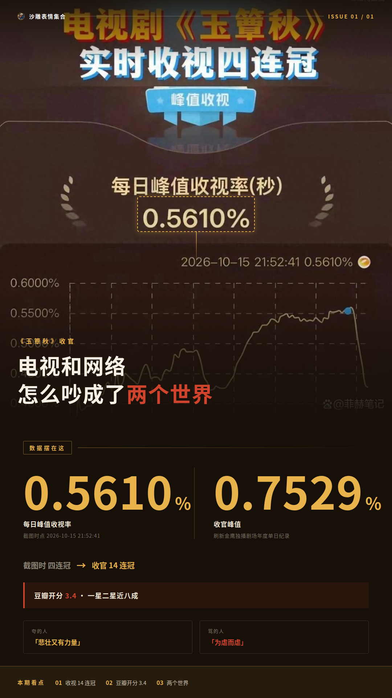
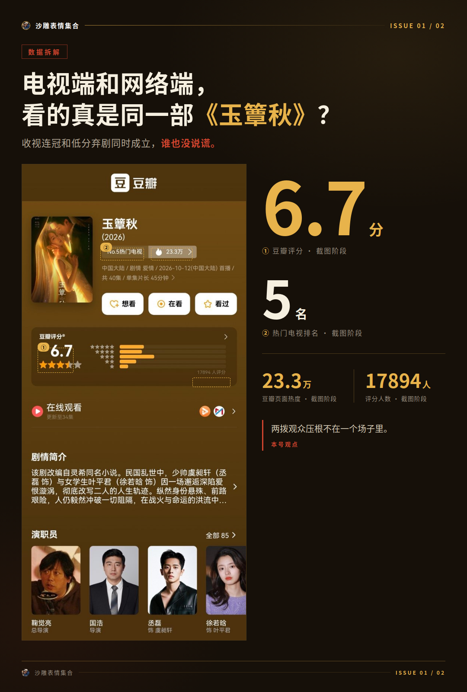
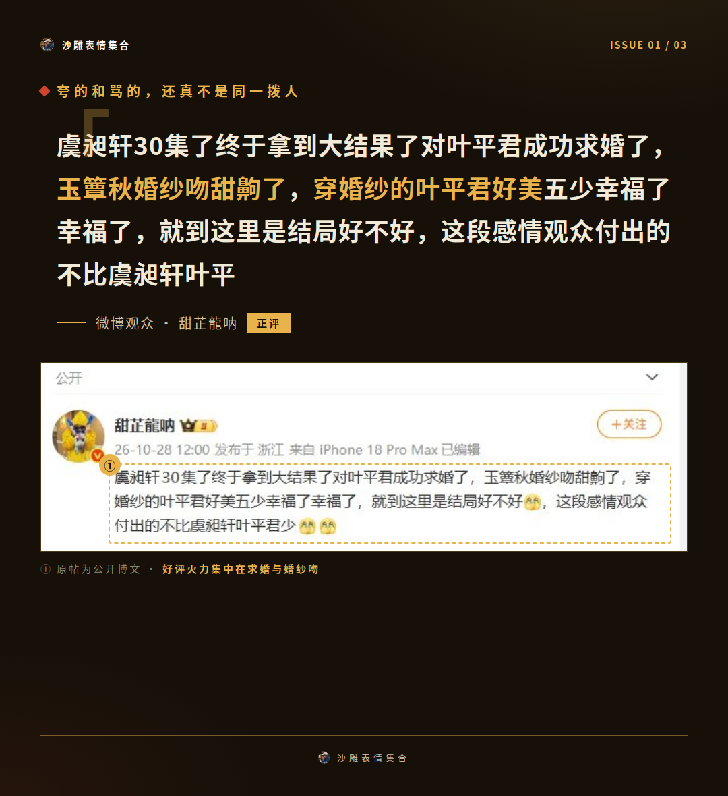
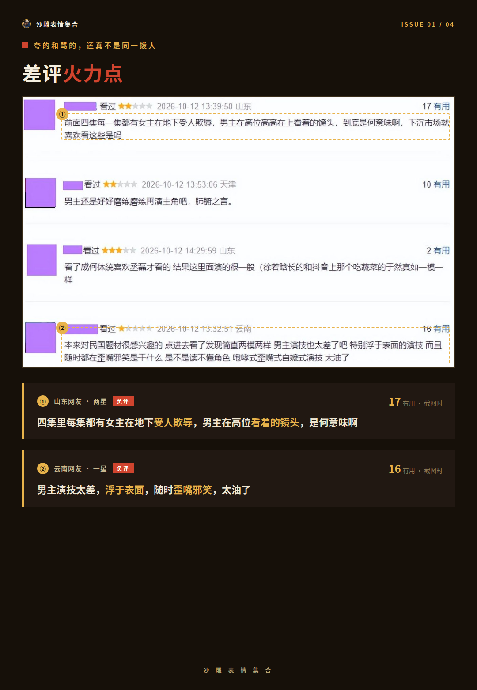
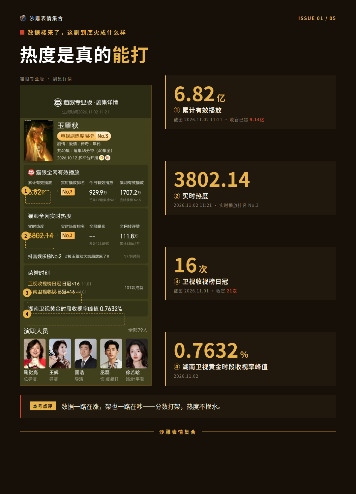
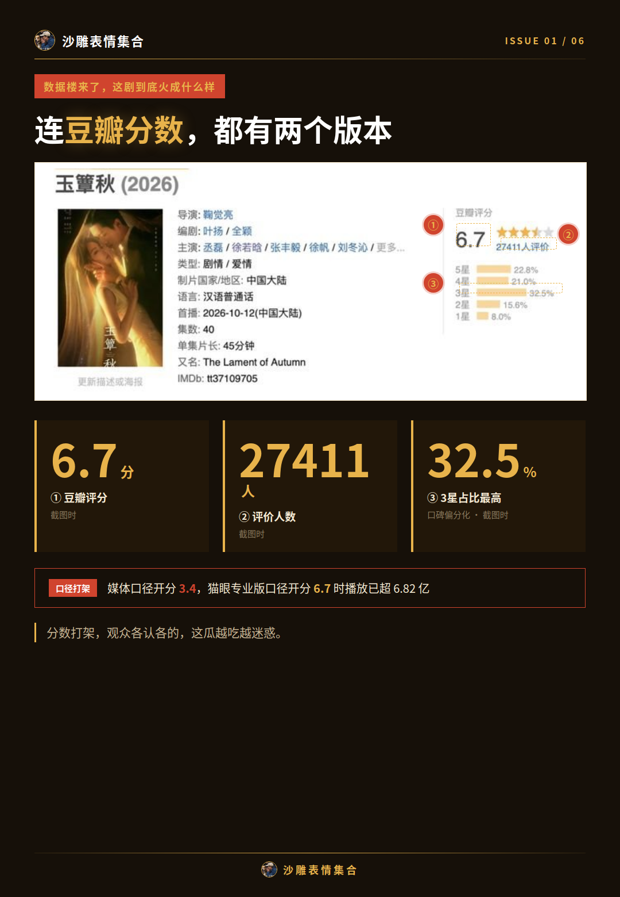
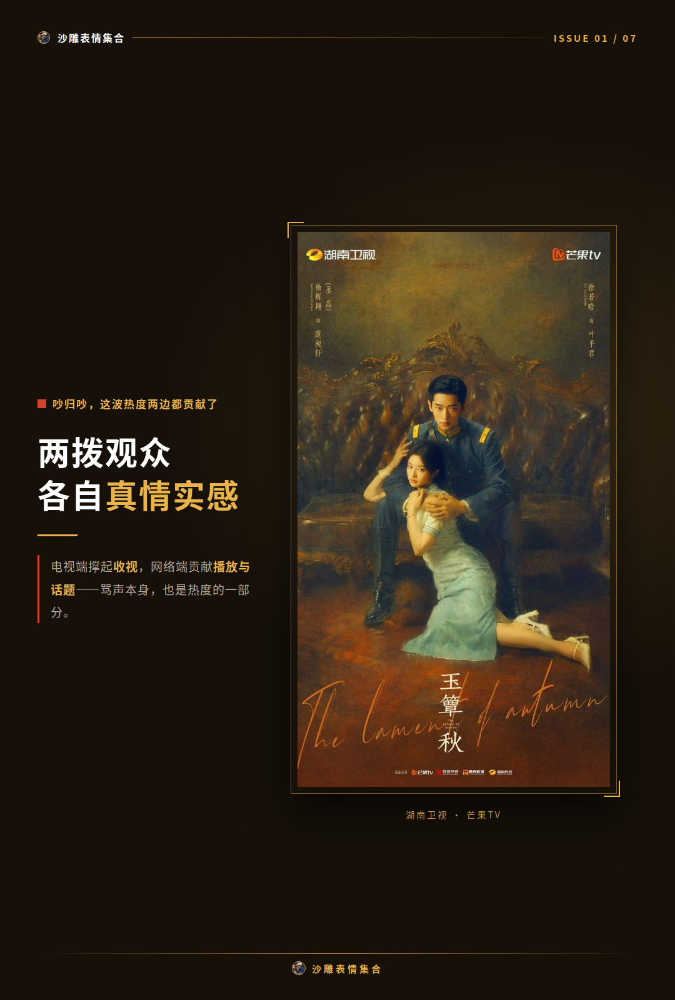

# 《玉簟秋》电视和网络，怎么吵成了两个世界

一部剧收官了，怎么电视观众和网络观众聊得像两部剧？《玉簟秋》大结局一出来，夸的人说“悲壮又有力量”，骂的人说“为虐而虐”，谁也不服谁。可数据摆在这：湖南卫视实时收视14连冠，峰值0.7529%，刷新金鹰独播剧场年度单日纪录；另一头，有媒体口径显示豆瓣开分3.4，一星二星加起来接近八成。

## 电视端和网络端，看的真是同一部《玉簟秋》？

我认为这不是简单的火或者扑，是两拨观众压根不在一个场子里。电视那头合家欢看得起劲，网络这头吵得昏天黑地，收视连冠和低分弃剧同时成立，谁也没说谎。

## 夸的和骂的，还真不是同一拨人

先看好评都在夸啥。有人就吃民国戏码的氛围，直说“民国的戏码我喜欢”；结局的安静留白也被点名，最后一集不少画面没刻意煽情，就这么平平淡淡地叙事，反而看得人一直流泪。还有一批观众对“强制爱”的设定很上头，觉得男主为爱低头的戏码看着过瘾。

再看差评，火力点完全不一样。女主的台词配音被吐槽最狠，大场面的情绪起伏撑不起来，听着尴尬。番外的结局也被指套路，正文收得还行，番外一出来直接劝退一批人。还有观众专门冲着营销词去的，宣传吹得太满，追剧时落差感拉满。

**差评打的是剧情套路和表演，好评打的是质感和情绪冲击，两边聊的维度都不一样，吵不出结果很正常。**

## 数据楼来了，这剧到底火成什么样

热度是真的能打。收官有效播放量超9.14亿，猫眼剧集热度总榜日冠拿了3次，湖南卫视收视日冠更是拿了21次。海外更离谱，V-Pulse华语榜持续第一，没上Netflix，却登顶了爱奇艺国际版全球热播榜，拿下七个地区华语剧第一，TikTok英文词条播放量13亿。

但弃剧数据也摆在那。行业口径显示，第三集弃剧率高达42%，约为同类型剧的三倍；三百万预约进来的观众，到第三集走了一半。前期劝退，后期收视却越战越勇，10月26日实时收视峰值之前还冲到过0.7058%，云合评级从S升到S+。

连豆瓣分数本身都有两个版本。有媒体口径显示开分3.4，另有猫眼专业版口径显示开分6.7时播放已超6.82亿。分数打架，观众各认各的，这瓜越吃越迷惑。湖南卫视10月28日起还加了下午档日间重播，双轨排播安排上，平台端看起来信心很足。

## 吵归吵，这波热度两边都贡献了

把账摆一起看：电视端观众撑起收视，网络端追更的贡献播放和话题，骂声本身也是热度的一部分。夸的地方也是真有货，制作质感被广泛肯定，上千平实景、超4000套服装，民国风貌的还原度被认为在同期剧里算上游；徐若晗还凭这剧进了华语艺人国际榜TOP3，新代言和杂志封面都安排上了。

一部剧能同时让两拨观众各自真情实感，这画面是真不多见。后续口碑走向和重播数据，本号蹲到新料再跟各位唠。
