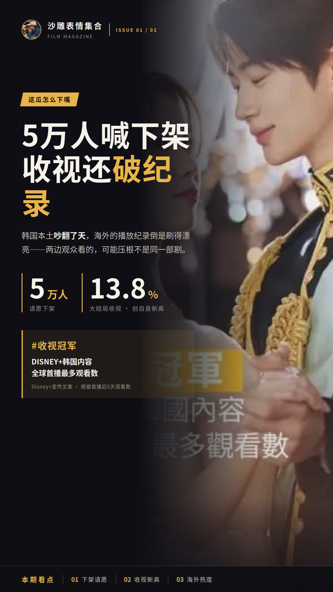
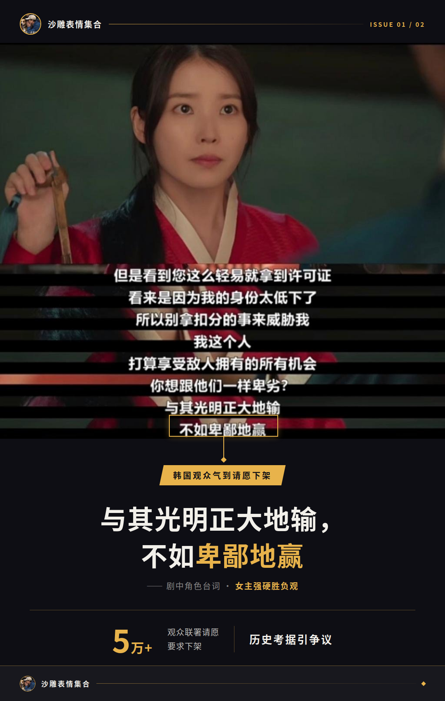
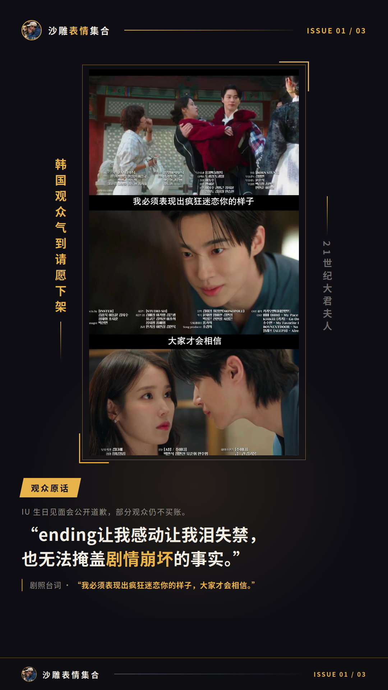
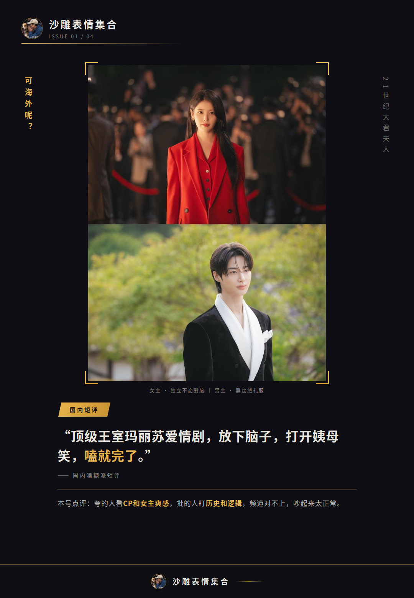
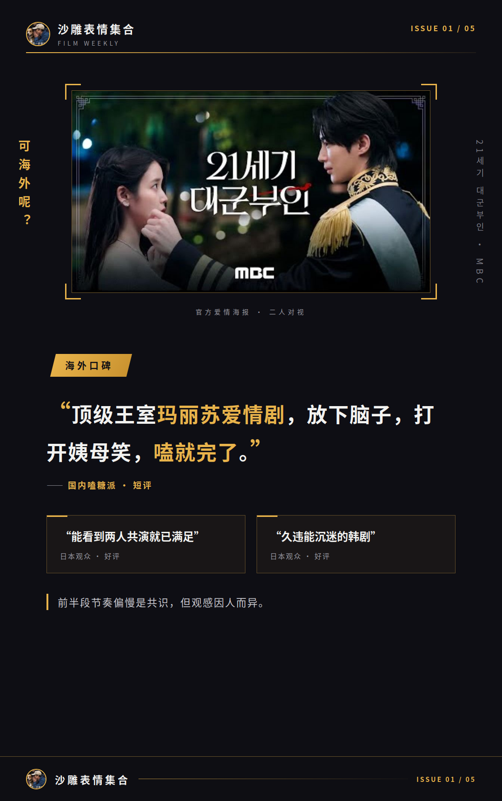
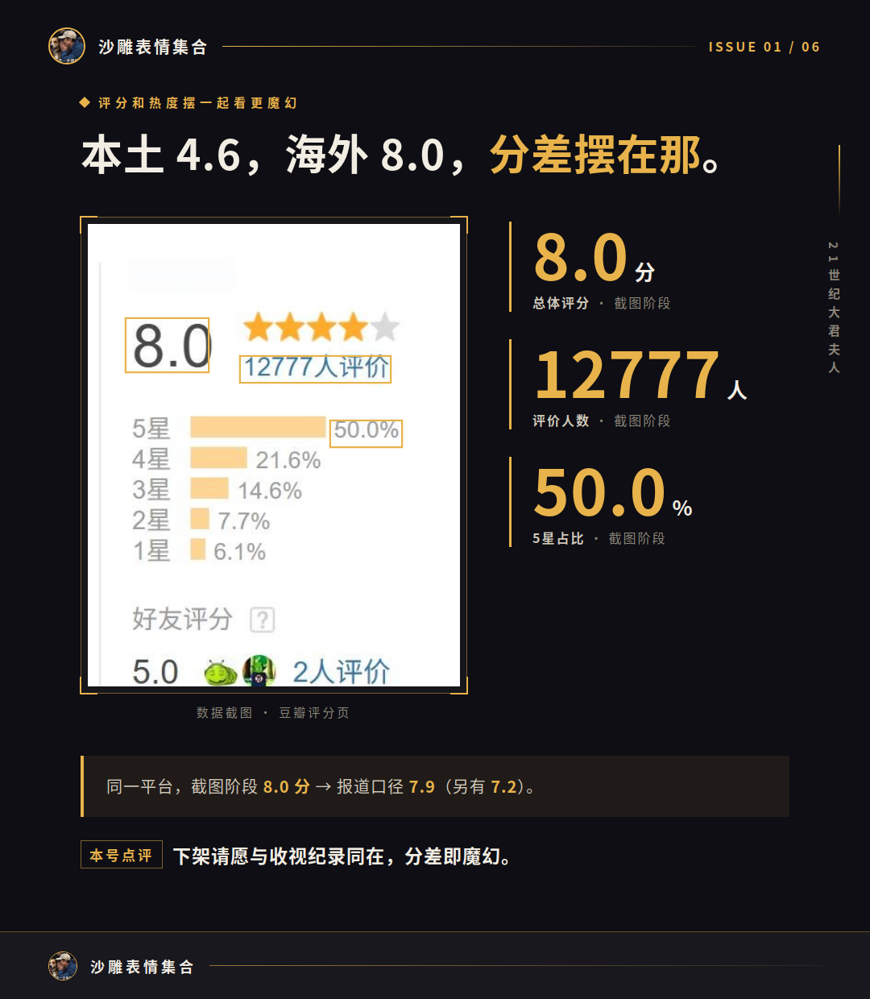

# 《21世纪大君夫人》被请愿下架还破纪录

一部剧被5万多人请愿下架，大结局收视率还能冲上13.8%创自身新高，这瓜到底怎么下嘴？《21世纪大君夫人》就是典型：韩国本土吵翻了天，海外的播放纪录倒是刷得漂亮。两边观众看的，可能压根不是同一部剧。

**5万人喊下架，收视还破纪录，这操作我头一回见。**

## 韩国观众气到请愿下架

韩网的火，主要烧在历史考据上。九旒冕冠、“千岁”称呼、中式茶道，再加上被扒出淘宝同款的茶具，被指矮化了君主的独立地位。超过5万名观众联署请愿，要求直接下架。

IU在生日见面会上公开道了歉，韩网部分观众还是不买账，觉得主演对剧本选择也该担一份责任。

演技和剧情这边也没躲过去。IU和边佑锡被部分观众批尴尬、表演过头，故事被指老套，政治戏份比爱情还多。有观众的原话是：“ending让我感动让我泪失禁也无法掩盖剧情崩坏的事实。”

从韩网的动静看，火气主要对准历史考据和创作选择，倒不算无差别开喷。

## 可海外呢？

正面口碑同样成规模。女主独立、不恋爱脑的人设和台词，被赞击中了观众的期待。国内嗑糖派的声音很响，有短评是这么说的：“这部剧就是一部顶级王室玛丽苏爱情剧，放下脑子，打开姨母笑，嗑就完了。”

日本观众那边好评也在流传，“能看到两人共演就已满足”“久违能沉迷的韩剧”这类评价不少。前半段节奏偏慢是共识，但观感因人而异。

我的看法是：夸的人看的是CP和女主爽感，批的人盯的是历史和逻辑。两拨人频道都对不上，吵起来太正常了。

## 评分和热度摆一起看更魔幻

先看评分。韩国本土观众打分4.6，豆瓣7.9（另有报道为7.2），JustWatch 7.8，样本量6.9k。同一个平台，本土和海外的分差摆在那。

再看热度。大结局全国平均收视率13.8%（Nielsen Korea全国口径），创自身最高纪录，也是MBC历代金土剧第三。Disney+上线首月全球累计播放超4300万小时，成了平台28天内全球观看次数最多的韩剧。

业界口径也得摆出来。JoyNews24创刊22周年问卷里，142名娱乐业界人士参与投票，它拿45票当选年度最差电视剧第一，第二名才9票。注意，这是业界问卷的结果，不是我的定性。

请愿下架和全球播放冠军同时成立，两边都没说谎。

下一部剧还能不能吵成这样？我搬好小板凳等着了，有新瓜第一时间端上来。
