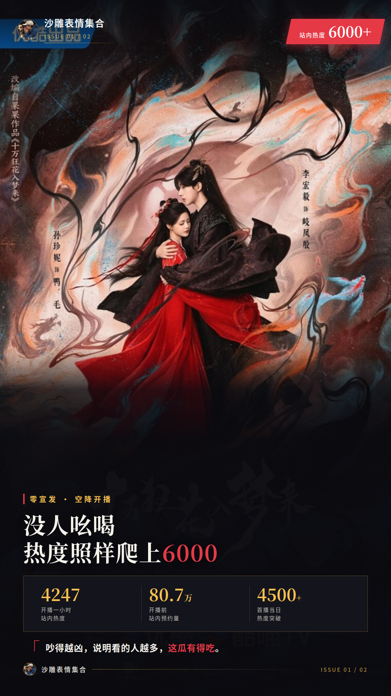
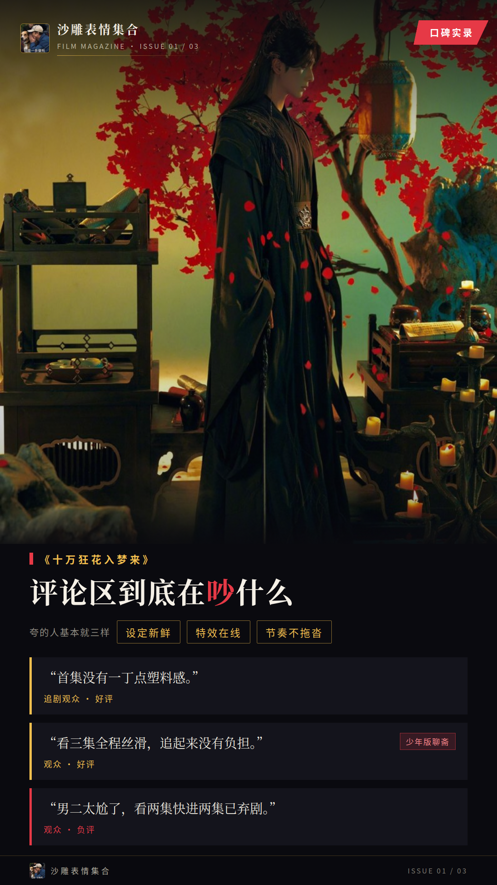
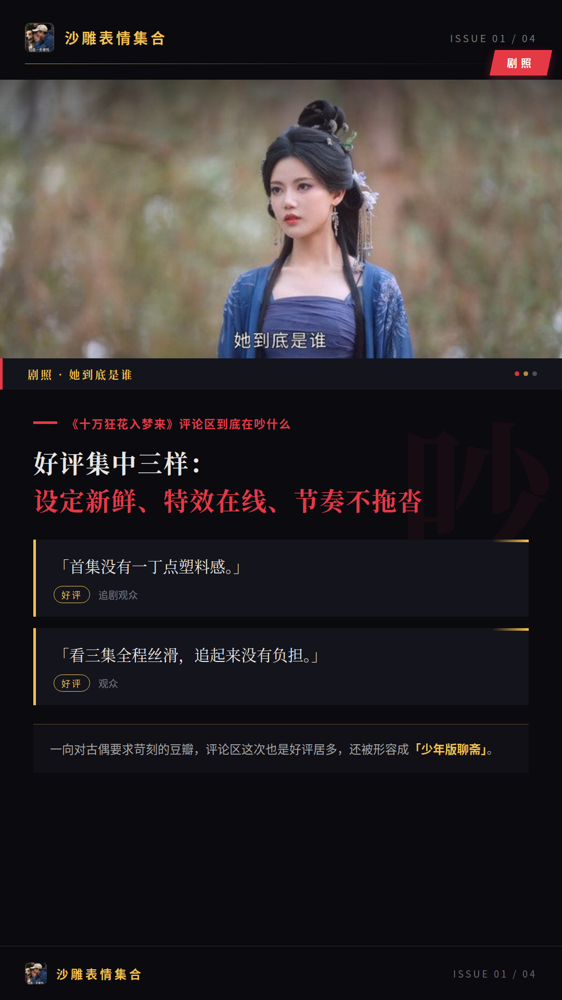
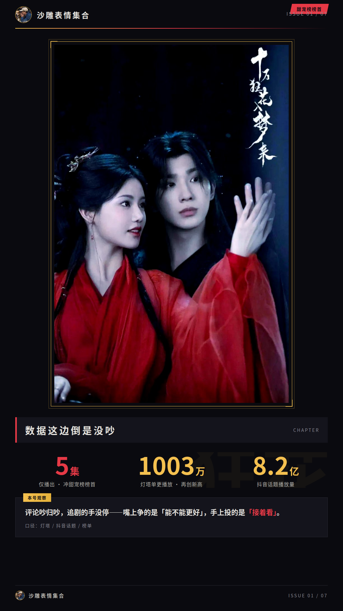

# 《十万狂花入梦来》没宣发，热度爬上6000

一部剧零宣发、没吭一声就开播，评论区还吵成两半，热度居然越吵越高，这事你敢信？《十万狂花入梦来》就这么干了。11月15日优酷空降开播，开播一小时站内热度冲上4247，直接登顶站内榜单，首播当日热度突破4500，之后一路爬到6000+。 

更离谱的是，这剧开播前几乎没怎么吆喝，站内预约量倒先攒了80.7万。开播之后热度攀升的速度，跟宣发投入完全不成正比。我认为这就是典型的零宣发空降打法：没人递话，观众自己用脚投票。 

口碑这边呢，褒贬之声交织，成了近期仙侠志怪赛道里争议最大的新作。

**吵得越凶，说明看的人越多，这瓜有得吃。**

有人看完只丢一句“我必须要给一个好评，本来随便点开的，居然意外的很好看”，也有人开局就嫌。两边都没闲着。 

## 《十万狂花入梦来》评论区到底在吵什么

先把好评那边的主题捋一捋，夸的人夸得挺集中，基本就三样：设定新鲜、特效在线、节奏不拖沓。特效和视听质感的好评尤其密，打戏结印特效被夸“酷炫”，画面干净，没有乱七八糟的滤镜。有追剧观众直接说首集“没有一丁点塑料感”。 

单元叙事这块的口碑也不错。前4集把主角团人设交代完，第一个《诡洞》单元完整收了尾，有观众称“看三集全程丝滑”“追起来没有负担”，还被形容成“少年版聊斋”。一向对古偶要求苛刻的豆瓣，评论区这次也是好评居多。 

嫌的人嫌什么？也很具体。节奏评价是分化的：有人说开篇直接入主线、没有冗长铺垫，也有人觉得第一集偏缓、第二集起才渐入佳境。表演和剧情走向也出现了不同声音，不是一边倒。有位观众的原话挺狠：“男二太尬了，看两集快进两集已弃剧。” 

夸的夸设定、特效、节奏，嫌的集中在第一集节奏和部分表演，分歧点其实很具体，不是笼统互喷。夹在中间的还有这种：“好看，开局搞笑像个喜剧，单元副本还挺诡异的，男女主相互下手都挺狠。”一边嫌一边追，才是这剧评论区的真实生态。 

## 数据这边倒是没吵

评论区吵归吵，数据那边安静得很，而且全朝一个方向走。仅播出5集，就冲上了甜宠榜榜首（榜单口径）。灯塔播放量也连着几天维持高位：周六999.1万上下，次日950万左右，单更当天直接冲到1003万，再创新高（灯塔口径，微博用户播报）。抖音相关话题播放量也飙到了8.2亿（抖音话题口径）。 

**评论吵归吵，追剧的手没停。**

播放量连续多日高位还创新高，跟“口碑两极”形成了挺有意思的对照：嘴上争的是“能不能更好”，手上投的是“接着看”。 

综合下来我的判断是：好评主题集中、热度口碑双升，这是一部用口碑自己把热度顶上去的剧。两极分歧更多落在“还能不能更好”，而不是“值不值得看”，零宣发能把热度从4500顶到6000+，观众用数据替它吵完了下半场。 

热度还在爬，评论区还在吵，这瓜本号接着蹲后续口碑走向，有新动静第一时间来报。
