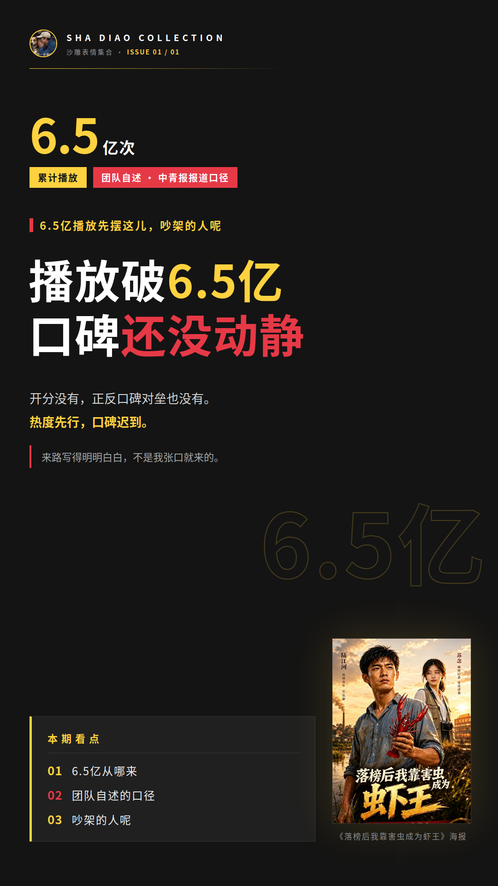
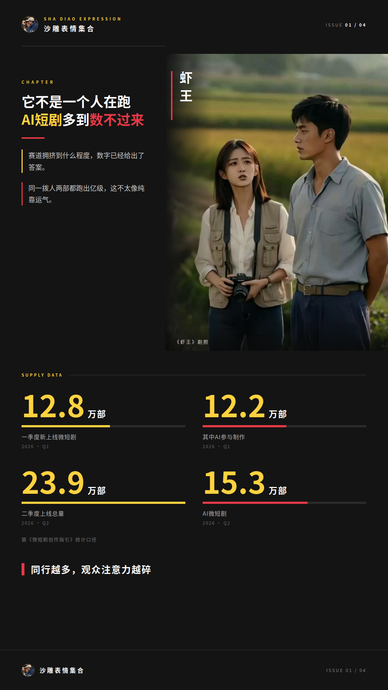
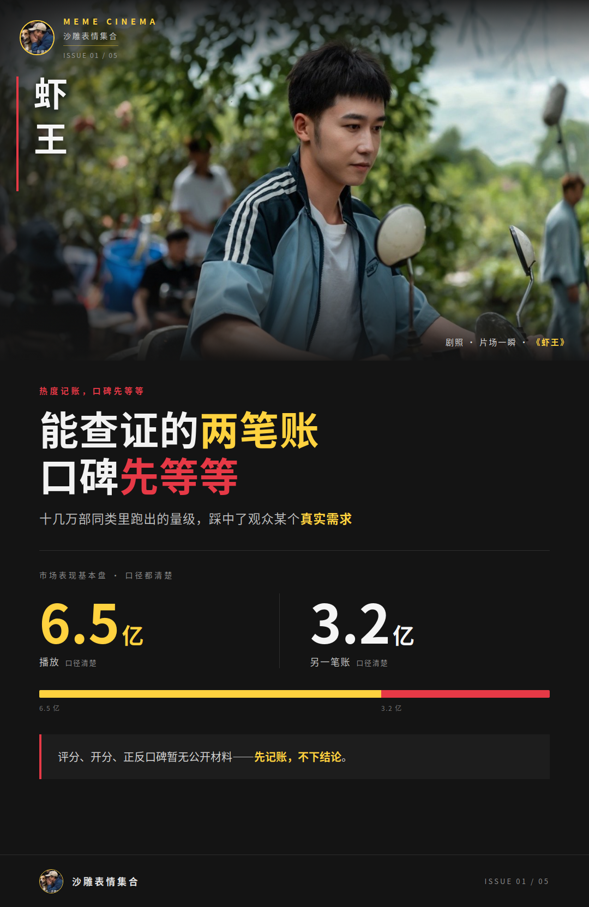

# 《虾王》播放破6.5亿，口碑怎么还没动静

## 6.5亿播放先摆这儿，吵架的人呢

《落榜后我靠害虫成为虾王》有个数字挺唬人：累计播放量6.5亿次。口径是中青报报道里团队自述的数，来路写得明明白白，不是我张口就来的。

按常理，一部剧播放冲到这个量级，评论区早该吵翻天了。可我翻了翻，公开的开分没有，成型的正反口碑对垒也没有。

**热度先行，口碑迟到，这瓜够我吃一阵子了。**

先把边界交代清楚：这篇只聊口碑和市场，剧情、表演、幕后一概不碰。缺的料不编，有几分证据说几分话。

## 它不是一个人在跑，AI短剧多到数不过来

单看6.5亿，你可能会想：会不会是一次性爆冷？再看一层就不是了。这个团队第二部作品的播放量已经到了3.2亿次，同一拨人两部都跑出亿级，这不太像纯靠运气。

把镜头拉回行情本身。据《微短剧创作指引》的统计口径，2026年一季度国内新上线的微短剧约有12.8万部，其中AI参与制作的约12.2万部。到了二季度，上线总量升至约23.9万部，AI微短剧约占15.3万部。单季十几万部的供给量摆在那里，赛道拥挤到什么程度，数字已经给出了答案。

还有更夸张的一层。中国网络视听节目服务协会的报告里写，2025年我国AI生成的视音频内容累计超过20亿条，比2024年涨了14倍以上。

我的判断：在这么个扎堆上线的行情里，《虾王》的播放量算得上头部。但同行越多，观众注意力越碎，口碑分化的素材只会越晚沉淀。现在就夸或者就踩，都太急了。

## 热度记账，口碑先等等

能查证的就两笔账：6.5亿和3.2亿，口径都清楚，这构成它市场表现的基本盘。

一部AI微短剧能在十几万部同类里跑出这个量级，说明它踩中了观众某个真实需求，这个价值可以先记下。但评分、开分、正反口碑，目前都没有公开材料，我不替任何人下褒贬结论。

热度这本账记好了，口碑那页先空着。等公开评分或者评论风向有新料出来，我回来对账，追更一篇。
