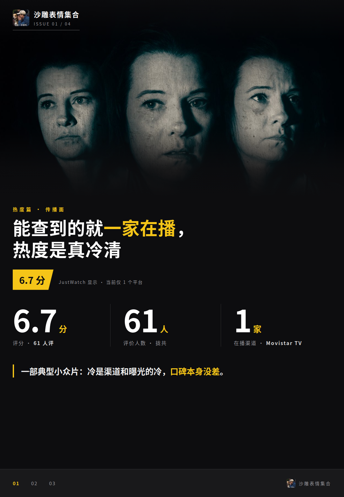

# 《Inevitable》6.7分，61人评

## 6.7分听着挺稳，打分的人是真不多

家人们，先抛个问题：《Inevitable》评分6.7，看着挺稳，可打分的人拢共才61个。这口碑到底算好还是算冷？本号老规矩，只报吃瓜进展，不替你们下结论，咱们先看数。

JustWatch上能查到的口径很清楚：《Inevitable》（2022）评分6.7，基于61个评价，片长1小时23分。

6.7这个数，过了及格线，单看确实不差。但61个评价这个样本量，搁任何一部片身上都算小的。分数不低，池子极浅，两个口径放一起看，才是这片口碑的完整画像。

**这状态大概就是：看过的人不多，看过的人没骂。**

## 《Inevitable》那条4.0分长评在聊啥

评分之外，本号还翻到一条能看的观众长评。用户叫Gallywix，来自eCartelera，给2013年那部《Inevitable》打了4.0分。评论标题是西语的《Desamores cruzados》。

他的观感挺有意思：片里"inevitable"这个词反复出现。他把这片当成对人类行为与关系的一项研究来看，压根没当消遣片。

聚类一下能看出点门道：愿意动笔写评价的观众，聊的是关系与行为本身，把这片当“研究题”来对待。场面炸不炸这种事，反倒没人提。

这里本号得把边界说清楚：素材里没有正反口碑对垒的评论，缺料不补位，这条长评是目前能看到的真实观感样本，本号不虚构对立声音。但换个角度想，我看完这条长评的感觉是：这片在小圈子里是被认真对待的。有人愿意认真写一篇关系研究向的长评，这就算个正向支点。

## 能查到的就一家在播，热度是真冷清

再看传播面。JustWatch显示，这片目前只有MovistarTV一个平台提供，“当前仅1个平台”这个口径，是热度最直观的答案。

把数拼一起：6.7的评分，拢共61个人打的，渠道就一家。能看到的评价里没有骂声，反而有人认真聊“关系研究”。

**我翻完这三个数的反应：一部典型小众片，冷是渠道和曝光的冷，口碑本身没差。**

小众片有小众片的好。想看的家人们知道去哪看、大概几分，这就够了。

后续这片的评分样本会不会变多、6.7会不会被更多人刷新，本号蹲着吃瓜，有新进展再报。
