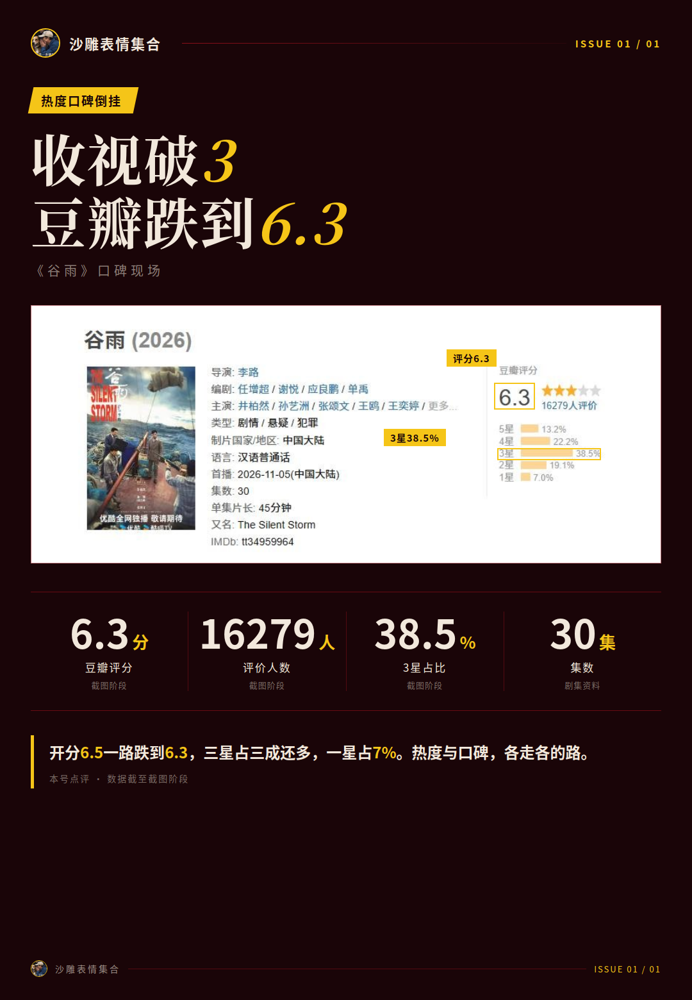
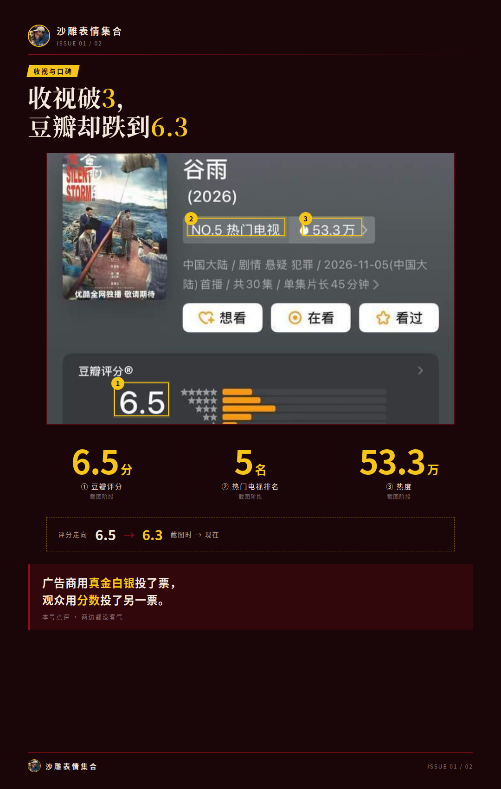
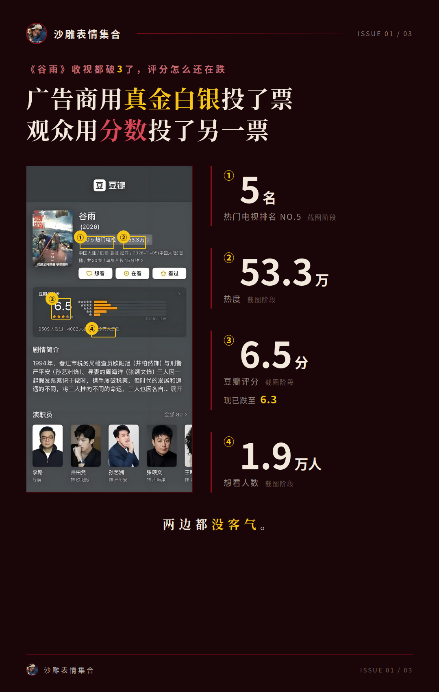
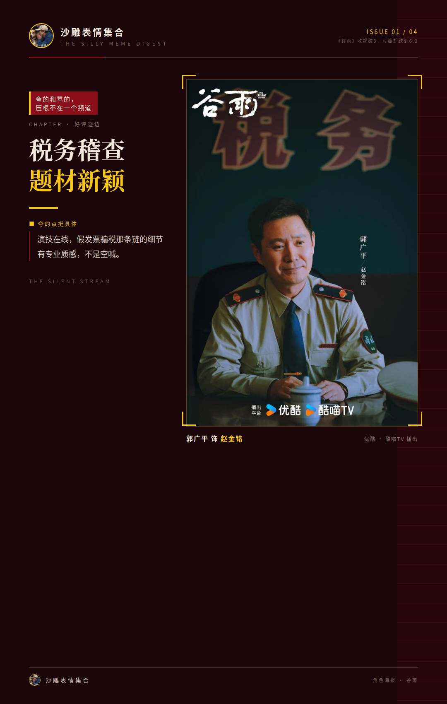
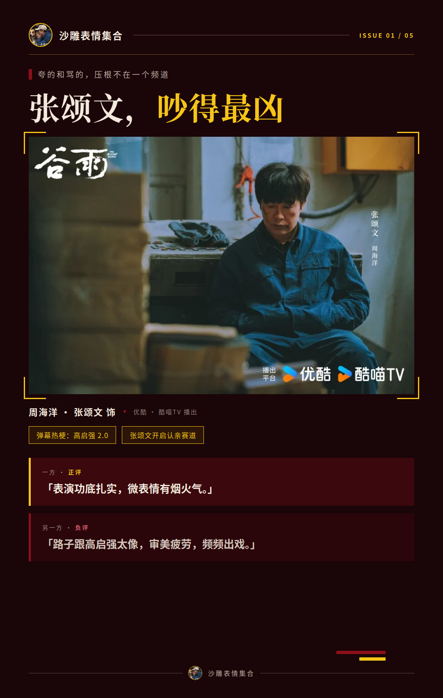
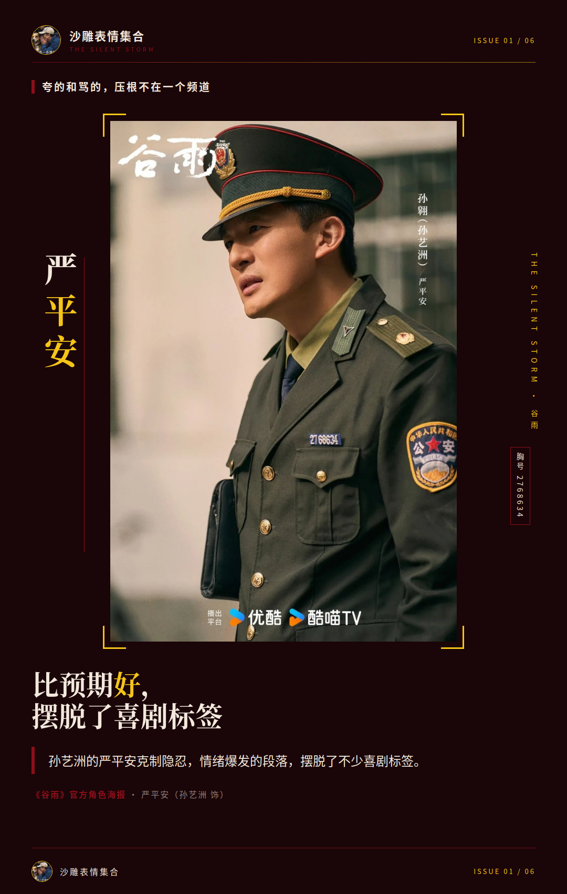
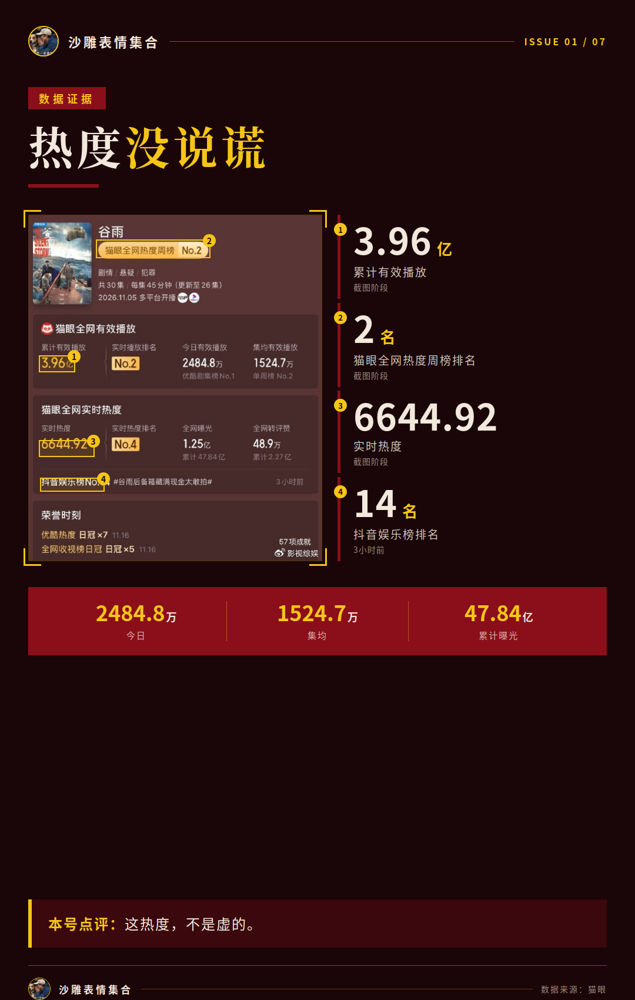

# 《谷雨》收视破3，豆瓣却跌到6.3

央八黄金档，收视峰值3.19%，优酷剧集榜连着好几天第一——《谷雨》这热度，肉眼可见地烫。可豆瓣开分6.5，一路跌到6.3，一万六千多人打分，三星占三成还多，一星占7%。

一边收视破3，一边评分往下出溜。这剧到底是火了还是糊了？我认为都不是，它就是热度和口碑各走各的路，这种倒挂本身就值得掰开看看。今天咱只聊口碑和市场这摊事，吃瓜视角，纯报进展。

## 《谷雨》收视都破3了，评分怎么还在跌

还有个细节挺有意思。开播当晚，豆瓣首批59条短评里，好评46条、差评才5条。结果后面分数还是一路走到6.3——看起来后进场打分的人，想法跟首播那晚不太一样。

首播四集就揽下34个品牌广告植入，第一集塞了8支广告。

**广告商用真金白银投了票，观众用分数投了另一票，两边都没客气。**

## 夸的和骂的，压根不在一个频道

好评这边，夸的点挺具体：税务稽查题材新颖，演技在线，假发票骗税那条链的细节有专业质感，不是空喊。

差评那边，主要说剧本推进生硬，人物动机交代不够。但差评区最大的记忆点其实不是剧本，是弹幕。开播才两天，弹幕里最常见的是“高启强2.0”“高启强换身西装又来了”。周海洋跪地敬茶喊妈那段，直接被网友拿来跟高启强给泰叔下跪认干爹对比，还玩出了“张颂文开启认亲赛道”的梗。

张颂文这边吵得最凶。一边说表演功底扎实、微表情有烟火气；一边说人物走的路子和演法跟高启强太像，看得审美疲劳，频频出戏。

配角也没闲着。井柏然争议更大，部分情绪戏偏外放，人物信念感有时被吼盖住；孙艺洲的严平安倒是比预期好，克制隐忍和情绪爆发的段落摆脱了不少喜剧标签。

还有第三派。不少观众觉得6.5分委屈，分数走低更多是感情线争议和反派洗白争议引发的情绪化打分。短评区有句原话挺典型：

**“分数翻车根本不是质量崩盘，而是舆论在疯狂报复”**

也有人看完只留下一句“看完谷雨後，五味雜陳，尤其是對周海洋的結局”。

所以你看，两拨人吵的压根不是同一个问题。一拨在评剧，一拨在评演员的重复感，还有一拨在评打分这件事本身。

## 热度没说谎，分也没冤枉谁

数据摆出来更清楚。全网有效播放量3.96亿。收官时灯塔累计正片播放量突破7.33亿，集均2444万，连续10次拿日冠，进了2026悬疑剧正片播放量榜前四。云合正片有效播放市占率一度升到16%，登顶云合霸屏榜。

第46周全端播放量4.88亿，周播放量市占率24.74%，单日播放市占率最高摸到28.28%。这热度，不是虚的。

热度说明题材和演员号召力是真的，6.3分说明剧本和演法让人不满足也是真的，两边都没造假，只是各说各话。瓜我先蹲着，有新动静再来报。
