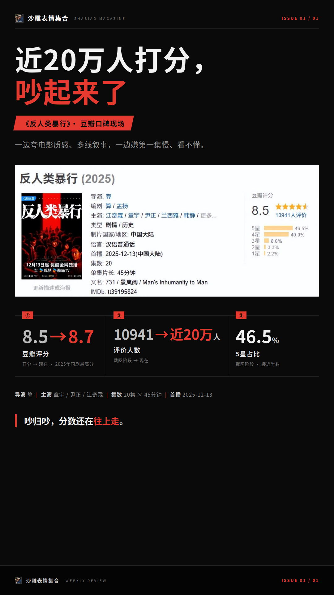
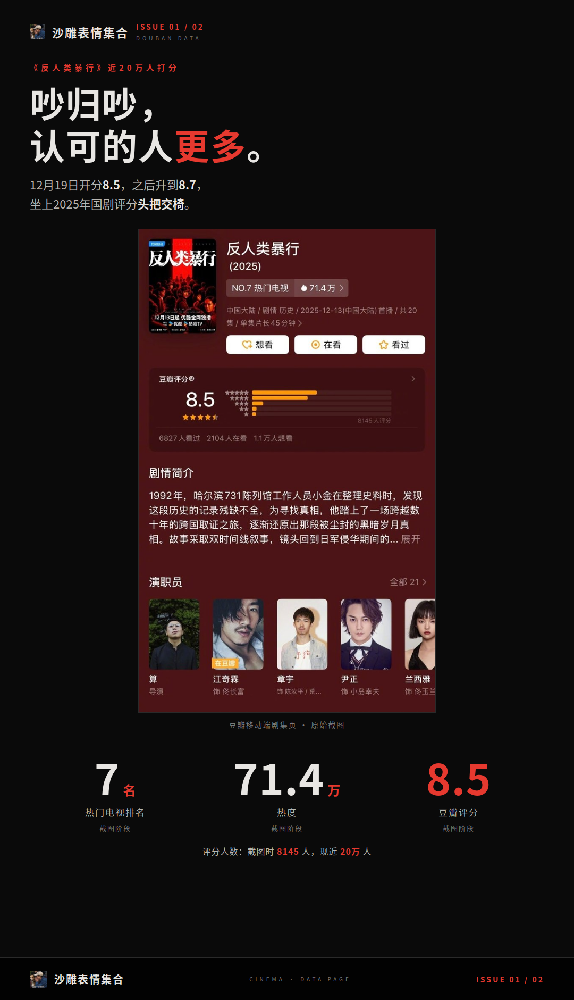
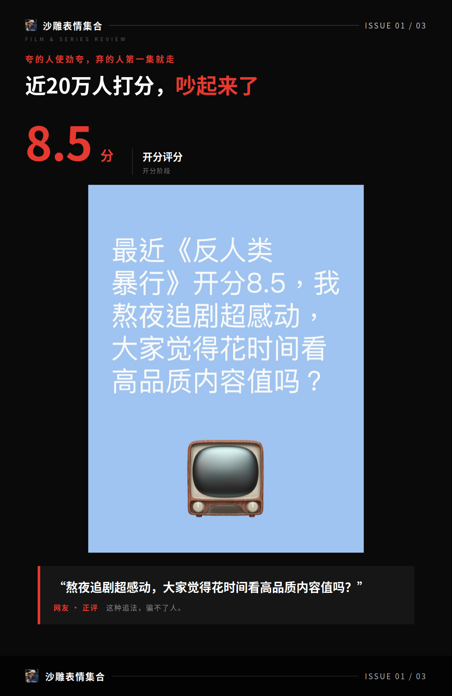
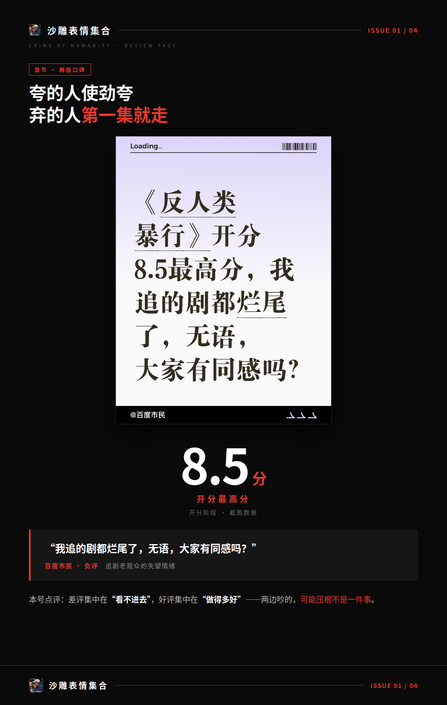
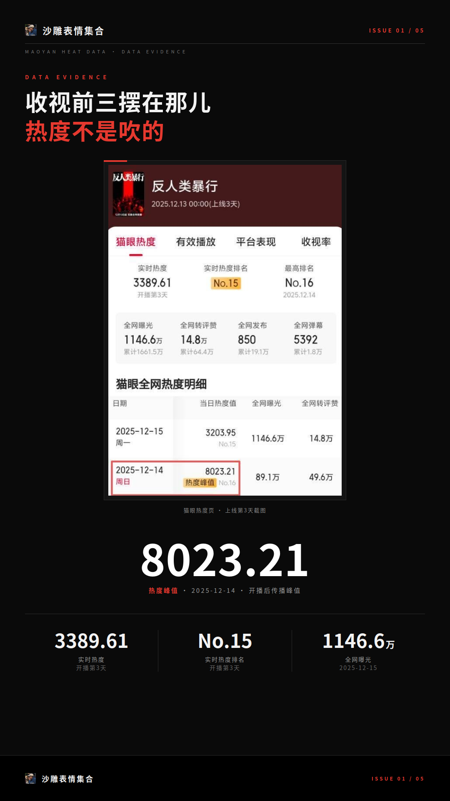
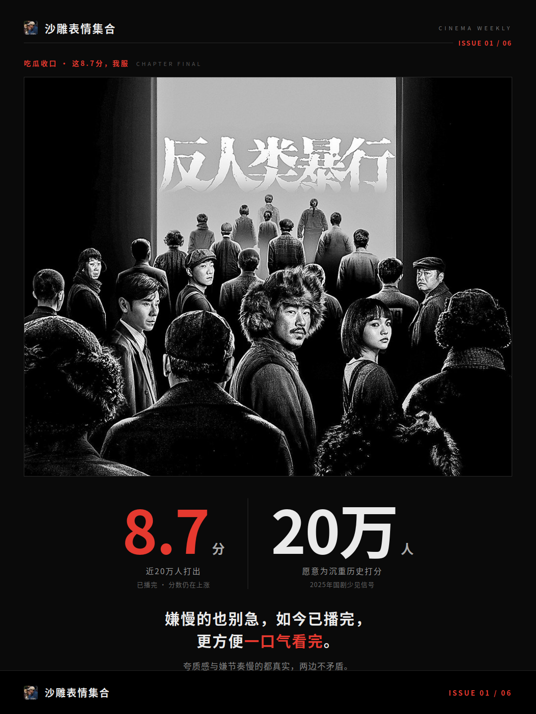

# 近20万人给《反人类暴行》打分，吵起来了

开分8.5还能一路涨到8.7，评论区却吵成一锅粥——《反人类暴行》这瓜，到底该怎么吃？先把账摆出来：12月19日豆瓣开分8.5，开播十几天，近20万人打分，现在涨到8.7，这也是2025年国剧最高分。一边夸电影质感、多线叙事、历史还原，一边嫌第一集慢、看不懂。吵归吵，分数还在往上走，这事本身就挺有意思。

## 《反人类暴行》近20万人打分，吵的点就那几个

先看数据：12月19日开分8.5，之后升到8.7，开播十几天近20万人参与打分，坐上2025年国剧评分头把交椅。

吵的点其实很集中。夸的人说质感、说叙事、说历史细节；嫌的人说第一集一个多小时讲不明白故事，说形式大于内容。两边声音都不小，但分数从8.5爬到8.7，说明吵归吵，认可的人更多。

## 夸的人使劲夸，弃的人第一集就走

好评这边，关键词是电影质感和历史还原。有观众直接说，“**这剧太精致了，不输网飞剧的水准**”。

好评里我觉得最有分量的一条，来自平房区本地观众：人家每天上下班路过罪证陈列馆本部大楼，看第二集时发现剧里本部大楼的全景跟实景对得上。历史还原这事，被住在那儿的人亲自盖了章。

沉浸度也有证据。有观众说“**手机都没有碰一下，全神贯注看完了4个小时**”，还有人攒四集一口气看完。这种追法，骗不了人。

差评这边呢，矛头很统一：第一集节奏慢、叙事绕、视角频繁切换，看着费劲。有人觉得不如直接看纪录片，也有人反过来纳闷这质量怎么才8.5分。同一部剧，两边感受差得不是一星半点。

还有一类人不算差评：题材太压抑，个人不想看。这是劝退，不是嫌质量差。我的看法是，差评集中在“看不进去”，好评集中在“做得多好”，两边吵的可能压根不是一件事。

## 收视前三摆在那儿，热度不是吹的

评分之外，市场数据也摆着：截至12月23日，CSM71城平均收视1.82%，CSM35城平均收视1.87%，都排进同时段前三。

评分端的走势也值得看一眼：8.5开分一路涨到8.7，涨分本身，就是口碑还在发酵的证据。

再给个参照：同题材电影《731》9月18日上映，票房19.4亿元。这个题材的市场盘子本来就大，剧版接住这波关注度，不算意外。

吃瓜存档一条传闻：有报道称该剧豆瓣开分后一路涨到9分，但本届金鹰奖连提名都没获得，这一说法目前尚未得到官方确认，咱们看看就好，不下结论。

## 吃瓜收口：这8.7分，我服

综合下来我的判断是：嫌节奏慢、看不懂的反馈是真的，夸质感、叙事、还原的也是真的，两边不矛盾，就是看剧的入口不一样。

能把这么沉重的历史，做成近20万人愿意打8.7、而且分数还在往上走的样子，这在2025年的国剧里算是相当少见的信号。嫌慢的也别急，如今已经播完，更方便一口气看完，有观众已经这么干了。

后续口碑走势和颁奖季的动静，本号接着吃瓜，有进展第一时间端上来。
