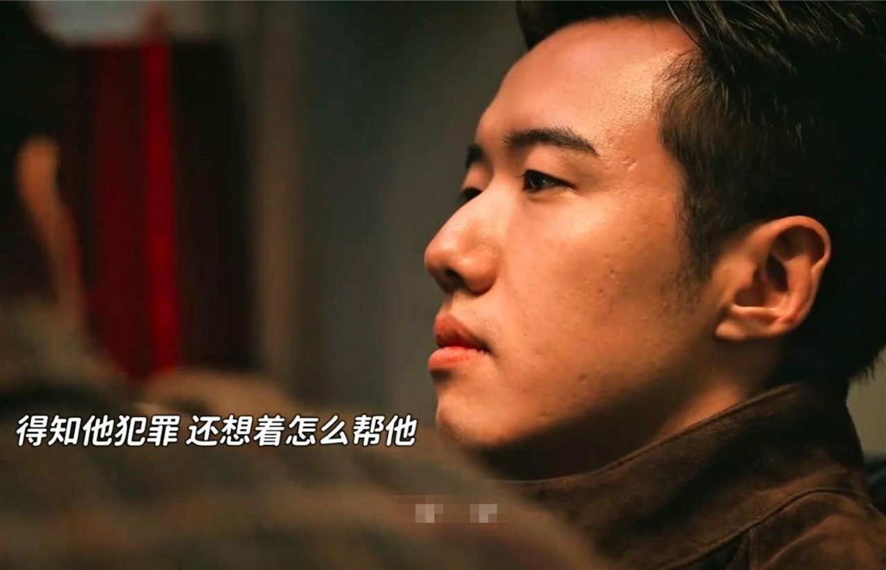
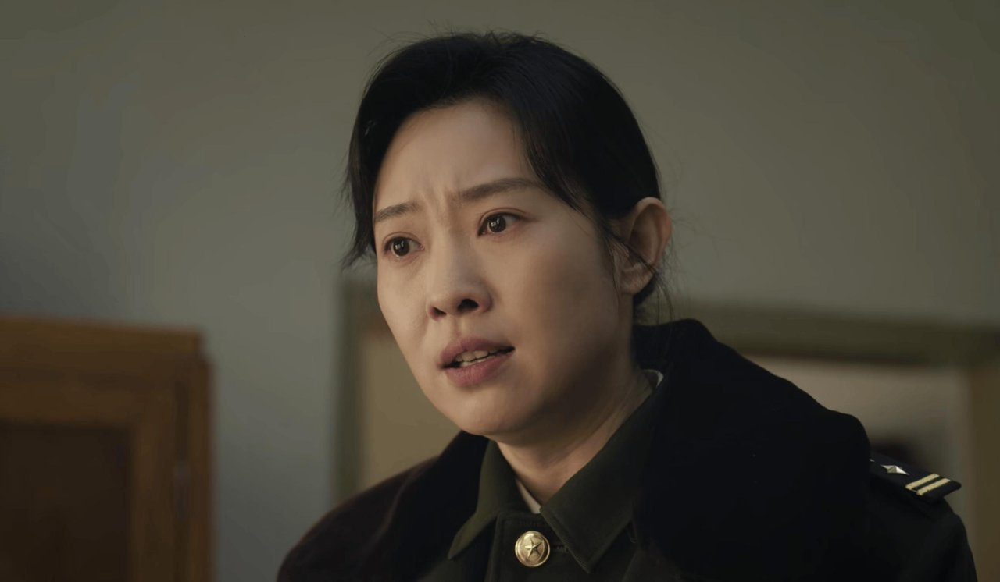
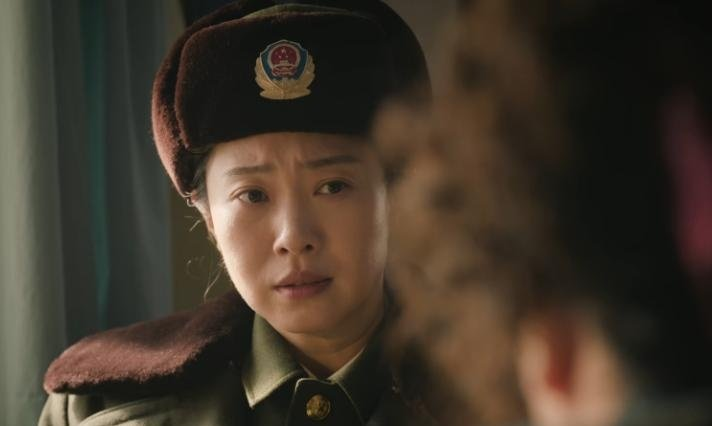
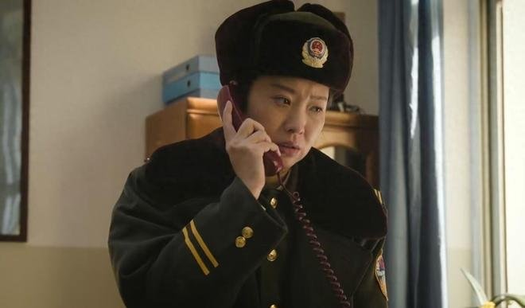

# 《余红旧事》刘阳逃出来打回去，不算正当防卫

## 看完林场那段，我第一反应是他太冤了

刷到《余红旧事》林场那段的时候，我倒回去看了三遍。第一反应就一句话：刘阳也太冤了。

**差点命都没了，追上去怎么反倒成了罪名？**

我当时满脑子就这一句。

人是差点被烧死的。工长老林在山火里对他下了狠手，他侥幸从火场爬出来，沿铁路追上去，冲突里老林他们先后死了。结果法官释法那段说，这不构成正当防卫。

第一遍看到老林下狠手那段，我心想，这下总该轮到刘阳反击了吧。

我刷到的讨论，基本吵成两派。喊冤那派，话里话外都是意难平，说穿了就一个意思：人都差点被烧死了，打回去怎么了，换你你忍得住？另一派不接情绪，直接搬出剧里法官的话：侵害都已经结束了，你还追什么。

两边谁也说服不了谁，我刷了半天也没刷出一个统一答案。

说实话，我一开始就站在喊冤那队，第一遍看完也觉得冤，第二遍开始动摇。直到法官释法那段，我才咂摸过来——按剧里的说法，逃出来再打回去，正是罪名的起点。这篇我就想讲清楚这一件事。

## 它偏不拍成爽戏，我反而更服了

按我看剧的经验，从火场爬出来、沿铁路追上去这种戏，十有八九会拍成大快人心的反杀爽戏，音乐一燃，观众爽完翻篇。

《余红旧事》偏不。它把最重的一段话，留给了后面的法官释法。

先把剧情摆在这儿。刘阳在林场边上的货运小站干活，撞破了工友偷猎、私下交易山货的事，碍了人家转运货物。山火发生时，工长老林趁他低头找工具，一扳手砸在他头上，又推倒货架把他压住，就想让他葬身火场。

按京报网刊载的法官释法，单看这一下，老林趁人不备下手、欲置人于死地，符合故意杀人罪未遂的特征。看到这儿我本以为，后面就是标准的反杀戏码。

结果它卡在了另一头：刘阳要是在最初遇袭那一下反击，还有得辩；可他是脱险之后，沿铁路追上老林他们三个，双方再次冲突，老林等人先后死亡。侵害已经结束了，你再追上去，性质就变了。

法官把这层逻辑掰开的时候，我是真的愣了一下。原来“逃出来”和“打回去”之间，隔着一整条罪与非罪的线。

有人替刘阳憋屈：那这顿打就白挨了？也有人说，白挨是白挨，追上去就是另一个案子了。

我刷到有人说得挺准：“三个剧情片段，带我们从法律视角寻找答案。”

这段我服气的地方就在这儿。它不糊弄法律，把“正在进行的不法侵害”这条边界，老老实实讲给观众听。这是写实，也是对观众的信任。

## 当年昆山反杀案，吵的也是这条线

先把口径说清楚：剧是剧，现实是现实。法官释法是剧里的说法，不能把剧情结论直接套到现实个案头上。

但这条线，现实里是真吵过。2018年的昆山反杀案，据新华每日电讯、北京青年报等报道，于海明被刘海龙持刀连续击打，夺刀反击；他后面追砍的那两刀，当年同样引发公开讨论——吵的就是“追上去还算不算防卫”。

最后警方、检方认定正当防卫，依法撤案。这个结果，当年算是让很多人吃了颗定心丸。

当年那段监控视频一放出来，大家翻来覆去地看，都想自己看出个结论。剧里这段播完，观众掰扯的是沿铁路追上去这一程。隔了这么多年，卡的还是同一个点。

对照着看就有意思了。昆山案里，砍刀刚甩落，刘海龙还上前抢刀，被致伤之后也没有放弃侵害的迹象，危险是“正在进行”的。刘阳呢？他是从火场爬出来之后，沿铁路追上去的。差的就是这一步。

最高检指导性案例里说得更细：侵害被暂时制止、但对方还可能继续实施的，仍属正在进行；判断要立足防卫人当时所处的情景，按社会公众的一般认知来，不能苛求防卫人。

所以现实里这条边界，是一帧一帧核出来的。有句话我刷到之后一直记着：“为了复原案件事实，我们和侦查人员一帧一帧反复查看现场监控录像。”

看完这些再回头看剧，我反而更理解它为什么非要这么拍——它想把现实里这条来之不易的边界，原原本本交给观众。

## 哪儿一般？这段说实话有点费脑子

情绪和法理叠在一起，第一遍看容易光顾着紧张，法官释法那段信息密度不小。

**我是倒回去第二遍，才咂摸出味道的。**

对只想看个痛快的观众来说，这段可能不算友好。我猜到时候评论区也会分成两拨，一拨觉得法理戏拖节奏，看得不过瘾；一拨觉得这才是这剧最值钱的地方，宁可多费点脑子。

但对我来说，正是这份“费脑子”让我服气。它把正当防卫的边界画清楚了，护住的是我们这些可能遇上事的老实人。还有一句我印象特别深：“审判还了我公道，我在街坊邻居面前抬得起头来了。”我读到这句的时候，忽然明白这剧较真较的是什么。

所以这段我是真心愿意安利的，值得倒回去再看一遍。

抛个站队题。如果你是刘阳，从火场里爬出来的那一刻，你会怎么选——

A. 沿铁路追上去，当面讨个说法

B. 先保命、报警，把剩下的交给法律

评论区站队。说真的，我希望选B的多，但我猜A不会少。
