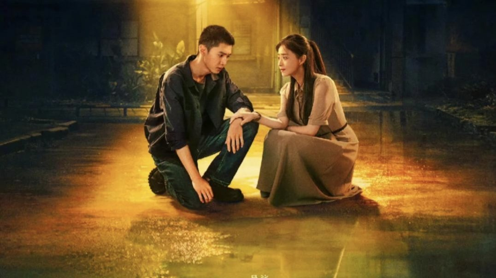
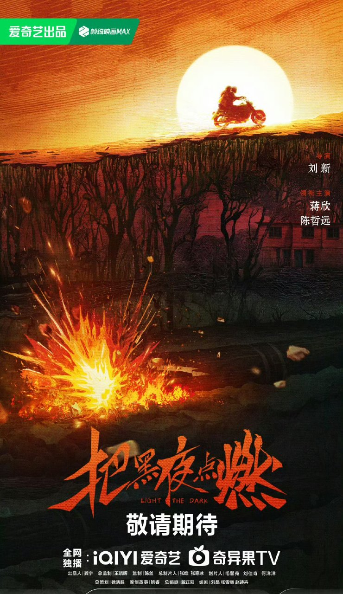

# 把黑夜点燃：家家过上中产日子，善哥困在当年

## 追完《把黑夜点燃》这几集，我心里堵着一句话

说实话，追平这几集之后，我心里一直堵着一句话：这剧最扎我的不是爆炸案，是四年后那一幕——雾港家家户户都过上中产日子了，善哥还像把自己关在了1997年。

我是10月15日刷到《把黑夜点燃》空降开播的。据网易报道，这是迷雾剧场空降上线的剧，一晚热度就突破了8700，首播口碑看着也不错。我本来只想点开看一眼，结果第一集看完就没停下来，一口气追到了第6集。

评论区不少人就是冲着姐弟俩去的，有人直接说：“不得不说，这姐俩不愧是主角，胆子也太大了。”我特别能懂这种心情，这姐弟俩在剧里是真敢往前冲。

我看完这6集，最想说的一句话其实特别简单。

**热闹是别人的，善哥什么也没捞着。**

这篇我就聊这一个点——时代往前跑了，有人被留在了原地。

顺便交代进度：爱奇艺目前更新至6集，全剧共12集，我已经追平。下面会聊到剧情，但尽量不过度剧透，放心往下看。

## 四年后的雾港越热闹，善哥越像个外人

官方剧情简介是这么写的：2001年，西南石油系统乘上经济发展的高速列车，家家户户都过上了中产的日子；陈善成了施工队一把手“善哥”，像行尸走肉般把自己困在了当年。

第一次看到“行尸走肉”这四个字，我还觉得是不是写重了。追完前几集回头看，一点没写重。

这得从1997年说起。按官方剧情简介，陈善一家住在西南石油单位分配的单身楼里：父亲陈福是管道施工项目一把手，母亲张文英是设计院骨干。姐姐陈英在供应站档案室上班，陈善本该顺着父辈的路进石油系统。标准的石油子弟家庭，日子稳稳当当。

当年的他，还是个舍不得家的弟弟。有人提到他时是这么说的：“这确实是个好消息，可化工厂离家实在太远，陈善总觉得父母不会同意。”就这么一句，我看着心里咯噔一下——那时候他还在为离家远近纠结，多普通的一个弟弟啊。

然后一场管道燃气爆炸，把这一切全炸碎了。父亲死在了事故里，母亲在系统内部的斗争中成了牺牲品，陈善只身离家，去抢修队谋生。这几句我复述官方简介的时候，手都是沉的。

四年后的反差是怎么拍的？据齐鲁壹点报道，剧集用1997旧案和2001新案双线并行、倒叙穿插，新的意外爆炸案把善哥拽回了当年。这里有个地方得说清：官方简介里他这四年是“困在当年”，重查旧案是被新案牵动的，跟“四年一直在追凶”是两回事。

新案里有个细节我印象特别深，观众原话是：“有一户人家被炸了，他们工程队来到院里，发现法兰片的材质不太对劲。”法兰片。据网易报道，1997年父亲生前就跟陈善提过，工地有人用伪劣法兰片滥竽充数。四年了，这个词一出来，我后背直接发麻——这不就闭环了吗。

这段对照拍出来，比爆炸场面更让我心里发沉。

**好日子是真的，被困住的人也是真的。**

## 夸和挑刺，我两边都照实说

先把容易误会的地方讲清楚。“家家户户过上中产日子”是官方剧情设定的原文，不是那段年代的普遍史实。

据国史网，全国国企从业人员从1997年的7237.9万人降到了2001年的3953.8万人；据人民论坛网，1998—1999年国企下岗分流约2200万人。剧里石油系统的红火，和现实中不少行业的下岗阵痛是两回事，行业之间的处境差异也没有定论。看剧别把设定当纪实，这句我得说在前头。

但正因为是设定，这个对照拍出来才狠。把好日子和困住的人放进同一座城，2001年的雾港越热闹，善哥越像被落在站台上的人。敢把时代列车和掉队的人拍进同一个画面，这是这剧最值得夸的地方，我是真心这么觉得。

我觉得一般的地方，也照实说。悬疑感偏慢热，前几集更像在铺日子、铺人物——豆瓣短评区两边的声音都有：有人觉得稳扎稳打、剧本看得出是打磨过的，也有人说悬疑感不算强烈、不是硬破案那挂的。

演技上，蒋欣演的姐姐外表克制、内里翻涌，这个劲儿是真的稳；可男主有些场次和她的对戏接得偏平，短评区也有观众提过。这两点我追的时候确实有同感。

可回到我认的那个点：别的都可以商量，“四年前后”这个对照是立住了的。据齐鲁壹点报道，姐弟俩从隔阂反目到冰释前嫌，联手设局、以身犯险——每一步都在提醒，1997年欠这个家一个交代。

## 最后想问问你们

案子才揭开一角，但“善哥困在当年”这个人，已经立住了。12集的剧现在播到一半，后面能不能收住还不好说，可光前6集，这个人物已经够我记很久了。

悬疑之外，这剧还让我看见了一个被时代甩下的人怎么继续活——这个对照，值得被更多人看到。

所以最后抛个二选一：善哥这种“困在1997”，你站“放不下的深情”，还是站“走不出去的执念”？

我自己是来回横跳的。看到“像行尸走肉般把自己困在当年”那句，我偏向执念；可一想到他等的其实就是个交代，又觉得这是深情。评论区扣1或扣2，说说你站哪边。

追平的来对答案，还没看的自己去爱奇艺补就行，目前更到第6集。
