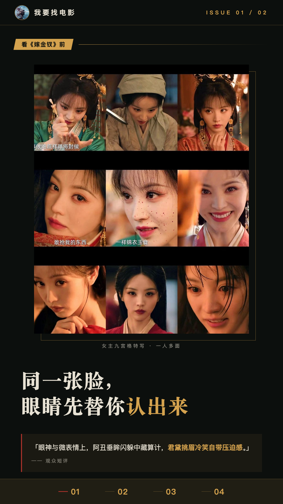
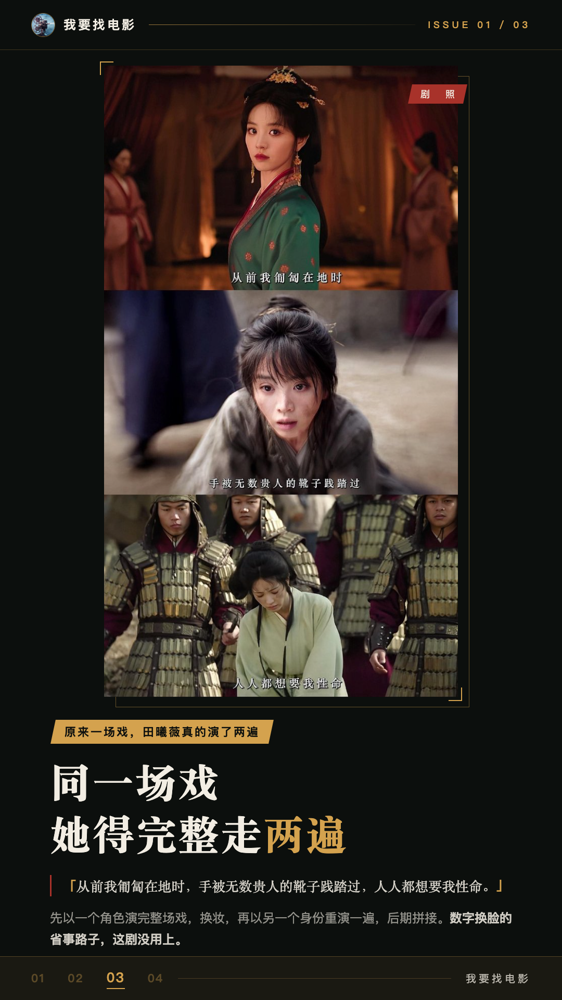
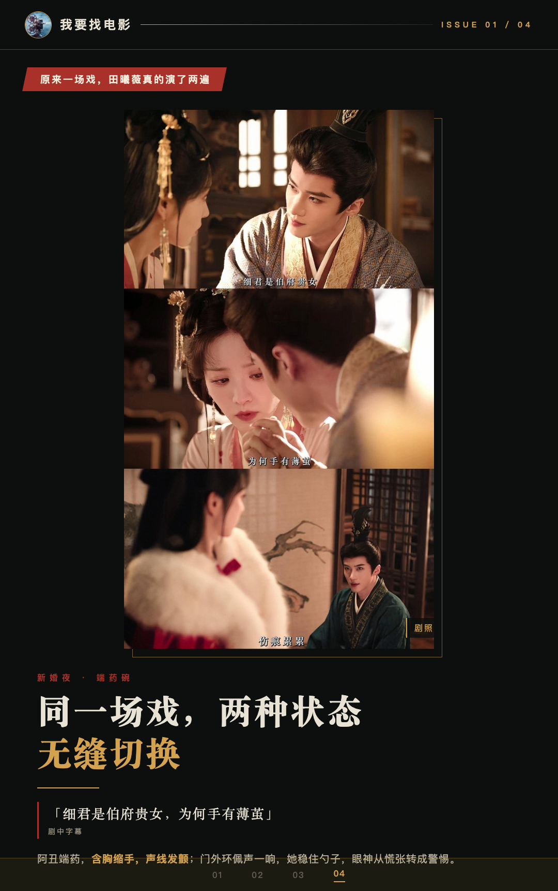
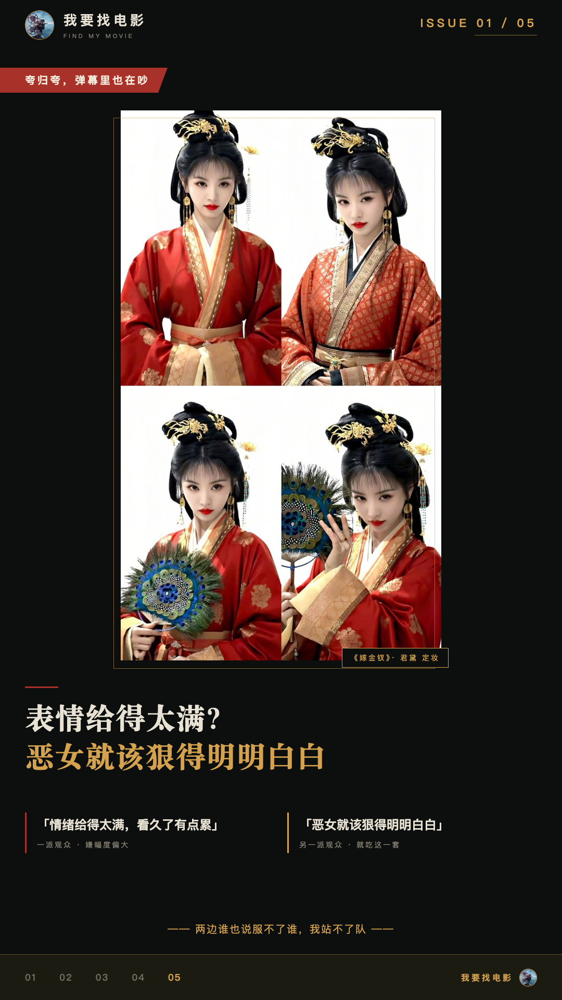
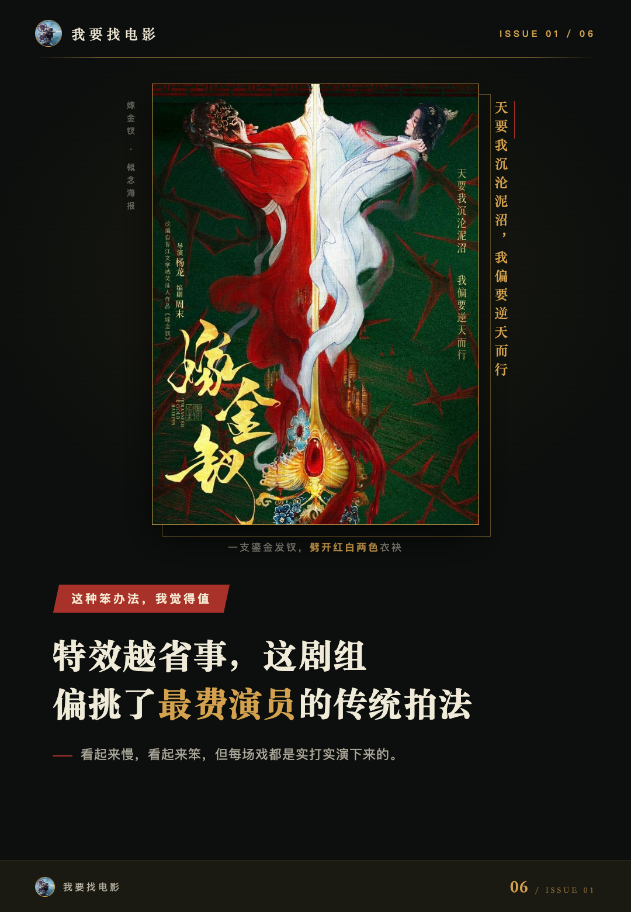

# 《嫁金钗》俩人一张脸，我居然从没认错

## 看《嫁金钗》前，我本来准备来回拖进度条

说实话，点开《嫁金钗》之前，我就做好了心理准备：一手遥控器一手暂停键，看一段，退回去认一遍人。

毕竟设定摆在那儿——田曦薇一个人演俩：一个是市井里倒夜香长大的阿丑，一个是锦衣玉食里养大的假千金君黛，俩人还是死对头。同一张脸，我怕我自己先看晕。

结果第一场对手戏，我下意识按了暂停，想停下来认认这张脸是谁的。盯了两秒我发现，多余了。

**我一次都没认错，进度条一下都没拖。**

这是我追这剧最意外的一件事。

同一张脸的两个人分得这么清，我一开始把这功劳记在特效和剪辑头上，觉得肯定是镜头切得聪明。后来看了看片会的报道才发现，账记错了。这事儿咱们下面细说。

观众短评里有句话写得挺准：“眼神与微表情上，阿丑垂眸闪躲中藏算计，君黛挑眉冷笑自带压迫感。”我的感受差不多——俩人往那儿一站，你根本不用想，眼睛先替你认出来了。

播出的事儿一句带过，不堆数据：据公开报道，这剧10月16日在CCTV-8、优酷开播，同步上了Netflix，开播两天优酷热度破万。我就是被这股热闹劲儿勾进来的。

## 原来一场戏，田曦薇真的演了两遍

先说我是怎么一步步搞明白这事儿的。

据搜狐娱乐报道，10月10日这剧在北京办了超前看片会，导演杨龙在映后环节被问到，一人分饰两角到底怎么完成。

他说用的是传统拍摄模式：先以一个角色的身份把整场戏演完，换好妆，再以另一个身份重演一遍，最后通过后期剪辑拼接。

我第一遍看到这说法，愣了一下。同一场戏，她得完整走两遍。

我琢磨了一下，这大概率意味着，她演阿丑的时候，对面站着的不是“君黛”。她得自己把两个人的戏都接住，还得让两边接得上。数字换脸那种省事的路子，这剧没用上，用的就是这种笨办法——两个角色各自立住了，后期才拼得起来。

再看声线。据潮新闻、哈尔滨日报的报道，田曦薇给魏娆和君黛设计了完全不同的两副声线。10月19日杭州的追剧团活动上，她现场原声复刻了一段台词：“天要你身为下贱，合该老老实实，一辈子待在污泥里，妄图窃取不属于你的荣华富贵，这就是下场。”

报道说，她咬字的力度、情绪的爆发几乎跟正片一致，两个声线现场切换自如。我后来自己留意过，光竖着耳朵听，确实能分出来谁在说话。

还有细节。据海外媒体报道和一些剧评，剧组用眼部的痣、手部细节和服装差异帮观众区分两个人，观众对这些小设计也挺买账。导演在看片会上也说，田曦薇下了很大功夫吃透角色，两个角色在眼神、体态、声线上都有区别。

最直观的是新婚夜端药碗那场戏，这是我看的时候自己发现的。阿丑端着药碗走向重伤昏迷的陆濯，含胸缩手，声线发颤，喂药的手抖得几乎端不稳。门外君黛的环佩声一响，她立刻稳住了勺子，眼神从慌张转成了警惕。

同一场戏，两种状态，无缝切换。我是看到这儿才真服气的。

## 夸归夸，弹幕里也在吵

写到这儿，我得把话说全乎——这剧不是没有争议。

据公开数据，它开播即拿下全国收视第一。但口碑是两极的，目前还没有公开评分，我不打算把它吹成十全十美。

正面那边的短评，有人写“又癫又爽，让人直接上头”。这个我能理解，它节奏确实快，一集里装的事儿不少。

吵得比较凶的，是君黛的表情处理。有观众觉得幅度偏大，情绪给得太满，看久了有点累；也有观众就吃这一套，觉得恶女就该狠得明明白白。两边谁也说服不了谁，我站不了队。

**但吵成这样，居然没人抱怨认不清人。**

我刷了几天评论，基本没刷到分不清阿丑和君黛的吐槽。这事反过来想挺有意思——这种演法不一定人人喜欢，可“分得清”这件事，两边观众倒是共享的体验。搞不好，这是全剧争议最小的一块。

## 这种笨办法，我觉得值

聊聊我觉得最值的一笔账吧。

据看片会报道和九派新闻，制片人秋水说过，拿到前五集剧本的时候，脑海里第一个想到的就是田曦薇，因为这姑娘“身上有劲儿、眼里有力量”，跟聪明机灵、生机勃勃有野心的魏娆很搭。

后来追剧团活动上还有个细节，我觉得跟这个眼光对得上。田曦薇用两个角色的口吻分别做了自我介绍，还顺手给两个角色的“狠”排了序：君黛的狠是“拉完了”，魏娆的狠是“夯”。她自己的解释是——君黛对别人狠，魏娆是对自己狠。

我听完这个区分，回头再想剧里那两个人，确实就是这么回事。

现在做剧，特效越来越省事，这剧组偏偏挑了最费演员的传统拍法。看起来慢，看起来笨，但每场戏都是实打实演下来的。观众能分清这两个人，说到底，是信了这两个各自完整的人。

这剧值不值得看，我不替所有人做决定。但如果你也好奇，一张脸到底怎么演出两个人——前两集就能看到答案。

你更站哪一个——对自己狠的魏娆，还是对别人狠的君黛？评论区聊聊。
