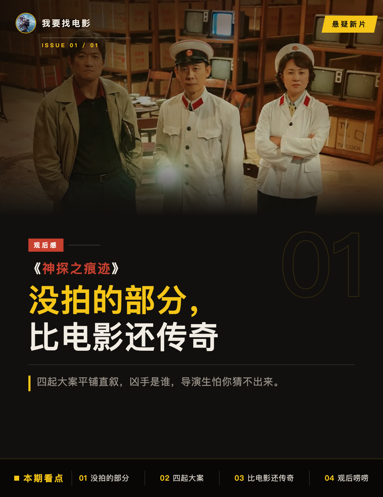
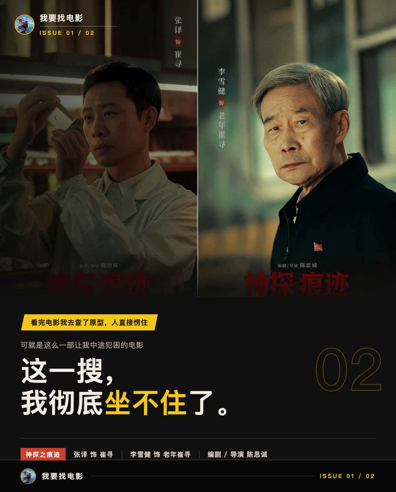
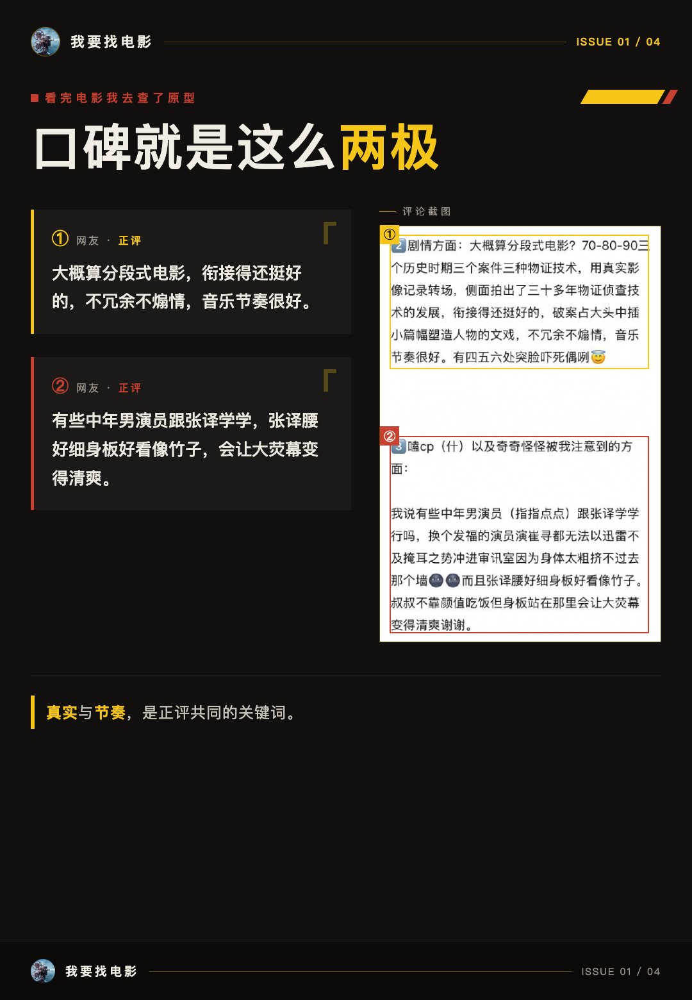
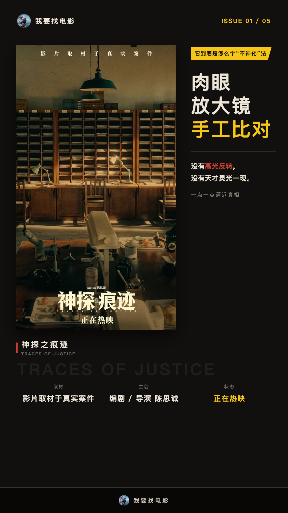
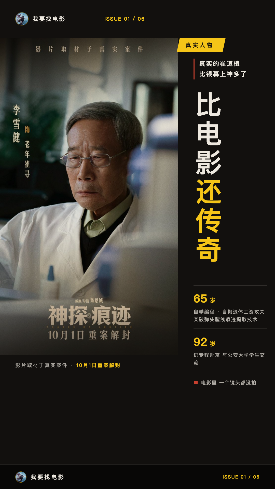
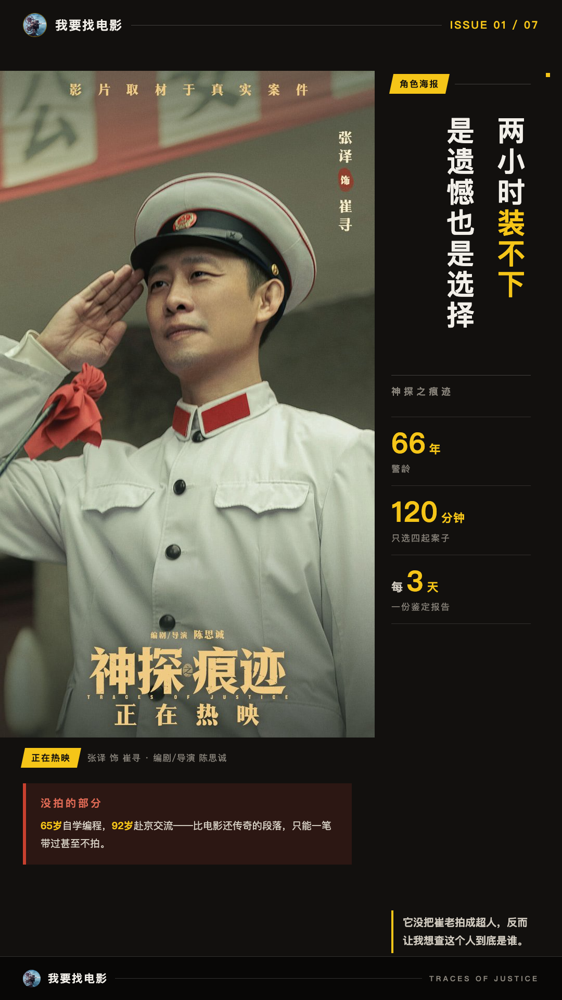

# 《神探之痕迹》没拍的部分，比电影还传奇

我昨晚看完《神探之痕迹》，今天必须来跟你们唠唠。说实话，前半段我一度觉得节奏太平了，四起大案平铺直叙，凶手是谁，导演生怕你猜不出来。

## 看完电影我去查了原型，人直接愣住

可就是这么一部让我中途犯困的电影，回家路上我顺手搜了一下原型崔道植的资料。

这一搜，我彻底坐不住了。

7000余件痕迹物证检验鉴定、参与办理1200余起重特大案件、无一差错——这些数字是新华网、澎湃新闻等多个权威来源一致确认的。平均每3天就要上交一份鉴定报告，一干就是66年。

我当时的第一反应是：**电影拍得越克制，我越觉得这个人两小时根本装不下**。

观众那边也不是一边倒。猫眼9.6分，在映新片里口碑排在最前头。可评论区照样有人嫌它不够“爽”。

也有看完的观众给出了另一种说法，我直接引原话：

“有观众看完说，片子真实还原了早年办案的困境，办案依靠反复比对物证、严谨规范的流程。”

还有人说：“大概算分段式电影，衔接得还挺好的，不冗余不煽情，音乐节奏很好。”

一个嫌不爽，一个夸真实。这电影的口碑就是这么两极。

## 它到底是怎么个“不神化”法

先说说电影里具体是怎么拍的。

1970年代，DNA技术还没用于刑侦。主角靠的就是肉眼、放大镜和手工比对，一点一点逼近真相。没有高光反转，没有天才灵光一现。

四起案件按时间顺序平铺：1971年冰城色魔案、1983年特大杀人抢劫案、1998年公交车爆炸案、2016年系列强奸杀人案。陈思诚主动放弃了悬疑类型最核心的“猜谜快感”，让你去看一个技术人员怎么干活。

据路演报道，张译曾表示“七千多份物证无一出错带给我巨大震撼”。这个表态我只在单一路演报道里看到，但换成是我，看到这个数字估计也说不出比这更准确的话了。

我的态度是：这种拍法是冒险，但它把“神探”还原成了“人”。这是电影有意的选择，跟能力没关系。

而且说个我自己的真实观感：正因为没有“天才灵光一现”，那些反复比对、熬夜盯案卷的段落反而让我坐得住。我看的哪是什么超人破案，就是一个人把一件事做到了极致。

## 真实的崔道植，比银幕上神多了

来，摆几个已经过多个独立来源确认的事实。

65岁，自学计算机编程，自掏退休工资攻关，突破弹头膛线痕迹提取核心技术，填补国内刑侦技术空白。2021年6月29日被授予“七一勋章”，是政法系统唯一一位获得者。近期92岁高龄，还专程从哈尔滨赴北京，跟公安大学的学生交流。

这些段落，电影里一个镜头都没拍。

再看具体传奇细节。仅凭一个牙印，锁定10起连环杀人案的凶手。仅凭断裂的一枚指甲，顺着纹路抓出真凶。为了验证指甲纹路的唯一性，他收集黑龙江省警校200名学生每隔20天剪下的指甲，研究了近两年。为了弄清膛线磨损与弹痕的关系，他用同一把枪击发3000发子弹，逐一拍照比对。

看到3000发子弹那段，我人都麻了。这是人干的事吗？是，就是一个人踏踏实实、一天一天干出来的。

崔老自己怎么说的？原话我必须引一下：

“不要说我‘神’，我只不过是比别人多研究了一些。”

还有一句更戳我的：“搞刑事科学技术，必须得实事求是，你要论据清楚……我最怕发生错案。”

看完这些资料再回想电影，我反倒理解了它为什么拍得那么“平”。银幕上那些看起来平淡的反复比对、加班熬夜、退休了还盯着案卷，全都有真实出处。

**真实人生已经够传奇，银幕再使劲加戏反而假**。

## 两小时装不下，是遗憾也是选择

66年警龄、平均每3天一份鉴定报告的人生，压缩进120分钟，注定只能选四起案子、选一个切面。

65岁自学编程、92岁还在赴京交流，这些比电影还传奇的段落，只能一笔带过甚至不拍。这是这部电影的遗憾。

但换个角度，这也正是它“不神化”姿态的一部分。它没把崔老拍成超人，反而让我看完想去查这个人到底是谁。从这个意义上说，电影做到了它该做的。

好电影不一定把传奇拍满。有时候它负责让你记住“痕迹，从不说谎”这句话，剩下的传奇，留给真实人生。

所以最后抛个二选一：你觉得《神探之痕迹》这种“不神化”的留白处理，是把传奇让给真实人生的聪明做法，还是浪费了原型这座宝山？评论区聊聊，我看看站哪边的多。
