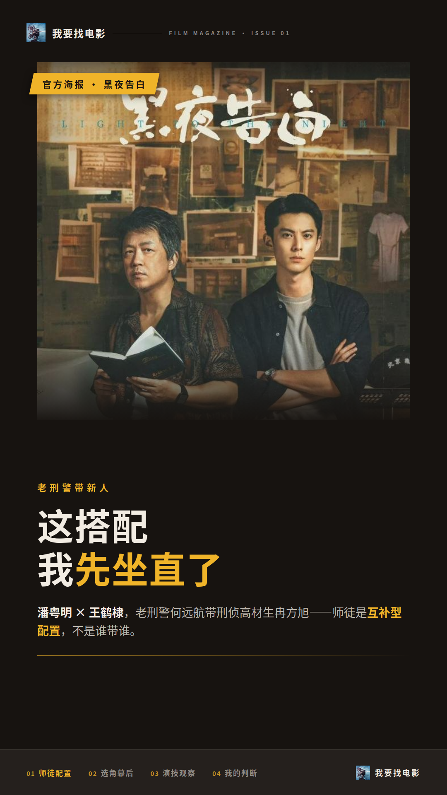
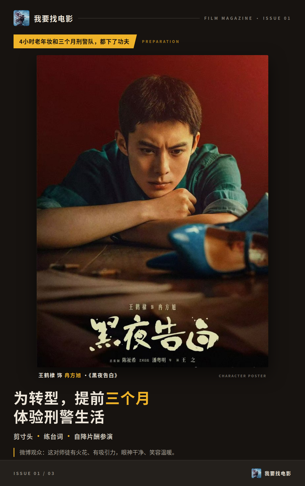
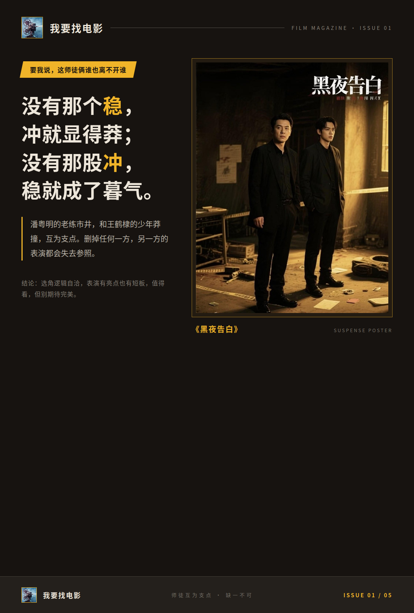

# 潘粤明王鹤棣这对师徒，到底行不行

看《黑夜告白》之前，我最担心的就是潘粤明和王鹤棣这对师徒搭不搭。结果追下来，这俩凑一块，反而是全剧最值得聊的选角。

## 老刑警带新人，这搭配我先坐直了

角色分工很清楚：潘粤明演老刑警何远航，王鹤棣演刑侦学高材生、新晋警员冉方旭。一个市井刺头，一个学院派新人，这配置本身就带着天然的张力。

更让我意外的是选角幕后。潘粤明在这部剧里还担任艺术总监，对选角有决定权，他看中的就是王鹤棣身上“少年气与韧劲的矛盾感”。这个眼光我觉得挺准，冉方旭要的就是又锐又生那股劲儿，太顺滑的演员反而给不出来。

所以我的判断先放这儿：这对师徒是互补型配置，不是谁带谁。

## 4小时老年妆和三个月刑警队，都下了功夫

先说潘粤明。他一改以往同类型剧的形象，这回演的是个带市井气的“刺头”警察。角色年龄跨度18年，他每天要花4个小时做老年妆造，这个投入度摆在那儿。

王鹤棣这边也没躺平。为转型他提前三个月体验刑警生活，剪寸头、练台词，还自降片酬参演。你说这是不是诚意，我觉得至少态度上挑不出毛病。

观众的反响也印证了这一点。微博上有观众说这对师徒有火花、有吸引力，还有人夸他演的幻觉里的冉方旭鲜活虐心，眼神干净、笑容温暖。

有条短评我印象很深：“但这部剧真的不一样，让我真切感受到用心打磨的好作品。”

**我看的时候也是这个感觉，两人的准备度肉眼可见。**

师徒对手戏，是这部剧最扎实的部分。

## 夸的和骂的，吵的其实是同一个人

争议也得照实说。有条豆瓣短评夸“02年的冉队超棒”，但同一条评论也觉得，表演和妆造撑不起18年的时间跨度。

网上对王鹤棣的面部表情控制也有讨论，有评论认为他部分情绪转换的戏处理得不够细腻，哭笑不分引争议。也有观众觉得他的表现低于预期，相比之下潘粤明完成度更高，但个别场次状态有起伏。

我的看法是：夸的和骂的，指向的都是王鹤棣的表演。他在幻觉戏这类特定场景里是成立的，但在需要细腻表情转换的戏里，确实有短板。这表演，真没法用一句好或差打发。

## 要我说，这师徒俩谁也离不开谁

回到演员和角色的关系上。潘粤明的老练市井，和王鹤棣的少年莽撞，是互为支点的。删掉任何一方，另一方的表演都会失去参照——没有那个稳，冲就显得莽；没有那股冲，稳就成了暮气。

而且王鹤棣的争议，反倒说明这个角色有难度。刑侦高材生的锐，和新警员的生，本来就不好拿捏。潘粤明的稳，给了他试错的空间，这大概也是当初选他进组的原因之一。

所以我的结论是：选角逻辑自洽，表演有亮点也有短板，值得看，但别期待完美。

看完这部剧，你更站老何远航的稳，还是小冉方旭的冲？评论区选一个。

## 本文信息来源
- [S9] 豆瓣网：《黑夜告白 的全部演职员》 https://movie.douban.com/subject/35922594/celebrities
- [S61] 百家号：《潘粤明王鹤棣《黑夜告白》搭档探案老戏骨带顶流是王炸还是翻车》 https://baijiahao.baidu.com/s?id=1863156982029408322&wfr=spider&for=pc
- [S46] 舜网：《《黑夜告白》高热开播 悬疑剧如何打破公式》 https://news.e23.cn/yule/2026-04-29/2026042900116.html
- [S55] 微博平台：《#黑夜告白# 我的评分:》 https://weibo.com/6918415999/QE4TcqptV
- [S57] 微博平台：《我的评分:》 https://weibo.com/7187057341/QENwe7DU7
- [S24] 豆瓣网：《黑夜告白 短评》 https://movie.douban.com/subject/35922594/comments?sort=new_score
- [S43] 百家号：《《黑夜告白》:选角失败!王鹤棣哭笑不分引争议,面部表情被诟病》 https://baijiahao.baidu.com/s?id=1842864788192026434&wfr=spider&for=pc
- [S58] 搜狐网：《《黑夜告白》遭观众差评,理由:演技油腻、故弄玄虚,真看不下去》 https://news.sohu.com/a/1016258914_122094386
