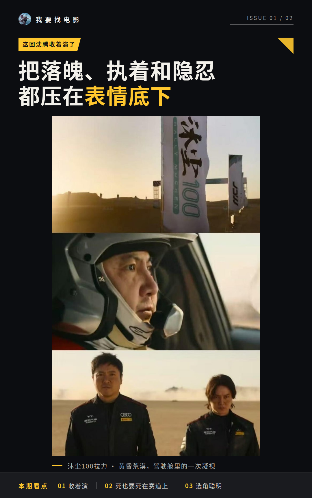

# 沈腾找帅哥演年轻自己，这步选得聪明

我看完《飞驰人生3》出来，第一反应是沈腾这回没把张驰当纯喜剧人物演。张驰这一部的任务变了，他要告别跑了半辈子的巴音布鲁克，转头去面对一个AI对手。人物处境一换，演法跟着就换，沈腾三度演同一个人，这次是收着来的。

## 这回沈腾收着演了

前两部的张驰，怎么落魄都带着喜剧底色。这一部不一样。中年车手要跟不是人的对手比，还得跟自己待了多年的赛道告别，这种处境里再挤眉弄眼就不对了。沈腾的处理是往回收，把中年人的落魄、执着和隐忍都压在表情底下，只在关键处放出来。

全片表演的高点，是那句“老子就算死也要死在赛道上”的怒吼。那一下不是搞笑，是憋了整场的情绪一次性炸开，我旁边的观众明显坐直了。

有观众的观感可以做个参照：“镖人低了，飞驰人生太高了”。这话带着比较的口气，不代表什么官方结论，但至少说明，冲着沈腾的表演走进影院的人，出来时是满意的。

**我自己的感受是，这是三部里他跟角色咬合最紧的一次。**

## 配角一个比一个能接戏

尹正这次让我差点没认出来。寸头造型直接把过往形象掀了，他把领航员孙宇强的忠诚和热血演得很扎实。这个人物有原型，就是韩寒的御用领航员孙强，所以那股子真实的江湖气不是凭空来的。他和沈腾的对手戏，默契是看得见的。

黄景瑜的林臻东是另一个惊喜。这个人设本身偏稳重，但“翻遍六个口袋找资料”那段诙谐反差成了笑点，冲线前祝张驰好运的台词又让不少观众直接泪目。有观众觉得他这次“又狠狠圈了一波”粉丝，我看完觉得这话不夸张。

段奕宏是特邀出演，戏份极少，但每个眼神都有东西，权威里透着温度。魏翔是全片的喜剧担当，市井幽默长在身上，从对手到队友的转变也顺，不生硬。张本煜那段维护张驰的戏我印象最深，发现涡轮数据异常，一字一顿地质问，肌肉紧绷，那是真急了。

实话也得说。配角戏份分布不均，段奕宏这种级别的演员只拿到极少发挥空间，有的角色留给演员的余地确实有限。这属于创作选择层面的事，不是演员能力问题，但看的时候会替他们有点可惜。

## 帅哥演年轻自己，沈腾怎么想的

全片最值得聊的一步选角，是王安宇演青年张驰。这事的源头挺随意，灵感来自综艺《现在就出发》里沈腾自己的调侃，结果真就这么选了。

官宣之后网友玩梗刷屏。有人调侃“南村群童欺腾老无力”，也有人力挺：“校草找校草演自己，合理”。沈腾的旧照还被翻出来全网鉴定颜值，热闹得很。

但我觉得这事不能只当梗看。网友普遍的说法是，敢找帅哥演年轻自己，这更像顶级自信而不是回避。从选角来看，青年张驰和中年张驰放在一起，形成的是一种对照，看起来是在服务人物弧光，让“他曾经是谁”和“他现在是谁”同框，而不是单纯图个话题。

所以我的最终判断是：这一部的表演和选角整体扎实，沈腾和张驰的绑定越演越深，三部下来已经不只是演，更像在陪这个角色变老。值不值得看，可以落到这个点上，你想不想看一个演员怎么跟角色一起往前走。

你觉得这是沈腾最好的一次张驰，还是前两部更对味？评论区聊聊。

## 本文信息来源
- [S1] 百度百科：《飞驰人生3》 https://baike.baidu.com/item/飞驰人生3/65573816
- [S40] 百家号：《《飞驰人生3》演员演技榜前十:尹正第2,黄景瑜第5,第一无悬念》 https://baijiahao.baidu.com/s?id=1857639272657425571&wfr=spider&for=pc
- [S60] 搜狐网：《《飞驰人生3》结局看哭了!张弛退役真相曝光,网友:比巴音布鲁克更扎心》 https://yule.sohu.com/a/989256625_121165755
- [S38] 百度百科：《电影《飞驰人生3》中的角色》 https://baike.baidu.com/starmap/view?nodeId=f1121e7fb5df38fa90961bfe
- [S41] 百家号：《给《飞驰人生3》演技最好7位演员排名,沙溢第3,第1无争议》 https://baijiahao.baidu.com/s?id=1858169201287315799&wfr=spider&for=pc
- [S42] 搜狐网：《沈腾挑了个顶级帅哥演自己!《飞驰人生3》春节档预售票房断层第一》 https://www.sohu.com/a/986408610_476413
- [S43] 百家号：《《飞驰人生3》预售破7600万,沈腾王安宇的选角逻辑,藏着流量密码》 https://baijiahao.baidu.com/s?id=1857011306123823702&wfr=spider&for=pc
- [S44] 搜狐网：《《飞驰人生3》选角背后:沈腾的反差操作与观众缘密码》 http://mt.sohu.com/a/987054475_122369736
- [S62] 搜狐网：《飞驰人生3放大招,沈腾最帅替身引爆预售票房?选王安宇选对了》 https://www.sohu.com/a/986647250_121627565
