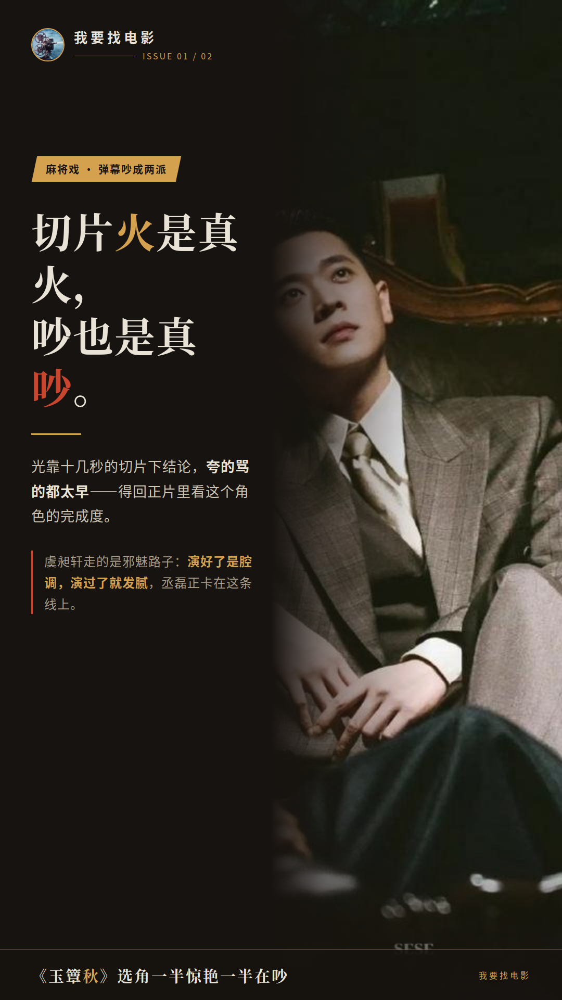
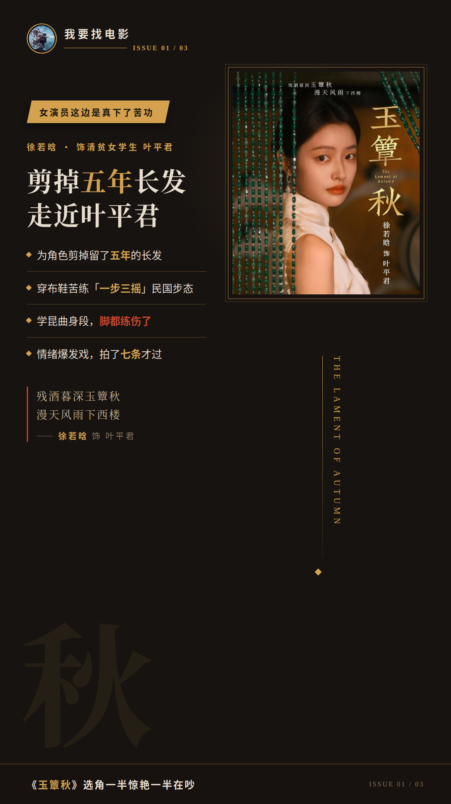
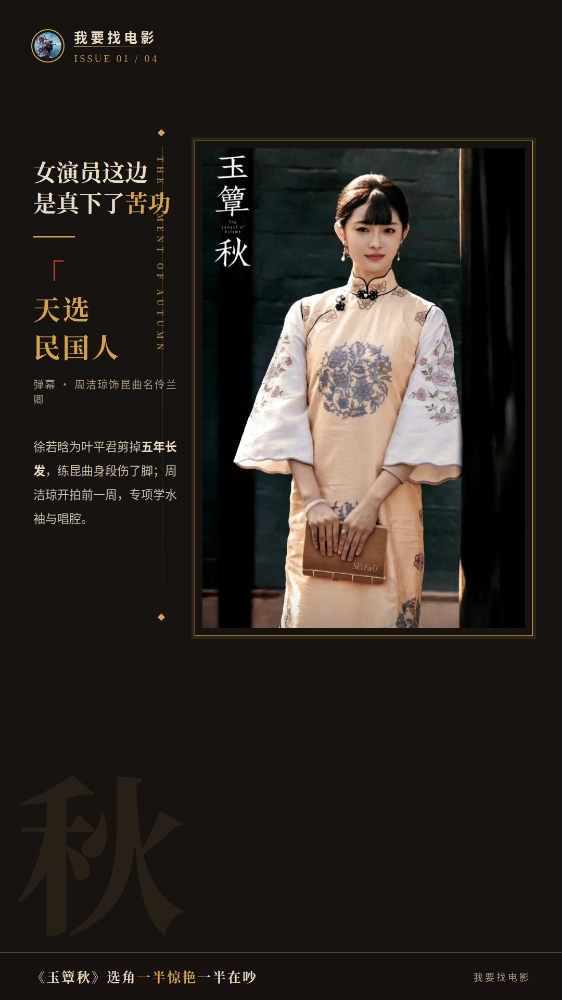
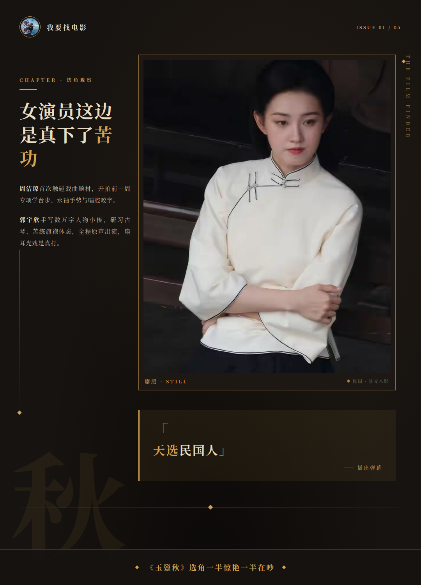
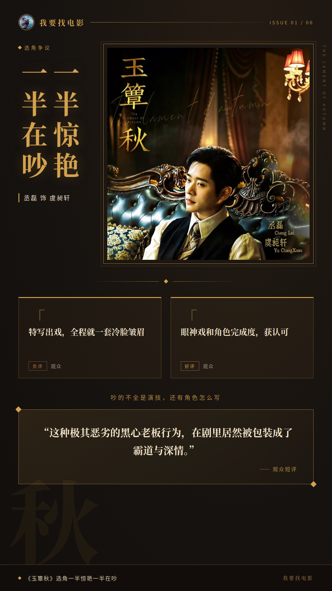

# 《玉簟秋》选角一半惊艳一半在吵

**我看完《玉簟秋》当晚，把丞磊那场麻将戏倒回去又看了三遍。**

这角色有记忆点，但围绕他的表演争议同样真实，不能只看切片就下结论。

他演的是军阀五少虞昶轩，这是他头一回扛长剧一番男主。斜倚在牌桌上，咬着烟搓牌，就这一个镜头，切片在抖音连着好几天霸榜，“不像演的”“民国最有腔调的男人”成了高频评价。

## 丞磊这场麻将戏，弹幕吵成两派

可我刷弹幕的时候发现，同一批弹幕里“歪嘴战神”的调侃也在刷屏。夸的和调侃的混在一起，谁也没说服谁。

**切片火是真火，吵也是真吵，这俩事不冲突。**

我的看法是：光靠十几秒的切片下结论，夸的骂的都太早，得回正片里看这个角色的完成度。虞昶轩这个人物本身走的是邪魅路子，演好了是腔调，演过了就发腻，丞磊卡在这条线上，弹幕吵成两派不奇怪。

## 女演员这边是真下了苦功

再说说让我意外的地方，这批年轻女演员的准备，肉眼可见。

徐若晗演清贫女学生叶平君，为角色剪掉留了五年的长发，穿着布鞋苦练“一步三摇”的民国步态，还学昆曲身段，脚都练伤了。有场情绪爆发戏，她拍了七条才过。

周洁琼演乱世昆曲名伶兰卿，这是她第一次碰戏曲题材的角色。开拍前一周，她专项学了戏曲台步、水袖手势和唱腔咬字。播出来弹幕满屏“天选民国人”，还有人喊她不演女主不服。

郭宇欣是第一次拍上星长剧，演明艳偏执的千金陶紫宜。她手写了数万字人物小传，专门研习古琴，苦练旗袍体态，全程原声出演。有场扇耳光戏，是真打。

这些准备能不能全部变成角色说服力，我说不准。但态度摆在这儿，没人是来混的。

## 张丰毅一抬眼，年轻人接不接得住

老戏骨这边是另一个画风。张丰毅演虞家老爷虞仲权，徐帆演大夫人赵宝茹。张丰毅一个抬眼，满屋噤声，弹幕齐刷刷夸“一张脸顶半部剧”。也有观众说，两位老演员发挥稳，跟年轻演员搭戏有层次感，这个我认同，老戏骨在场，年轻人的节奏都被带住了。

但争议也得摊开讲。丞磊这边，有人觉得特写出戏，邪魅狂狷的人设跟他不太搭，全程就一套冷脸皱眉的表情；也有人认可他的眼神戏和角色完成度。郭宇欣同样两极：有人赞她扛住了长剧镜头，把千金演得灵动鲜活；也有人觉得她台词一字一顿，跟周洁琼有差距。

还有一层分歧，其实大家吵的不是演技，是角色本身怎么写。虞昶轩的人设本身就在被讨论，有观众说得挺直接：“这种极其恶劣的黑心老板行为，在剧里居然被包装成了霸道与深情。”这句我印象很深，吵的不全是演技，角色怎么写也是分歧的一部分。

顺带一提，张云龙和周洁琼的副线CP对手戏，收获了大量求单独开一部的呼声，这条线的化学反应，观众是买账的。

我的整体判断：选角这事吵归吵，年轻演员的努力和老戏骨的托底都看得见，《玉簟秋》值得给一次机会再看。

虞昶轩这个角色，你觉得丞磊接住了还是没接住？追完还是弃了，评论区站个队。

## 本文信息来源
- [S43] 百家号：《玉簟秋收视3天翻倍,弹幕却喊歪嘴战神,丞磊是扛剧还是虚火》 https://baijiahao.baidu.com/s?id=1879065682747995838&wfr=spider&for=pc
- [S66] 百家号：《140天拍摄落幕!《玉簟秋》杀青定档暑期,丞磊首当一番男主》 https://baijiahao.baidu.com/s?id=1860463788668477769&wfr=spider&for=pc
- [S47] 新浪网：《丞磊谈《玉簟秋》后劲大,幕后有哪些不为人知的拍摄细节?》 https://k.sina.com.cn/article_7879848925_1d5acf3dd06801t70q.html
- [S44] 百家号：《《玉簟秋》今日开播,周洁琼破壁演绎乱世名伶兰卿》 https://baijiahao.baidu.com/s?id=1878818680004554495&wfr=spider&for=pc
- [S64] 搜狐网：《《玉簟秋》热度大爆!没想到躲过女主,却被27岁齐眉短刘海直接惊艳了》 https://yule.sohu.com/a/1089761892_122961169
- [S46] 百家号：《《玉簟秋》郭宇欣太惊艳!短剧女王昔日性感写真身材超赞》 https://baijiahao.baidu.com/s?id=1879224228691675457&wfr=spider&for=pc
- [S59] 搜狐网：《《玉簟秋》首播遇冷:观众吐槽太狠,演技拉胯剧情夸张还虐女主》 https://yule.sohu.com/a/1088556418_121975550
- [S67] 新浪网：《《玉簟秋》的网络口碑呈现两极分化的原因是什么?》 https://ent.sina.cn/2026-10-17/detail-inivpfyi7200486.d.html
- [S39] 新浪网：《郭宇欣在《玉簟秋》中演女二表现怎么样?》 https://ent.sina.cn/2026-10-21/detail-inivyhkp5492528.d.html
- [S55] 百家号：《都说《玉簟秋》三观不正,可它的问题根本不在三观,丞磊徐若晗背大锅》 https://baijiahao.baidu.com/s?id=1879005009073935074&wfr=spider&for=pc
