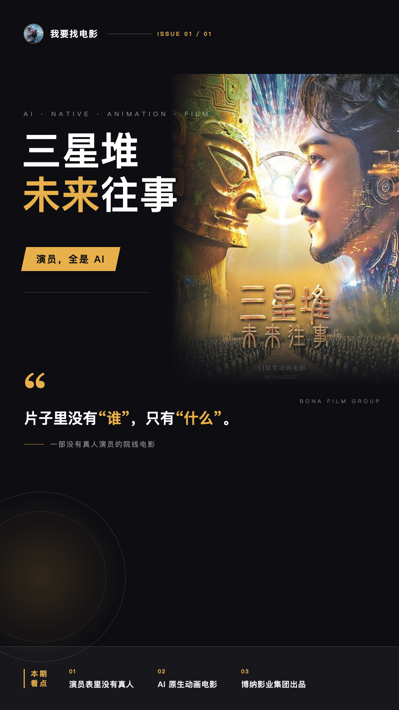
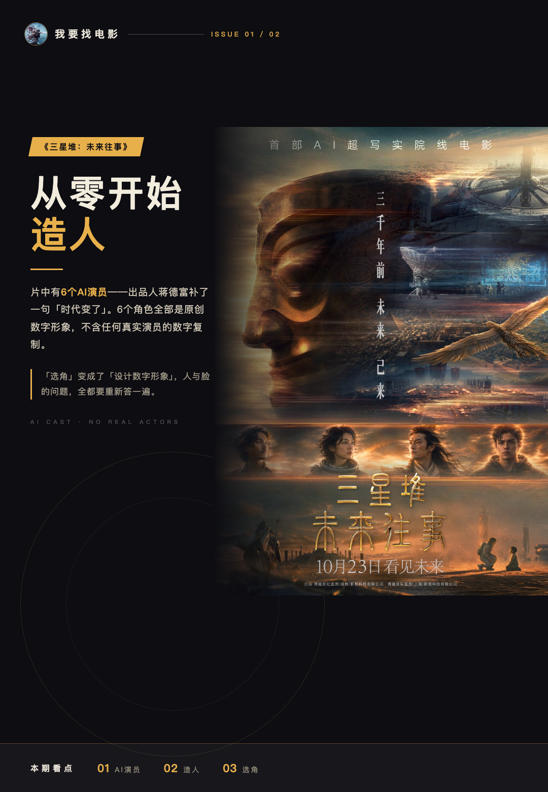
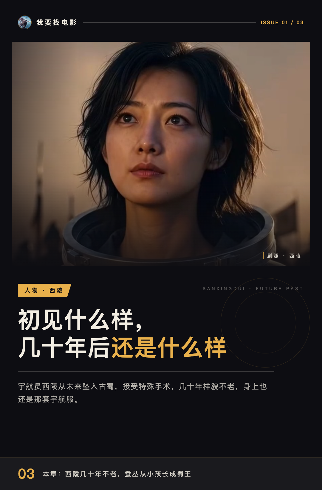
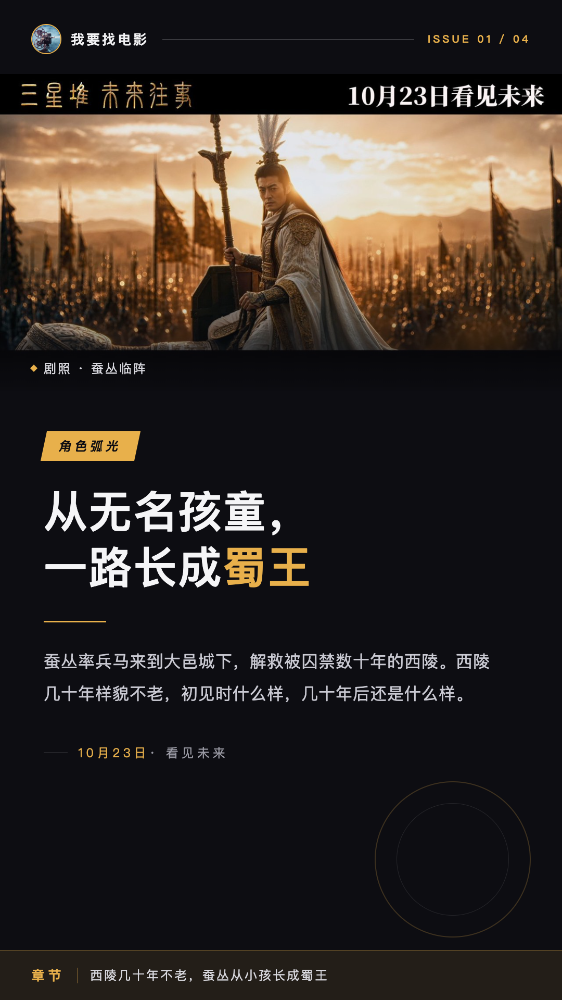
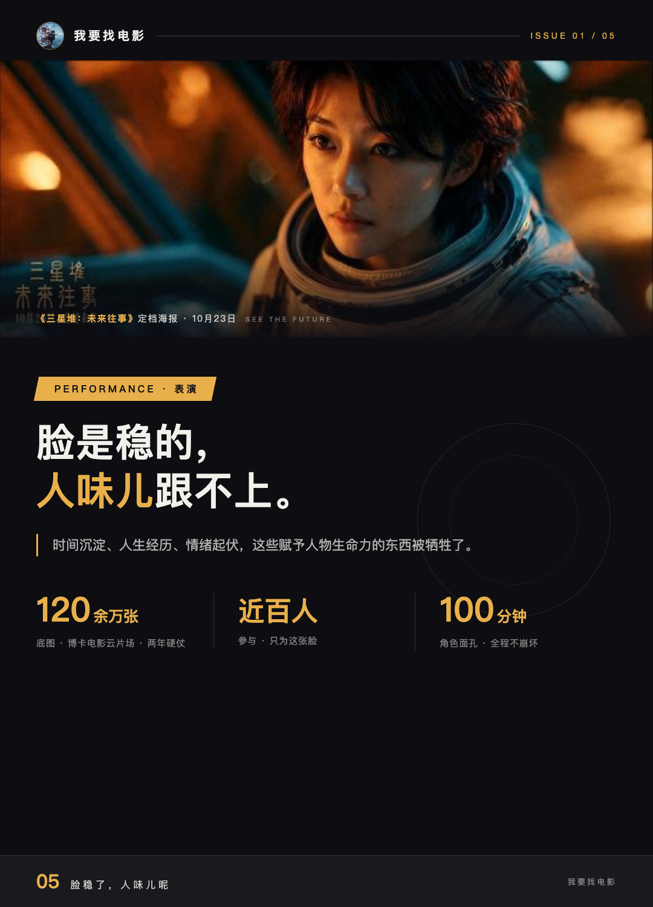

# 《三星堆：未来往事》的演员，全是AI

第一次聊一部没有真人演员的院线电影，我的第一反应是先确认一件事：演员表里到底写的是谁。翻完《三星堆：未来往事》的资料我可以确定，这片子里没有“谁”，只有“什么”。

## 《三星堆：未来往事》，一个真人演员都没有

出品人蒋德富说过，片中有6个AI演员，还补了一句“时代变了”。这6个角色全部是原创数字形象，不含任何真实演员的数字复制。

我认为这是它最值得聊的地方。这不是给哪个明星换脸，是从零开始造人。往一部片子里“选角”，在这变成了“设计数字形象”。没有真人，但演员与角色的问题一个不少，脸怎么立住、人怎么长出来，全都要重新答一遍。

## 西陵几十年不老，蚕丛从小孩长成蜀王

先看角色任务。西陵是宇航员，从未来穿越坠入古蜀。她接受过特殊手术，几十年样貌不老，初见时什么样，几十年后还是什么样，身上也还是那套宇航服。蚕丛则是从无名孩童一路长成蜀王，最后率兵马来到大邑城下，解救被囚禁数十年的西陵。考古学者江城肩上压着全片最重的活儿：解读三星堆铭文，他提出铭文是只有机器才能读懂的语言。

谁要干什么、谁在成长，这三条任务线是立得住的。一个宇航员的不老、一个孩子的称王、一个学者的破译，各有各的弧光，人物设计这一环没有偷懒。

## 脸稳了，人味儿呢

再看表演。片方为这张脸打了两年硬仗：团队在博卡电影云片场生成120余万张底图，近百人参与，就为了让角色面孔在100分钟内不崩坏。从结果看，这个目标达成了。

但代价也写在明面上。时间沉淀、人生经历、情绪起伏，这些赋予人物生命力的东西被牺牲了。

**脸是稳的，人味儿跟不上。**

观众观感也有出入：豆瓣用户水青就说角色脸不稳定，一会儿老一会儿嫩，说话口型对不上，这和片方“面孔不崩坏”的说法对不拢。两种口径我都照实摆在这，你信哪个自己判断。

短评里也能听到夸的声音，有人写“这部片子，AI反而是唯一的加分项”。批评的夸的都落在AI和角色身上，这本身就说明选角实验被认真讨论了。

我的判断是：AI演员赢在稳定，输在人味儿。情绪的颗粒度，眼角那点说不清的东西，眼下还补不上。但作为一次选角实验，它把“演员与角色”这道题翻开了新的一页，这页值得正视。

全AI的数字演员，算不算演员？你会为一部“没有一个真人”的电影买票吗？
