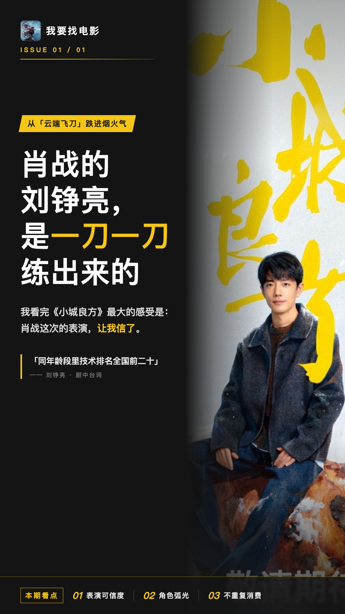
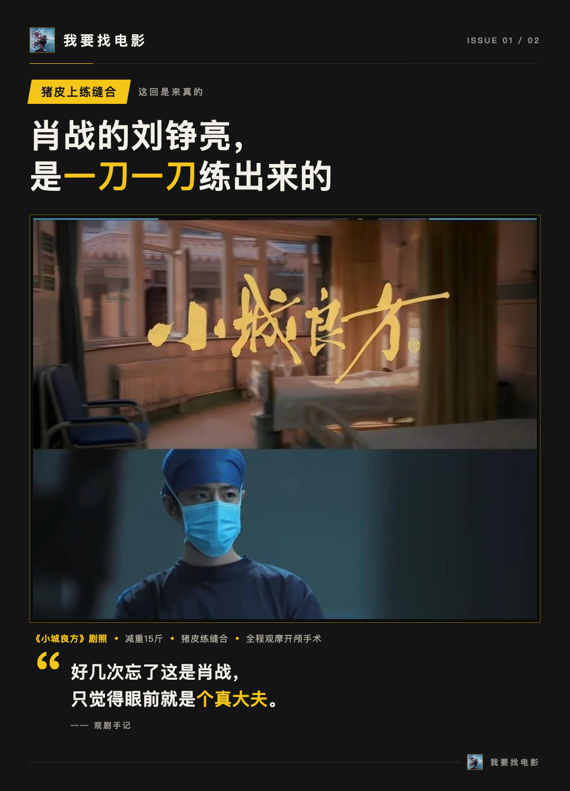
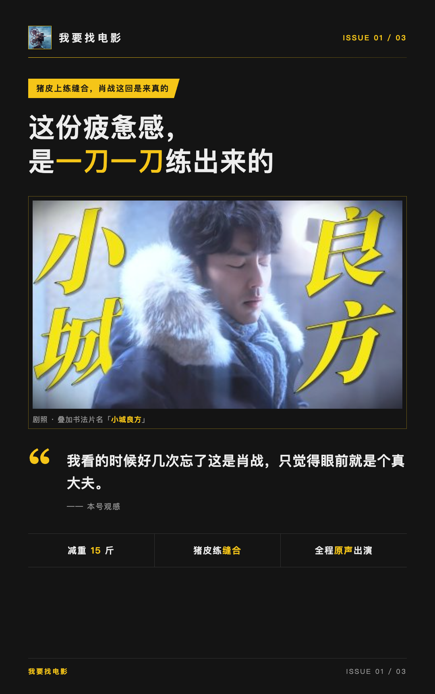
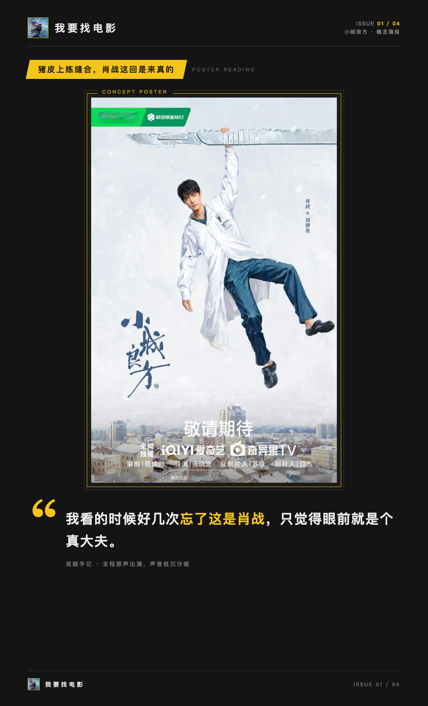
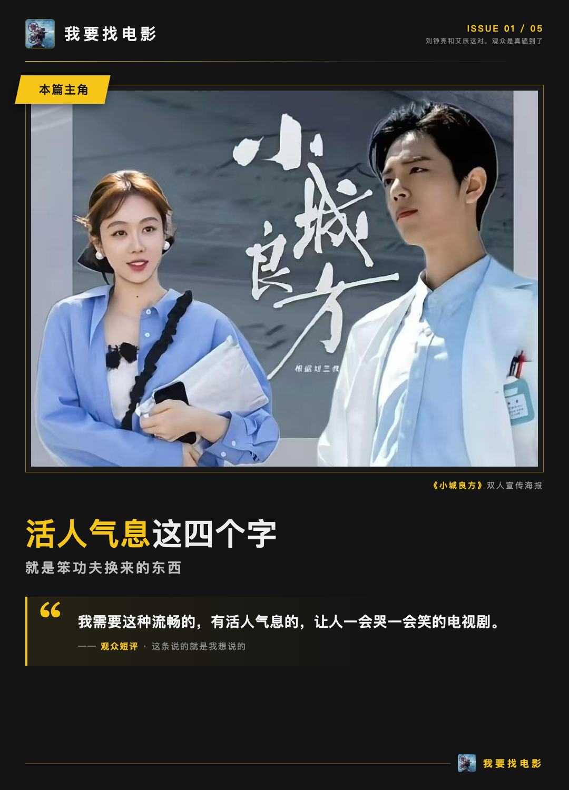
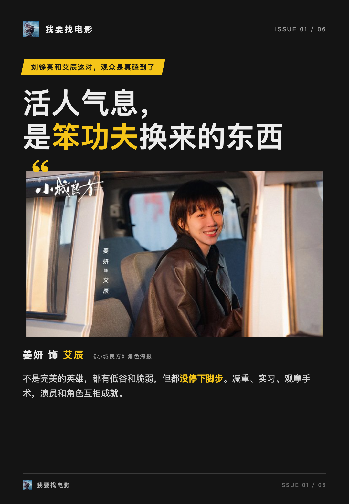

# 肖战的刘铮亮，是一刀一刀练出来的

**我看完《小城良方》最大的感受是，肖战这次的表演让我信了。**

刘铮亮这个人物，原先是北京三甲医院的神经外科医生，外号“云端飞刀”，台词里自己说“同年龄段里技术排名全国前二十”。一个站在云端的人落到东北小城，这个角色任务本身就带弧光。这是肖战第二次在电视剧里演医生，但我觉得刘铮亮不是重复消费，是从云端跌进烟火气的完整一个人。这篇只聊演员和角色，不铺剧情。

## 猪皮上练缝合，肖战这回是来真的

先说几个我印象最深的准备动作。肖战为这个角色减重15斤，开机前提前进医院实习，跟着急诊科主任学门诊流程，苦练东北方言，还拿猪皮练缝合。更狠的是，2025年10月下旬，他在锦州医科大学附属第一医院全程观摩了一场开颅手术，跟医疗团队深入交流。

这些细节为什么重要？因为它们真的能在表演里被看见。缝合的手不是摆样子的手，问诊的节奏也不像背台词的节奏。再加上全程原声出演，声音低沉沙哑，那种常年泡在手术台边的疲惫感和这股执拗劲儿，就都对了。我看的时候好几次忘了这是肖战，只觉得眼前就是个真大夫。

选角这边也有说法。总制片人苏晓的选角逻辑是看演员与角色的匹配性，肖战此前的角色自带孤独感、破碎感，跟刘铮亮那种“各色”的性格是契合的，导演跟他互动之后一拍即合。我自己看完的感受是，这个匹配度确实是这部剧成立的关键一步棋。

## 刘铮亮和艾辰这对，观众是真磕到了

角色关系上，观众的反馈很有代表性。微博网友感叹：“刘铮亮主动亲回那一下谁懂啊，人家刚凑上来他就张嘴，早就看上了还嘴硬。”另一条则点出，艾辰“永远第一时间能读懂刘铮亮藏起来的情绪，关键时刻永远第一个伸手”，这份读懂拧巴人的默契，放在刘铮亮身上堪称绝配。而要让“拧巴人被读懂”这层关系真正立得住，两位演员的表演都得足够细腻。

还有一条短评我想单独拎出来，因为它说的就是我想说的：“我需要这种流畅的，有活人气息的，让人一会哭一会笑的电视剧。”

**活人气息这四个字，就是笨功夫换来的东西。**

主创直播里还有个新说法。肖战坦言，菅纫姿的车明明和自己的刘铮亮内核相通，都不是完美的英雄，都有低谷和脆弱，但都没停下脚步。菅纫姿自己也说车明明没有悬浮的大女主逆袭光环。一个演员能这样理解对手的角色，说明他对自己的人物是真吃透了。

所以我的整体判断是：肖战的刘铮亮是靠减重、实习、观摩手术这些笨功夫，加上对人物的理解一点点立起来的，演员和角色互相成就，这是《小城良方》值得看的核心理由。

你觉得肖战的刘铮亮是被低估了，还是刚好够好？你站哪边。
