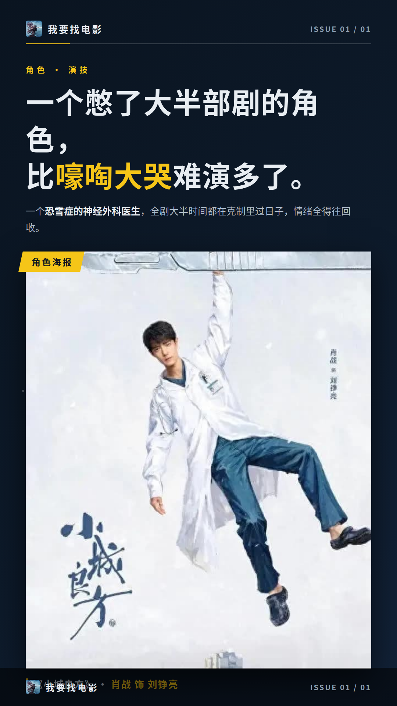
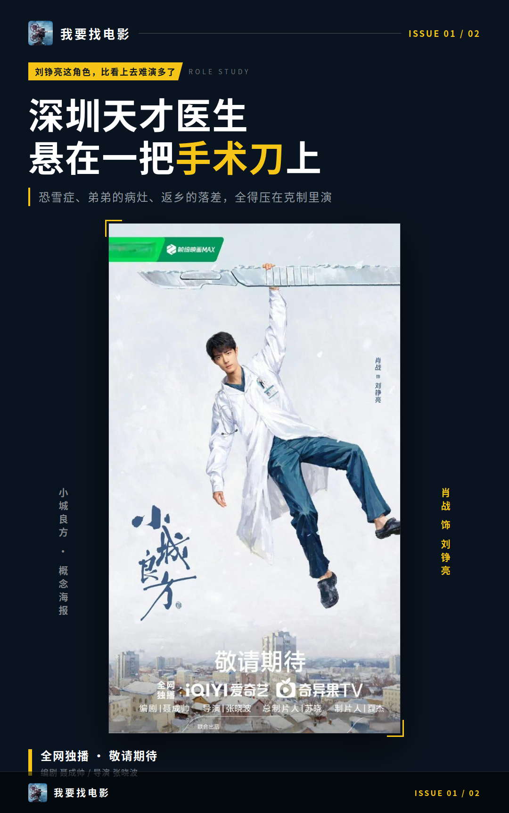
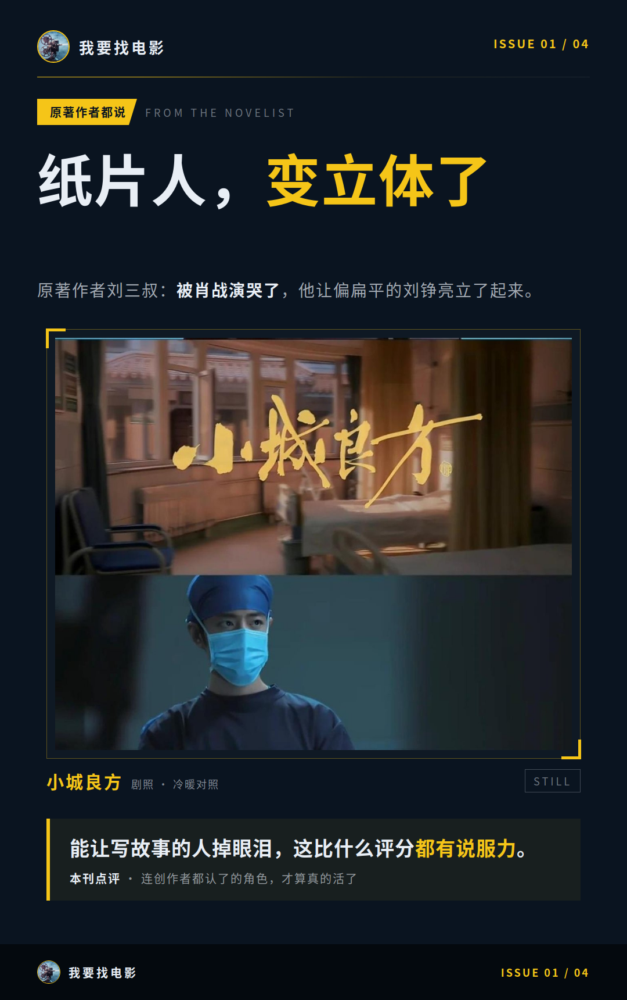
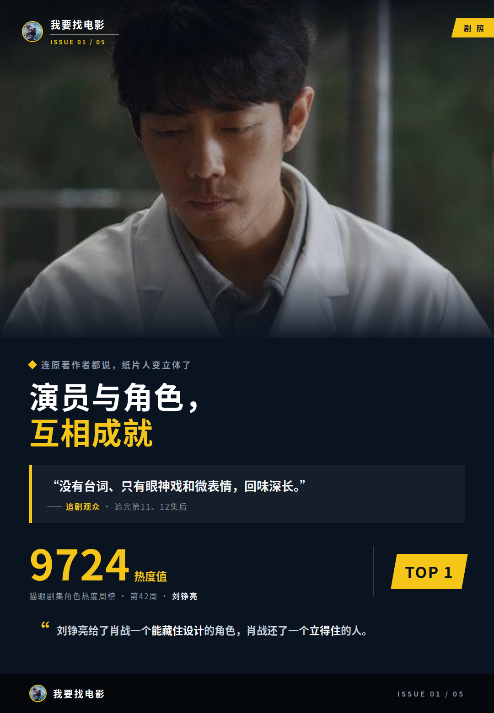

# 肖战把刘铮亮演活了，原著作者都看哭了

看完《小城良方》，我第一个念头是：肖战这次不是在演刘铮亮，是把自己往角色里摁。

**一个憋了大半部剧的角色，比嚎啕大哭难演多了。**

一个恐雪症的神经外科医生，全剧大半时间都在克制里过日子，情绪全得往回收。

## 刘铮亮这角色，比看上去难演多了

先把角色任务摆出来。刘铮亮原是深圳三甲医院的神经外科天才，童年亲眼看着父亲冬泳坠入冰窟，从此落下严重恐雪症。多年后，母亲也走向了冰窟，身边只剩弟弟刘铮光（史彭元 饰）一个亲人。

更狠的是，弟弟查出脑血管畸形，颅内病灶风险极高，能主刀的只有刘铮亮自己。这台手术，就是他从深圳回到抚城小西门医院、当个万金油医生的核心动因。事业家庭双双变故，被迫返乡，跟一群各有短板的同事搭伙过日子。

我认为这个角色最难演的就是“憋着”，哭戏反而好办。创伤、责任，再加上返乡的落差，全得压在克制里演，一旦演松了，人物就散了。

## 抠了十七次的虎口

再看他做了什么。为这个角色减重15到18斤，白大褂旧得发灰，零下二十九度蒙着眼在雪地里拍恐雪症的戏。蒙眼实拍，等于把角色的恐惧先在自己身上过了一遍，“敬业”两个字根本兜不住。

声线也分了两段：前期低沉沙哑、带着疲惫感，后期转温柔治愈。他提前到县医院实习，苦练手术技能，还为演手抖设计了一个小动作——拿杯子时扣住虎口。

最值得说的是雪夜那场零台词的戏。梦见母亲，他远远站着，嘴角先扬，笑意慢慢僵住，左手拇指一下一下抠虎口。有观众数过，第四集抠了十七次。

## 连原著作者都说，纸片人变立体了

光我一个人说不算数。原著作者刘三叔说被肖战演哭了，认为他让小说里偏扁平的刘铮亮变立体。

**能让写故事的人掉眼泪，这比什么评分都有说服力。**

同剧组的人也看在眼里。张国强在片场评价肖战开机便沉入人物、用心打磨细节。姜妍在见面会上只用一个“帅”字概括，这位白玉兰最佳女配得主，被评稳得住接得住，给男主角的表演当了坚实后盾。

观众这边，有人追完第11、12集后说：“没有台词、只有眼神戏和微表情，回味深长。”也有人评：“从主角到配角，一众演技派把小城里的市井烟火气全都演活了。”数据上，猫眼剧集角色热度周榜第42周，刘铮亮以9724热度值拿下TOP1。

所以我的判断是：演员与角色在这部剧里是互相成就的。刘铮亮给了肖战一个能藏住设计的角色，肖战还了一个立得住的人。

你看的时候是被哪场戏说服的——雪夜那场，还是手术室那场？
