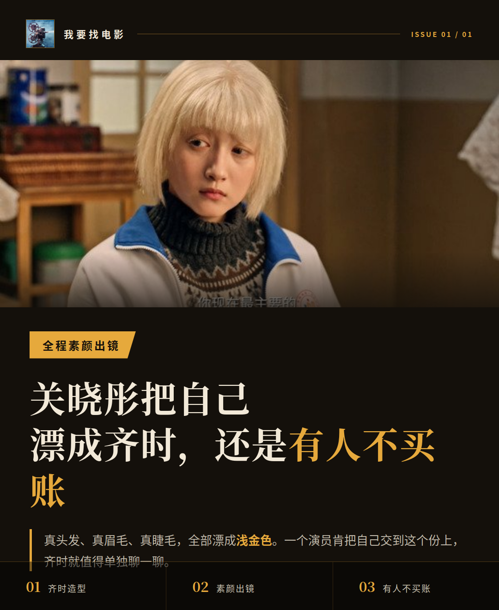
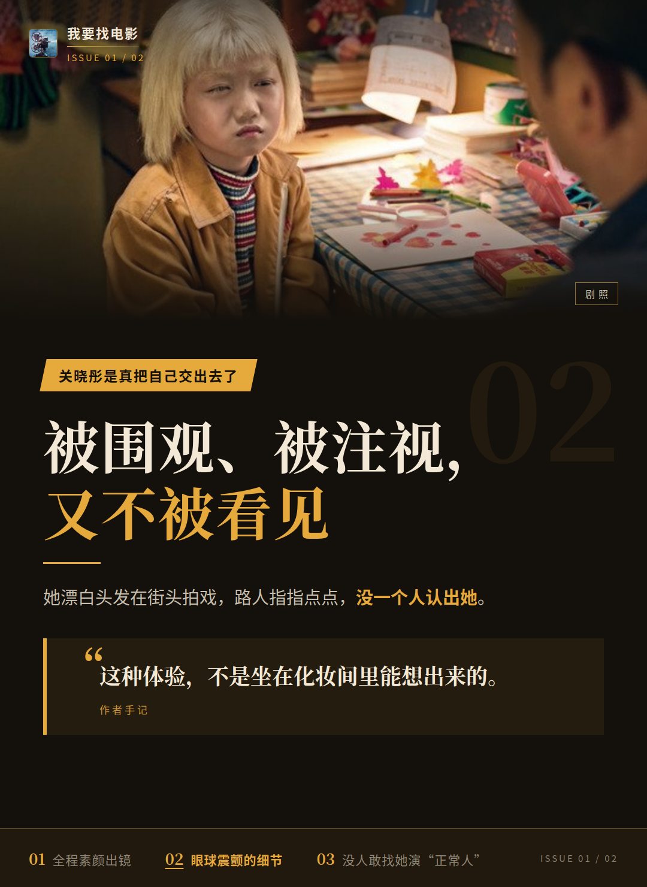
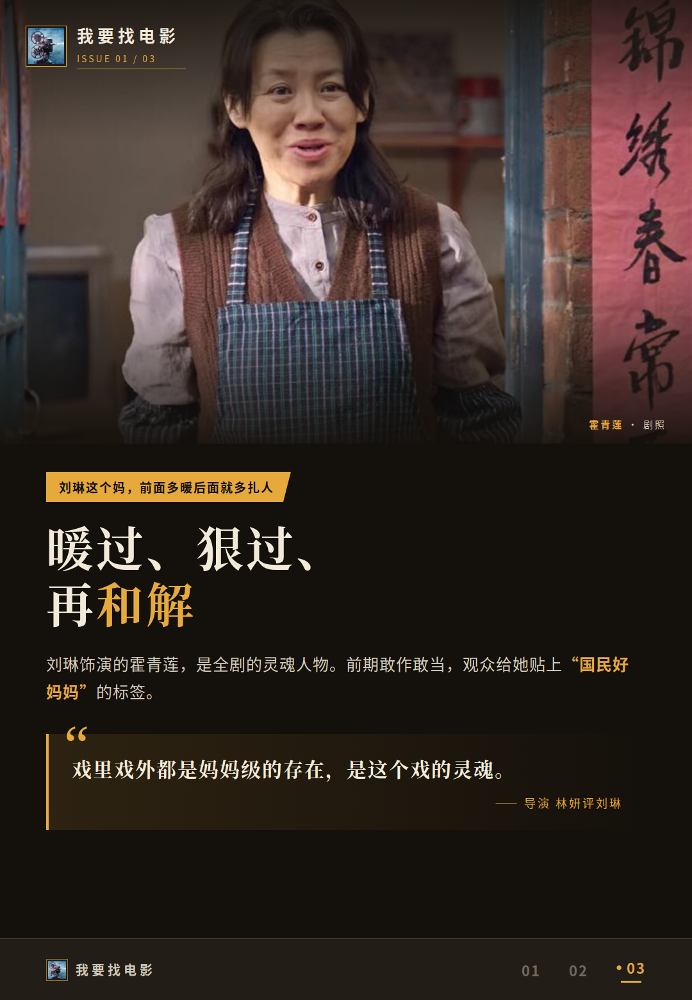
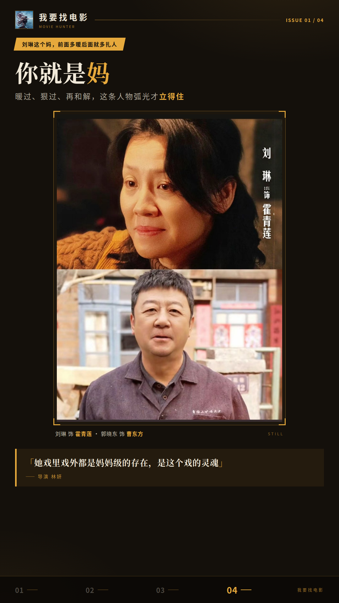
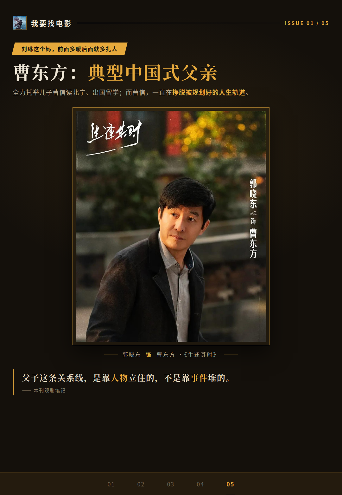
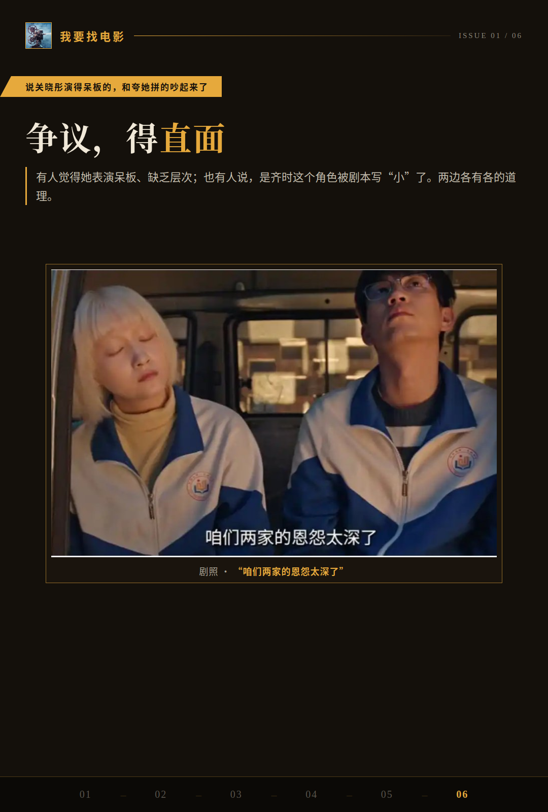

# 关晓彤把自己漂成齐时，还是有人不买账

关晓彤这回为齐时下的功夫，我是真服气。先说真心话：**这不是营销稿能编出来的东西。**真头发、真眉毛、真睫毛，全部漂成浅金色，全程素颜出镜，连眼下的乌青和雀斑都留着。一个演员肯把自己交到这个份上，齐时就值得单独聊一聊。

## 关晓彤是真把自己交出去了

造型只是最表层的一层。为了贴近角色，她花了几个月去了解白化病“月亮的孩子”这个群体，发现患者会下意识眯眼。于是剧里你能看到她演出了眼球震颤的细节，连齐时写作业时身体不自觉贴近桌面的习惯动作，都做了出来。

还有个挺触动我的细节。她漂白头发在街头拍戏，路人指指点点，没一个人认出她。她由此体会到齐时小时候的感受——被围观、被注视、又不被看见。**这种体验，不是坐在化妆间里能想出来的。**

导演滕华涛开玩笑说，担心她演完这部戏后没人敢找她演“正常人”。玩笑归玩笑，这句话本身说明她贴角色贴得有多狠。我认为这份投入有据可查，不是吹出来的。

## 刘琳这个妈，前面多暖后面就多扎人

换个人物讲。刘琳饰演的霍青莲，是全剧的灵魂人物。前期敢作敢当，接受了患白化病的养女，观众给她贴上“国民好妈妈”的标签。

可到了后期，因为儿子入狱，她拦着齐时复读，骂她扫把星。人设前后反差极大，这是演员要接的高难度任务。观众会拿前期的暖，去审判后期的狠——这种翻转的角色最难演，一旦接不住，人物就塌了。

导演林妍评价她戏里戏外都是妈妈级的存在，是这个戏的灵魂。刘琳接住了这个反差，大结局那句“你就是妈”的和解才有分量。暖过、狠过、再和解，这条人物弧光是立住的。

顺带一句郭晓东的曹东方：典型中国式父亲，全力托举儿子曹信读北宁、出国留学；而曹信则一直在挣脱被规划好的人生轨道。父子这条关系线，也是靠人物立住的，不是靠事件堆的。

## 说关晓彤演得呆板的，和夸她拼的吵起来了

争议得直面。有观众觉得她表演呆板、缺乏基本层次，这条差评被媒体文章引用讨论过，真实存在，我不回避。

但另一种观点认为，问题不在演员，在于齐时这个角色被剧本写“小”了，演员没空间发挥层次。两边各有各的道理。

用户短评也是两极。有人叹“可恨的是，演员真的太好了”，也有人直接说“选角不贴脸，滤镜真尴尬”。两种声音都摆出来，你自己判断。

我的边界判断是这样：造型和细节层面的功夫，看得见，也做得很实。至于层次感的欠缺，到底该算演员还是算剧本，目前两边都只是观点。我倾向角色空间确实有限，但这不构成对演员的全盘否定。

齐时的表演，你站哪边——A：演员尽力了，是角色被写小；B：细节再拼，层次感确实没出来？评论区聊聊。
