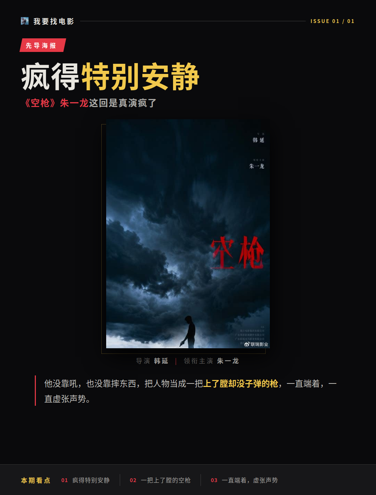
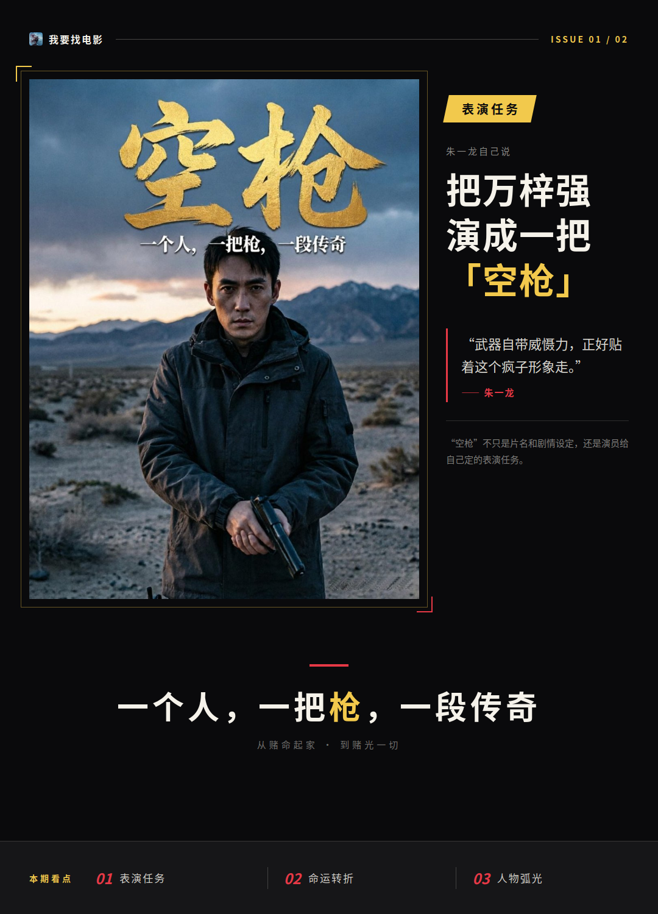
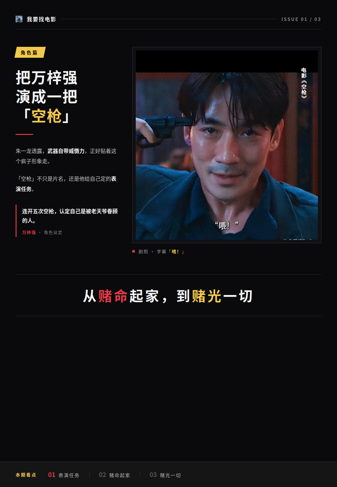
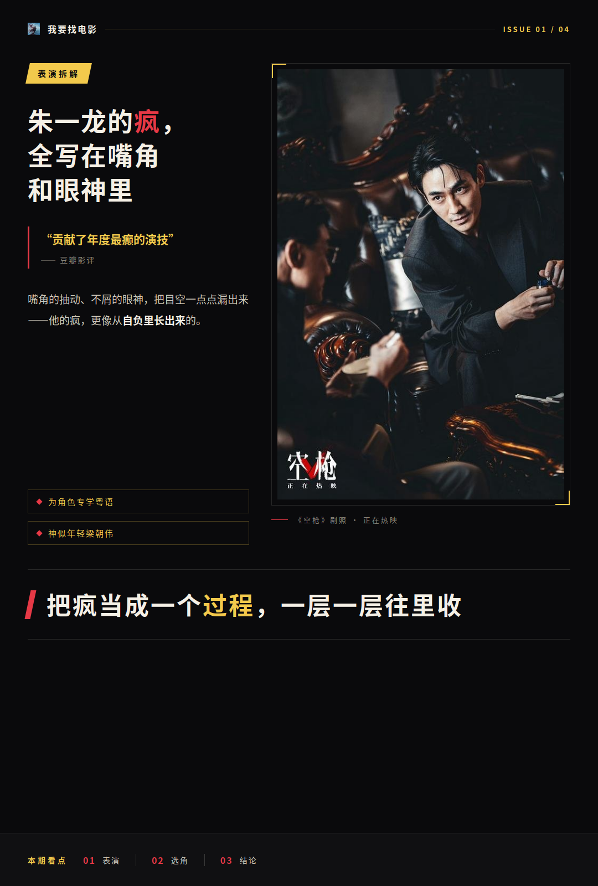
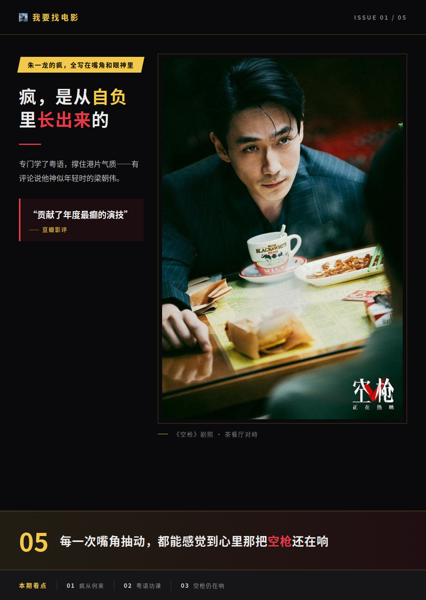
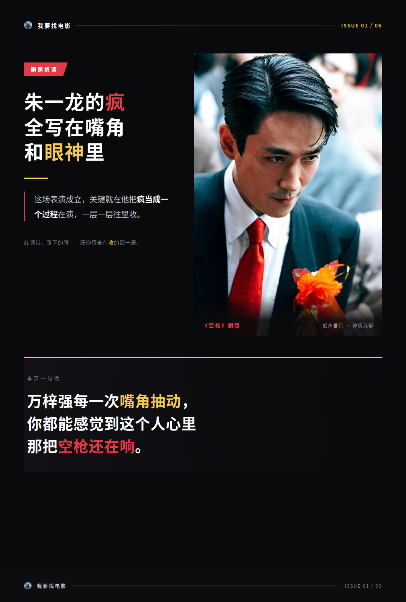
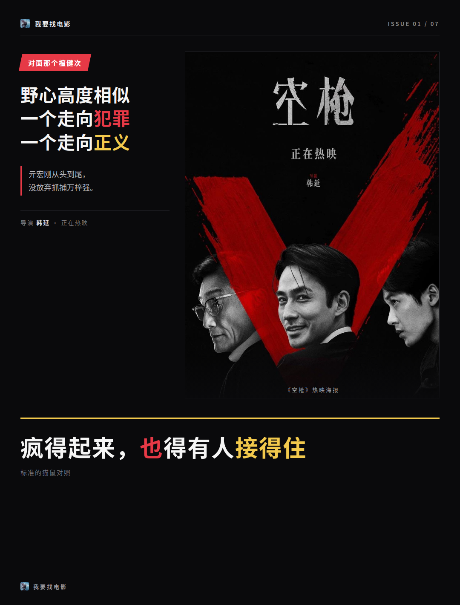

# 《空枪》朱一龙这回是真演疯了

我的第一反应是：《空枪》里朱一龙这个万梓强，疯得特别安静。他没靠吼，也没靠摔东西，就是把人物当成一把上了膛却没子弹的枪，一直端着，一直虚张声势。

**看完我一直在想，这个处理到底是谁的主意。**

## 朱一龙自己说，要把万梓强演成一把空枪

答案是演员自己。朱一龙透露过，他是有意把万梓强演成一把“空枪”的，因为武器自带威慑力，正好贴着这个疯子形象走。“空枪”不只是片名和剧情设定，还是演员给自己定的表演任务。

角色这边的底子也够硬。万梓强因为连开了五次空枪，认定自己是被老天爷眷顾的人，“空枪”成了他命运的转折点，也是他野心的起点。他后来用荣哥的手枪对着自己脑袋连开五枪，靠这份胆识拿下了如姐、荣哥的赏识。

再往后，兄弟阿书、花桥、哑狗一个个没了，一见钟情的妻子也没了。孤家寡人之后，这个人才彻底癫狂。这条人物弧光很清楚：从赌命起家，到赌光一切。

## 朱一龙的疯，全写在嘴角和眼神里

具体到表演，朱一龙用的都是小动作。嘴角的抽动，还有那种不屑的眼神，把万梓强的目空一切一点点漏出来。有豆瓣影评说他“贡献了年度最癫的演技”，我不打算照搬这种捧法，但“癫”这个落点是真准——他的疯更像从自负里长出来的，不是硬摆在脸上的一个状态。

选角和准备这块也有东西可说。朱一龙为这个角色专门学了粤语，有评论觉得他神似年轻时的梁朝伟，放在香港背景下演这个人物，说服力更足。学方言这事看着不起眼，但对一个内地演员去撑住港片气质的角色，是实打实的功课。

我认为这场表演成立，关键就在他把疯当成一个过程在演，一层一层往里收。

**万梓强每一次嘴角抽动，你都能感觉到这个人心里那把空枪还在响。**

## 对面那个檀健次，接得住

一个演员疯得起来，也得有人接得住。檀健次演的亓宏刚，从头到尾没放弃抓捕万梓强。这两个人的设定挺妙：野心高度相似，却一个走向犯罪、一个走向正义，标准的猫鼠对照。

檀健次这边也没偷懒。他有一段伪装成司机、跟万梓强通电话的广西口音戏，口音是实打实磨过的。亓宏刚当侦查兵时放走过敌人，那是他心底的“空枪时刻”，也是他对抓罪犯有极强执念的来处。

观众层面的反馈也印证了表演这块的成色。有短评说“朱一龙演的强哥真的太疯了，表演太牛了”，还有人说“我对这部片里的各个演员的表现比较满意”。普通观众和专业观众都认这个表演，这在现在的片子里不算常见。

所以万梓强这个角色立得住，我倾向于认为是两头一起使劲的结果：一头是演员想清楚了“空枪”这个核心，另一头是每个细节都往这个核心上靠。角色给了演员发挥的空间，演员也没浪费这个空间。

最后抛个站队题：万梓强这个人物，你觉得是朱一龙演出来的，还是剧本本身就写得好？评论区聊聊。
