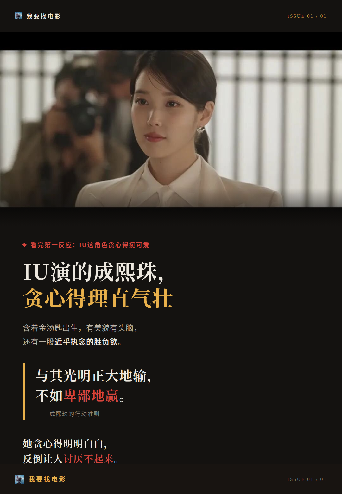
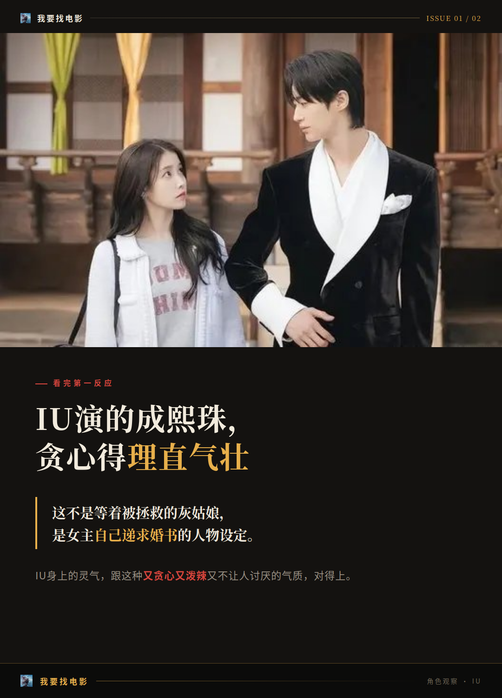
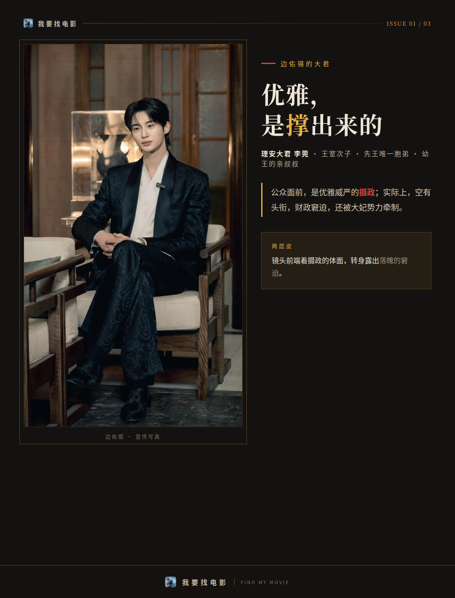
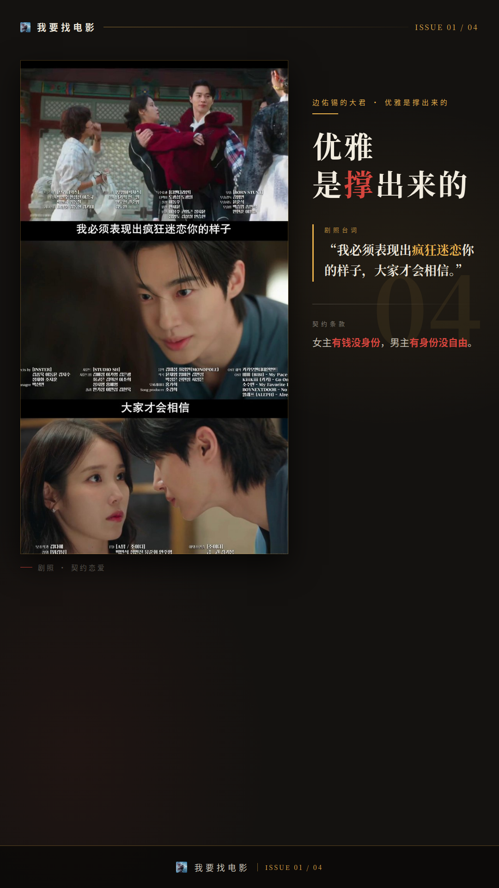
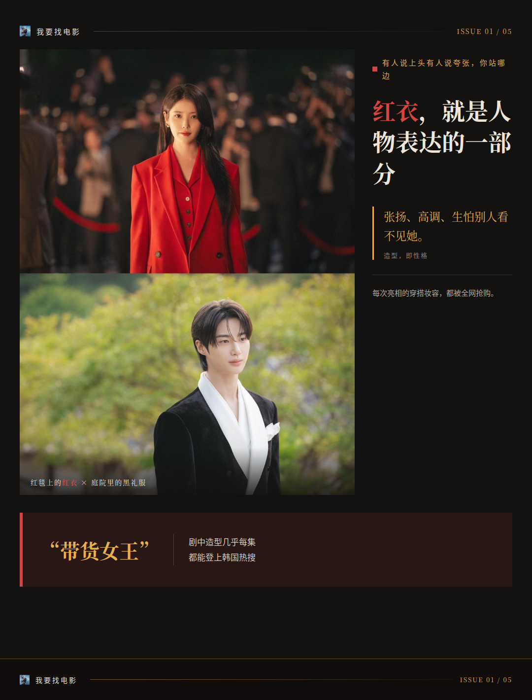
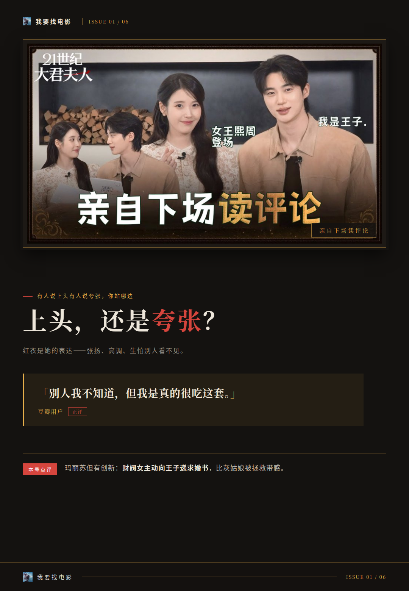

# IU演的成熙珠，贪心得理直气壮

## 看完第一反应：IU这角色贪心得挺可爱

IU继《苦尽柑来遇见你》之后的回归作，选了个挺妙的角色。她在《21世纪大君夫人》里演凯瑟集团二小姐成熙珠：含着金汤匙出生，有美貌有头脑，还有一股近乎执念的胜负欲。

这个角色的底色其实挺苦的。她因为“平民”“私生”的身份被贵族圈排挤，在父亲眼里是没法继承集团的“外人”。所以她的选择很直接——主动申请入宫面见理安大君，提出联姻，用契约婚姻换身份跃升。行动准则就一句：与其光明正大地输，不如卑鄙地赢。

**她贪心得明明白白，反倒让人讨厌不起来。**

我认为这个选角是贴合的：IU身上的灵气，跟这种又贪心又泼辣又不让人讨厌的气质，对得上。这不是等着被拯救的灰姑娘，是女主自己递求婚书的人物设定。

IU自己用“贪心、泼辣、可爱”三个词概括成熙珠，把角色跨越局限的特质归结为“积极性”。她还预告了人物反转：前期是压不住的欲望和古怪脾气，等内心的匮乏被填满，会展现可爱且帅气的面貌。也就是说，这个角色有弧光可挖，不是一路爽到底的平面人物。

## 边佑锡的大君，优雅是撑出来的

再看男主这边。边佑锡演理安大君李莞：王室次子、先王唯一胞弟、幼王的亲叔叔。公众面前是优雅威严的摄政，实际上空有头衔，财政窘迫，还被大妃势力牵制。

两个人的契约条款也很清楚：成熙珠注资王室稳固理安的地位，理安授予她大君夫人的身份，约定三年到期和平离婚。女主有钱没身份，男主有身份没自由，这组“身份悖论”就是两人关系的底色。

从表演难度看，边佑锡这个角色考验人的地方在于“两层皮”：镜头前要端着摄政的体面，转身又要露出落魄的窘迫。有意思的是，IU演的也是“表面与内里不一致”的人物——一个用张扬遮住出身伤口的财阀女。两个人演的是同一种人，方向相反。这也是我认为这对选角值得聊的地方。

## 有人说上头有人说夸张，你站哪边

造型这块是真下了功夫。一袭红衣成了成熙珠的代表色，每次亮相的穿搭妆容都被全网抢购，IU在剧中的造型几乎每集都能登上韩国热搜，被称“带货女王”。红衣不只是好看，它就是人物表达的一部分——张扬、高调、生怕别人看不见她。

观众反馈这边，豆瓣有用户短评说：“别人我不知道，但我是真的很吃这套”，觉得剧情虽玛丽苏，但人物设定有创新，财阀女主动向王子递求婚书，比灰姑娘被拯救带感。

照实说，也有部分观众觉得两人的表演风格偏夸张。这类观感目前只是部分反馈，没形成定论。我的判断是：这种风格化演法跟剧集“又爽又闹”的调性是匹配的，接受度因人而异，你吃这套就会觉得很对味。

还有个影评观察挺有意思：IU每次演完苦情角色，就会“奖励自己”一个富婆角色，这次被称“本色出演”。真假不论，但演员与角色这份适配度，确实是这部剧最值得聊的部分。

成熙珠这个角色，你觉得是IU的舒适区突破，还是她本来就适合富婆角色？评论区聊聊你站哪边。
